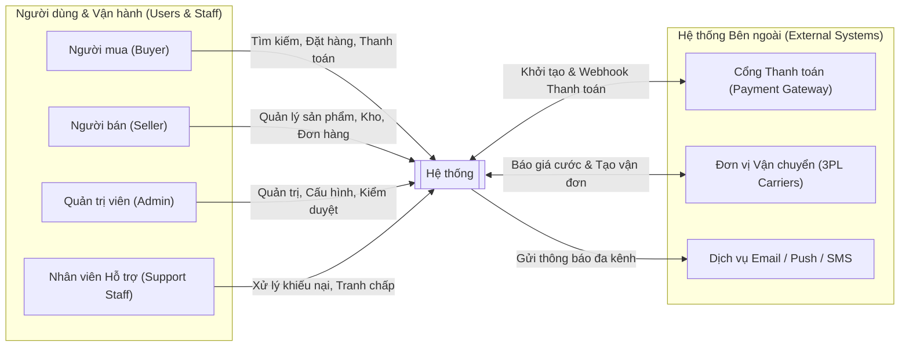
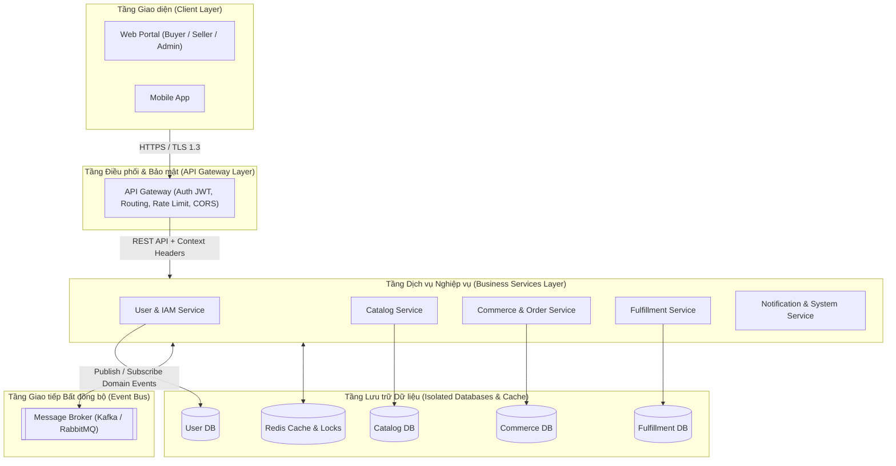
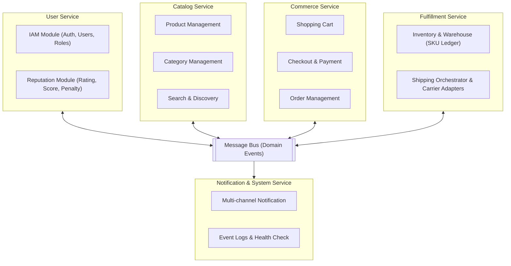

# DỰ ÁN <TÊN DỰ ÁN IN HOA> - TÀI LIỆU ĐẶC TẢ YÊU CẦU PHẦN MỀM (SRS)
## <Mô tả loại hình nền tảng Tiếng Việt> (<English Platform Subtitle>)

---

- **Tên dự án:** <Project Name>
- **Tài liệu:** Software Requirement Specification (SRS) - Đặc tả Yêu cầu Phần mềm
- **Phiên bản:** <1.0>
- **Người lập tài liệu:** <Tên tác giả> (Business Analyst)
- **Địa điểm & Thời gian:** <Thành phố>, Tháng <MM/YYYY>
- **Lần sửa đổi gần nhất:** <DD/MM/YYYY HH:mm:ss>

---

## Trang Phê Duyệt (Approval Page)

| Vai trò | Chức danh | Chữ ký | Ngày |
| :--- | :--- | :--- | :--- |
| **Người lập (Prepared by):** | Business Analyst | *(Đã ký)* | `____ / ____ / ______` |
| **Người kiểm tra (Reviewed by):** | Business Analyst | *(Đã ký)* | `____ / ____ / ______` |
| **Người hỗ trợ (Supported by):** | Technical Lead / Solution Architect | *(Đã ký)* | `____ / ____ / ______` |
| **Người phê duyệt (Approved by):** | Project Manager / Product Owner | *(Đã ký)* | `____ / ____ / ______` |

---

## Lịch Sử Thay Đổi (Revision History)

| Ngày | Phiên bản | Tác giả | Mô tả thay đổi |
| :--- | :--- | :--- | :--- |
| <DD/MM/YYYY> | 1.0 | <Tác giả> | Khởi tạo tài liệu đặc tả mới (Create new) |

---

## MỤC LỤC (TABLE OF CONTENTS)

1. [Giới thiệu (Introduction)](#1-giới-thiệu-introduction)
   - 1.1 [Mục đích (Purpose)](#11-mục-đích-purpose)
   - 1.2 [Phạm vi dự án (Scope of Project)](#12-phạm-vi-dự-án-scope-of-project)
2. [Mô tả Tổng quan Hệ thống (Overall Description)](#2-mô-tả-tổng-quan-hệ-thống-overall-description)
   - 2.1 [Bối cảnh nghiệp vụ (Business Context)](#21-bối-cảnh-nghiệp-vụ-business-context)
   - 2.2 [Sơ đồ ngữ cảnh hệ thống (System Context Diagram)](#22-sơ-đồ-ngữ-cảnh-hệ-thống-system-context-diagram)
   - 2.3 [Các tác nhân hệ thống (System Actors)](#23-các-tác-nhân-hệ-thống-system-actors)
   - 2.4 [Kiến trúc logic mức cao (High-Level Logical Architecture)](#24-kiến-trúc-logic-mức-cao-high-level-logical-architecture)
   - 2.5 [Sơ đồ thành phần (Component Diagram)](#25-sơ-đồ-thành-phần-component-diagram)
   - 2.6 [Danh mục cấu hình hệ thống (Configurations List)](#26-danh-mục-cấu-hình-hệ-thống-configurations-list)
   - 2.7 [Danh sách quyền hạn (Privileges List)](#27-danh-sách-quyền-hạn-privileges-list)
   - 2.8 [Bảng thông điệp sự kiện Domain (Event Message Table)](#28-bảng-thông-điệp-sự-kiện-domain-event-message-table)
3. [Đặc tả Yêu cầu Chức năng Phần mềm (Software Requirements Specification)](#3-đặc-tả-yêu-cầu-chức-năng-phần-mềm-software-requirements-specification)
   - 3.1 [Dịch vụ / Phân hệ 1 (<Service/Module Name>)](#31-dịch-vụ--phân-hệ-1-servicemodule-name)
   - 3.2 [Dịch vụ / Phân hệ 2 (<Service/Module Name>)](#32-dịch-vụ--phân-hệ-2-servicemodule-name)
4. [Các Yêu cầu Triển khai Khác (Other Requirements)](#4-các-yêu-cầu-triển-khai-khác-other-requirements)
   - 4.1 [Nguyên tắc thiết kế & hiện thực dịch vụ (General implementation principles)](#41-nguyên-tắc-thiết-kế--hiện-thực-dịch-vụ-general-implementation-principles)
   - 4.2 [Quản lý API & Giao ước dữ liệu (API & Contract Management)](#42-quản-lý-api--giao-ước-dữ-liệu-api--contract-management)
   - 4.3 [Quản lý Cấu hình & Thông tin bảo mật (Configuration & Secrets Management)](#43-quản-lý-cấu-hình--thông-tin-bảo-mật-configuration--secrets-management)
5. [Yêu cầu Phi chức năng (Non-functional Requirements)](#5-yêu-cầu-phi-chức-năng-non-functional-requirements)
   - 5.1 [Hiệu năng & Khả năng mở rộng (Performance & Scalability)](#51-hiệu-năng--khả-năng-mở-rộng-performance--scalability)
   - 5.2 [Độ sẵn sàng & Độ tin cậy (Availability & Reliability)](#52-độ-sẵn-sàng--độ-tin-cậy-availability--reliability)
   - 5.3 [Tính nhất quán & Toàn vẹn dữ liệu (Data Consistency & Integrity)](#53-tính-nhất-quán--toàn-vẹn-dữ-liệu-data-consistency--integrity)
   - 5.4 [Bảo mật & Tuân thủ tiêu chuẩn (Security & Compliance)](#54-bảo-mật--tuân-thủ-tiêu-chuẩn-security--compliance)
   - 5.5 [Khả năng quan sát & Giám sát hệ thống (Observability & Monitoring)](#55-khả-năng-quan-sát--giám-sát-hệ-thống-observability--monitoring)
   - 5.6 [Khả năng bảo trì & Mở rộng mã nguồn (Maintainability & Extensibility)](#56-khả-năng-bảo-trì--mở-rộng-mã-nguồn-maintainability--extensibility)
   - 5.7 [Quy trình Triển khai & Vận hành (Deployment & Operations)](#57-quy-trình-triển-khai--vận-hành-deployment--operations)
   - 5.8 [Lưu trữ dữ liệu & Kiểm toán (Data Retention & Auditing)](#58-lưu-trữ-dữ-liệu--kiểm-toán-data-retention--auditing)

---

# 1. Giới thiệu (Introduction)

### 1.1 Mục đích (Purpose)
Tài liệu này định nghĩa đầy đủ các yêu cầu chức năng (functional requirements) và yêu cầu phi chức năng (non-functional requirements) cho hệ thống **"<Project Name>"**. Tài liệu đóng vai trò là nguồn thông tin chuẩn mực duy nhất (single source of truth) dành cho các đội ngũ phát triển phần mềm, kiểm thử chất lượng (QA) và các bên liên quan nhằm đảm bảo sản phẩm cuối cùng đáp ứng đúng tầm nhìn kinh doanh và các mục tiêu chiến lược của dự án.

### 1.2 Phạm vi dự án (Scope of Project)
Hệ thống **"<Project Name>"** là một nền tảng được thiết kế để <mô tả sứ mệnh cốt lõi và đối tượng kết nối của hệ thống>.

#### Các tính năng thuộc phạm vi phiên bản 1.0 (In-Scope Features):
- **<Nhóm tính năng 1>:** <Mô tả phạm vi hỗ trợ>.
- **<Nhóm tính năng 2>:** <Mô tả phạm vi hỗ trợ>.
- **<Nhóm tính năng 3>:** <Mô tả phạm vi hỗ trợ>.

#### Các tính năng nằm ngoài phạm vi phiên bản 1.0 (Out-of-Scope Features for Version 1.0):
- **<Hạng mục ngoài phạm vi 1>:** <Lý do hoặc định hướng tích hợp bên thứ ba thay thế>.
- **<Hạng mục ngoài phạm vi 2>:** <Lý do hoặc kế hoạch cho giai đoạn tiếp theo (Phase 2)>.

---

# 2. Mô tả Tổng quan Hệ thống (Overall Description)

### 2.1 Bối cảnh nghiệp vụ (Business Context)
<Mô tả bài toán thị trường, những khó khăn hiện tại của người dùng/doanh nghiệp và cách hệ thống giải quyết khoảng trống thị trường đó thông qua các giá trị cốt lõi>.

### 2.2 Sơ đồ ngữ cảnh hệ thống (System Context Diagram)
Hệ thống <Project Name> tương tác với các nhóm người dùng đầu cuối, đội ngũ quản trị vận hành và các dịch vụ đối tác bên thứ ba.

### 2.3 Các tác nhân hệ thống (System Actors)

| Tác nhân (Actor) | Mô tả vai trò |
| :--- | :--- |
| **Buyer (Người mua)** | <Mô tả các hành động chính của người mua/khách hàng trên hệ thống>. |
| **Seller (Người bán)** | <Mô tả các hành động chính của đối tác/người bán>. |
| **Administrator (Quản trị viên - Admin)** | Quản lý hệ thống chịu trách nhiệm quản trị toàn diện nền tảng, kiểm duyệt nội dung, quản lý tài khoản, cấu hình hệ thống và xem báo cáo tổng hợp. |
| **Support Staff (Nhân viên Hỗ trợ)** | Nhân sự tiếp nhận, xử lý thắc mắc, khiếu nại và giải quyết tranh chấp phát sinh. |
| **External System (Hệ thống bên ngoài)** | Các hệ thống đối tác thứ ba tích hợp vào nền tảng (Cổng thanh toán, Đơn vị vận chuyển...). |

### 2.4 Kiến trúc Logic Mức cao (High-Level Logical Architecture)
Kiến trúc tổng thể của <Project Name> được phân tầng rõ ràng từ giao diện người dùng (Web/Mobile), API Gateway, hệ thống các dịch vụ nghiệp vụ giao tiếp qua REST API và Message Broker (Sự kiện bất đồng bộ), cùng tầng cơ sở dữ liệu riêng biệt theo từng miền nghiệp vụ.

### 2.5 Sơ đồ Thành phần (Component Diagram)
Mô tả sự phân chia các module chức năng bên trong từng dịch vụ nghiệp vụ và mối quan hệ tích hợp giữa chúng.

### 2.6 Danh mục Cấu hình Hệ thống (Configurations List)
Bảng dưới đây định nghĩa toàn bộ các tham số cấu hình được sử dụng trong hệ thống. Cấu hình có thể được cập nhật hoặc bổ sung thêm trong tương lai mà không làm ảnh hưởng đến mã nguồn.

| Tên cấu hình (Configuration Name) | Mô tả chi tiết | Giá trị mặc định |
| :--- | :--- | :--- |
| `SYSTEM_ENV` | Môi trường triển khai hệ thống (DEV / STAGING / PROD) | `DEV` |
| `SYSTEM_TIMEZONE` | Múi giờ mặc định của hệ thống | `UTC` |
| `SESSION_TIMEOUT_MINUTES` | Thời gian hết hạn phiên đăng nhập của người dùng (phút) | `30` |
| `MAX_LOGIN_ATTEMPTS` | Số lần đăng nhập sai tối đa cho phép trước khi khóa tạm thời | `5` |
| `PASSWORD_POLICY` | Quy tắc kiểm tra độ phức tạp của mật khẩu | `STANDARD` |
| `ACCESS_TOKEN_EXPIRY_MINUTES` | Thời gian hết hạn của Access Token JWT (phút) | `60` |
| `USER_SOFT_DELETE` | Sử dụng cơ chế xóa mềm (soft delete) cho tài khoản người dùng | `true` |
| `<CONFIG_KEY>` | <Mô tả ý nghĩa và đơn vị tính của tham số cấu hình> | `<Default Value>` |

---

### 2.7 Danh sách Quyền hạn (Privileges List)
Ma trận phân quyền chi tiết cho các vai trò trong hệ thống: **Admin** (Quản trị viên), **Seller** (Người bán), **Buyer** (Người mua), **Support Staff** (Nhân viên hỗ trợ).

| Mã quyền (Privilege) | Mô tả nghiệp vụ | Admin | Seller | Buyer | Support Staff |
| :--- | :--- | :---: | :---: | :---: | :---: |
| `AUTH.LOGIN` | Đăng nhập vào hệ thống | X | X | X | X |
| `AUTH.LOGOUT` | Đăng xuất khỏi hệ thống | X | X | X | X |
| `PROFILE.VIEW` | Xem hồ sơ cá nhân của mình | X | X | X | X |
| `PROFILE.UPDATE` | Cập nhật thông tin hồ sơ cá nhân | X | X | X | X |
| `<MODULE.ACTION>` | <Mô tả hành động được cấp quyền> | X | | | |

---

### 2.8 Bảng Thông điệp Sự kiện Domain (Event Message Table)
Danh sách các sự kiện nghiệp vụ (Domain Events) được phát hành qua Message Broker để đồng bộ trạng thái bất đồng bộ giữa các dịch vụ:

| Tên sự kiện (Event ID) | Mô tả ý nghĩa sự kiện |
| :--- | :--- |
| `UserRegistered` | Một tài khoản người dùng mới đã được đăng ký thành công |
| `UserUpdated` | Thông tin tài khoản người dùng đã được cập nhật |
| `UserDeleted` | Tài khoản người dùng đã bị xóa khỏi hệ thống |
| `<EntityActioned>` | <Mô tả trạng thái/sự kiện nghiệp vụ vừa hoàn tất> |

---

# 3. Đặc tả Yêu cầu Chức năng Phần mềm (Software Requirements Specification)

## 3.1 Dịch vụ / Phân hệ 1 (<Service/Module Name>)

### 3.1.1 <Nhóm chức năng CRUD / Quản trị> (<Sub-module Name>)
- **3.1.1.1 Tạo <Thực thể> mới (Create <Entity>):**
  - Hệ thống cung cấp chức năng cho phép <Actor có quyền> tạo mới <thực thể>.
  - Các trường thông tin bắt buộc gồm: <Liệt kê đầy đủ các trường bắt buộc>.
  - Hệ thống kiểm tra tính hợp lệ (validate) của dữ liệu và các giới hạn cấu hình (`<CONFIG_KEY>`). Nếu thiếu thông tin hoặc dữ liệu không hợp lệ, hệ thống từ chối lưu và hiển thị thông báo lỗi chi tiết.
  - Nếu hợp lệ, hệ thống lưu bản ghi mới vào cơ sở dữ liệu với trạng thái khởi tạo `<INITIAL_STATUS>`, phát sự kiện `<EntityCreated>` và ghi nhận hành động vào nhật ký kiểm toán (Audit Log).
- **3.1.1.2 Cập nhật <Thực thể> (Update <Entity>):**
  - Cho phép chỉnh sửa các trường thông tin: <Liệt kê các trường được phép sửa>. Các trường <Liệt kê trường bất biến> không được phép thay đổi sau khi khởi tạo.
  - Hệ thống kiểm tra tính hợp lệ của dữ liệu cập nhật; nếu sai định dạng hoặc vi phạm ràng buộc, hệ thống từ chối cập nhật và cảnh báo người dùng.
  - Khi cập nhật thành công, dữ liệu mới được lưu vào CSDL, phát sự kiện `<EntityUpdated>` và ghi nhận chi tiết các trường thay đổi cùng định danh người thực hiện vào Audit Log.
- **3.1.1.3 Lấy danh sách <Thực thể> (Get list of <Entities>):**
  - Cho phép người dùng có thẩm quyền (`<MODULE.LIST>`) xem danh sách <thực thể> trong hệ thống.
  - Cung cấp các tính năng tìm kiếm theo từ khóa, lọc (filter) theo tiêu chí và sắp xếp (sort) theo các cột khả dụng.
  - Mặc định, danh sách được sắp xếp theo <Tiêu chí sắp xếp mặc định, VD: Tên (A-Z) hoặc Thời gian tạo mới nhất lên đầu>.
  - Thông tin hiển thị trên mỗi dòng gồm: <Liệt kê các cột hiển thị>.
  - Nếu không có dữ liệu nào phù hợp, hệ thống hiển thị thông báo "No Data" thay vì để trống giao diện.
- **3.1.1.4 Xem Chi tiết <Thực thể> (View <Entity>):**
  - Cho phép xem đầy đủ thông tin chi tiết của một bản ghi cụ thể nếu bản ghi đang tồn tại và chưa bị đánh dấu xóa.
  - Trường hợp không tìm thấy hoặc bản ghi ở trạng thái không khả dụng, hệ thống trả về thông báo lỗi tương ứng.
- **3.1.1.5 Xóa <Thực thể> (Delete <Entity>):**
  - Cho phép <Actor có quyền> xóa bản ghi được chọn.
  - Hệ thống kiểm tra điều kiện xóa: nếu bản ghi đã phát sinh giao dịch liên kết và cấu hình cấm xóa (`<ALLOW_DELETE_CONFIG> = false`), hệ thống từ chối xóa để đảm bảo toàn vẹn dữ liệu.
  - Nếu đủ điều kiện và chưa bị xóa trước đó, hệ thống thực hiện xóa (áp dụng xóa mềm theo `<SOFT_DELETE_CONFIG> = true`), phát sự kiện `<EntityDeleted>` và ghi vết vào Audit Log.

## 3.2 Dịch vụ / Phân hệ 2 (<Transactional / State-Driven Service Name>)

### 3.2.1 <Nhóm chức năng Giao dịch / Luồng nghiệp vụ> (<Workflow Name>)
- **3.2.1.1 Khởi tạo & Kiểm tra Điều kiện Hợp lệ (<Action Initiation & Validation>):**
  - Người dùng thực hiện thao tác với các thông tin đầu vào: <Liệt kê tham số>.
  - Hệ thống kiểm tra điều kiện tiên quyết: trạng thái hiện tại phải là `<Active>`, thỏa mãn ngưỡng cấu hình (`<CONFIG_THRESHOLD>`) và công thức `<Biểu thức điều kiện>`.
- **3.2.1.2 Quản lý Vòng đời Trạng thái (<State Lifecycle Management>):**
  - Quản lý vòng đời qua các trạng thái tuần tự chặt chẽ: `<State1>` -> `<State2>` -> `<State3>` -> `<Completed>` (hoặc `<Cancelled>`). Ngăn chặn tuyệt đối mọi bước nhảy trạng thái trái quy tắc nghiệp vụ.
- **3.2.1.3 Xử lý Hết hạn & Thu hồi Tự động (<Timeout & Compensation Handling>):**
  - Nếu giao dịch không hoàn tất trong thời hạn quy định (`<TIMEOUT_CONFIG_MINUTES>`), hệ thống tự động chuyển trạng thái hết hạn, phát sự kiện `<TimeoutEvent>` để giải phóng tài nguyên đang giữ và áp dụng quy tắc xử lý vi phạm (nếu có).
- **3.2.1.4 Xử lý Đồng thời & Tính Lũy biến (<Concurrency & Idempotency Handling>):**
  - Áp dụng cơ chế xử lý nguyên tử (atomically) kết hợp Khóa lạc quan (Optimistic Locking) / In-Memory Caching để ngăn chặn xung đột dữ liệu khi có lượng truy cập đồng thời cao.
  - Đảm bảo tính lũy biến (Idempotent) trong cửa sổ thời gian (`<IDEMPOTENCY_WINDOW_MINUTES>`), tuyệt đối không xử lý trùng lặp khi nhận nhiều yêu cầu hoặc callback giống nhau.

---

# 4. Các Yêu cầu Triển khai Khác (Other Requirements)

### 4.1 Nguyên tắc Thiết kế & Hiện thực Dịch vụ (General implementation principles)
- Mỗi microservice / module trong hệ thống phải có trách nhiệm và ranh giới nghiệp vụ độc lập, rõ ràng (**Bounded Context** theo triết lý Domain-Driven Design).
- Mỗi dịch vụ phải có chủ sở hữu rõ ràng chịu trách nhiệm toàn diện về thiết kế, vận hành và chất lượng mã nguồn.
- **Quy tắc cô lập dữ liệu bắt buộc (Data Isolation):**
  - Các microservice tuyệt đối **KHÔNG ĐƯỢC PHÉP** truy cập trực tiếp vào cơ sở dữ liệu của dịch vụ khác.
  - Các microservice tuyệt đối **KHÔNG ĐƯỢC PHÉP** dùng chung Database Schema hay bảng dữ liệu (tables) với nhau.
  - Mỗi dịch vụ toàn quyền sở hữu dữ liệu của mình và chỉ cung cấp quyền truy xuất thông qua REST API hoặc Message Events nhằm đảm bảo tính liên kết lỏng (loose coupling) và khả năng mở rộng độc lập.

### 4.2 Quản lý API & Giao ước Dữ liệu (API & Contract Management)
- Tất cả các API bắt buộc phải:
  - Được đánh phiên bản rõ ràng trên URL (Ví dụ: `/api/v1`, `/api/v2`).
  - Duy trì tính tương thích ngược (Backward compatibility) bất cứ khi nào có thể.
- Mỗi dịch vụ phải cung cấp tài liệu kỹ thuật chuẩn **OpenAPI (Swagger)** mô tả đầy đủ:
  - Danh sách các Endpoint khả dụng.
  - Định dạng Request và Response (JSON Schema).
  - Các mã lỗi và cấu trúc phản hồi lỗi.
- Mọi thay đổi trong giao ước (Contract - bao gồm API schema hoặc cấu trúc sự kiện Event message) đều phải được thẩm định và phê duyệt kỹ lưỡng trước khi phát hành để tránh làm gián đoạn các dịch vụ phụ thuộc.

### 4.3 Quản lý Cấu hình & Thông tin Bảo mật (Configuration & Secrets Management)
- Tuyệt đối **KHÔNG ĐƯỢC LƯU CỨNG (hardcode)** các thông tin nhạy cảm vào mã nguồn (source code), bao gồm:
  - Khóa bí mật API (API keys)
  - Thông tin tài khoản, mật khẩu CSDL (Database credentials)
  - Mã khóa truy cập (Access tokens, private keys)
- Quản lý cấu hình và thông tin bí mật phải tuân thủ chuẩn:
  - Sử dụng **Biến môi trường (Environment Variables)** cho các thông số cấu hình thông thường không nhạy cảm.
  - Sử dụng hệ thống quản lý khóa bảo mật chuyên dụng như **HashiCorp Vault** hoặc dịch vụ Cloud Secrets Manager (AWS Secrets Manager / Google Secret Manager).

---

# 5. Yêu cầu Phi chức năng (Non-functional Requirements)

### 5.1 Hiệu năng & Khả năng Mở rộng (Performance & Scalability)
Hệ thống phải đáp ứng các tiêu chuẩn thời gian phản hồi (SLA Response Time) trong điều kiện vận hành bình thường:

| Nghiệp vụ / Tính năng | Tiêu chuẩn Thời gian Phản hồi (SLA) |
| :--- | :--- |
| Đăng nhập / Xác thực người dùng (User login / auth) | $\le 500\text{ ms}$ |
| Tìm kiếm & Tra cứu dữ liệu (Search & Query) | $\le 800\text{ ms}$ |
| Thao tác nghiệp vụ tương tác nhanh (<Fast Interaction>) | $\le 500\text{ ms}$ |
| Khởi tạo giao dịch / Đơn hàng (Transaction / Order creation) | $\le 1.5\text{ giây}$ |
| <Luồng nghiệp vụ tối quan trọng (Critical Path)> | $\le 300\text{ ms}$ |
| Phân phối thông báo (Notification delivery) | $\le 1\text{ giây}$ *(Bất đồng bộ)* |

> [!IMPORTANT]
> Tác vụ <Tên luồng nghiệp vụ tối quan trọng> được xác định là **Luồng nghiệp vụ tối quan trọng (Critical Path)** và bắt buộc phải được tối ưu hóa đạt độ trễ cực thấp (Low Latency $\le 300\text{ ms}$).

Hệ thống phải đáp ứng các chỉ tiêu năng lực xử lý tối thiểu (Minimum Throughput Targets):

| Dịch vụ (Service) | Chỉ tiêu Thông lượng Tối thiểu (Target) |
| :--- | :--- |
| **Catalog / Query Service** | $\ge 1,000\text{ requests/giây}$ |
| **Commerce / Transaction Service** | $\ge 500\text{ requests/giây}$ |
| **<High-Concurrency Service>** | $\ge 3,000\text{ giao dịch/phút}$ |
| **Notification Service** | $\ge 10,000\text{ thông điệp/phút}$ |

- Tất cả các dịch vụ phải hỗ trợ khả năng **mở rộng theo chiều ngang (Horizontal Scaling)**, thiết kế dưới dạng API phi trạng thái (Stateless APIs).
- Áp dụng cơ chế điều khiển truy cập đồng thời thích hợp (In-memory Caching, Khóa lạc quan - Optimistic Locking) tại các điểm nghẽn có lượng truy cập đồng thời cao nhằm triệt tiêu hiện tượng sai lệch số liệu.

### 5.2 Độ Sẵn sàng & Độ Tin cậy (Availability & Reliability)
Cam kết chỉ số sẵn sàng vận hành (Uptime SLA):

| Thành phần hệ thống | Cam kết Độ sẵn sàng (SLA) |
| :--- | :--- |
| **Nền tảng Cốt lõi (Core Platform)** | $\ge 99.9\%$ |
| **<Dịch vụ Nghiệp vụ Đặc thù>** | $\ge 99.5\%$ |
| **Tích hợp Đối tác Thứ ba (Payment / Carrier Gateways)** | Theo cam kết SLA của nhà cung cấp bên thứ ba |

- Sự cố tại các dịch vụ phụ trợ không trọng yếu (ví dụ: Notification Service) không được phép làm gián đoạn hoặc gây lỗi cho luồng xử lý giao dịch chính.
- Khi kết nối đối tác bên ngoài bị timeout, hệ thống tự động thử lại theo ngưỡng cấu hình và cung cấp cơ chế đối soát thủ công khi có sai lệch.

### 5.3 Tính Nhất quán & Toàn vẹn Dữ liệu (Data Consistency & Integrity)
- Áp dụng nguyên tắc **Tính nhất quán mạnh (Strong Consistency)** đối với các dữ liệu kinh doanh cốt lõi: Đơn hàng, Giao dịch thanh toán, Tồn kho khả dụng và Kết quả tất toán.
- Áp dụng nguyên tắc **Nhất quán sau (Eventual Consistency)** cho các thành phần bất đồng bộ: gửi thông báo, đồng bộ chỉ mục tìm kiếm (Search Indexing) và tổng hợp báo cáo phân tích.
- Mọi API nghiệp vụ trọng yếu bắt buộc phải đạt tính **Lũy biến (Idempotent)** để loại trừ hoàn toàn nguy cơ xử lý lặp dữ liệu.

### 5.4 Bảo mật & Tuân thủ Tiêu chuẩn (Security & Compliance)
- Sử dụng chuẩn xác thực **OAuth 2.0 và JWT (JSON Web Token)** với thời gian hết hạn rõ ràng và cơ chế Refresh Token an toàn.
- Bắt buộc kiểm soát truy cập dựa trên vai trò (**Role-Based Access Control - RBAC**) trên toàn hệ thống.
- Toàn bộ lưu lượng mạng bên ngoài phải được mã hóa qua **HTTPS/TLS 1.3**; giao tiếp nội bộ có thể áp dụng mTLS.
- Dữ liệu nhạy cảm phải được mã hóa khi lưu trữ (Encryption at Rest); mật khẩu băm một chiều bằng **BCrypt / Argon2**.
- Tuyệt đối **KHÔNG LƯU TRỮ** thông tin thẻ thanh toán đầy đủ hoặc mã CVV/CVC; tuân thủ chuẩn **PCI-DSS** và che mờ dữ liệu nhạy cảm (masked data) trong toàn bộ nhật ký hệ thống.

### 5.5 Khả năng Quan sát & Giám sát Hệ thống (Observability & Monitoring)
- Áp dụng kiến trúc ghi nhật ký tập trung (**Centralized Logging**) theo định dạng JSON, luôn đính kèm `Timestamp`, `Trace ID`, và `User ID` đã được che mờ.
- Các cấp độ ghi log chuẩn: `INFO`, `WARN`, `ERROR`.
- Thu thập đầy đủ các chỉ số hiệu năng (Metrics): Request Rate, Error Rate, và độ trễ phân vị $p95, p99$.
- Kích hoạt cảnh báo tự động (Alerts) ngay khi tỷ lệ lỗi vượt quá $1\%$ hoặc độ trễ vi phạm ngưỡng SLA.
- Hỗ trợ truy vết phân tán (**Distributed Tracing**) xuyên suốt từ API Gateway qua các microservices tới các dịch vụ bên thứ ba.

### 5.6 Khả năng Bảo trì & Mở rộng Mã nguồn (Maintainability & Extensibility)
- Kiến trúc theo nguyên lý **Clean Architecture** và phương pháp luận **Domain-Driven Design (DDD)**.
- Tỷ lệ bao phủ kiểm thử tự động (**Unit Test Coverage**) toàn dự án bắt buộc đạt tối thiểu **$\ge 70\%$**.
- Các RESTful API tuân thủ chuẩn REST, có phân chia phiên bản (`/api/v1`) và duy trì tính tương thích ngược.
- Tách biệt hoàn toàn cấu hình khỏi mã nguồn theo từng môi trường: Development, Staging và Production.

### 5.7 Quy trình Triển khai & Vận hành (Deployment & Operations)
- Tự động hóa hoàn toàn qua đường ống **CI/CD** (Build, Test, Deploy).
- Áp dụng chiến lược phát hành không gián đoạn dịch vụ (**Zero-Downtime Deployment**): Rolling Deployment hoặc Blue-Green Deployment.
- Đóng gói dịch vụ bằng **Docker** và quản lý điều phối qua **Kubernetes (K8s)** hoặc hệ thống tương đương.
- Sao lưu cơ sở dữ liệu tự động hàng ngày (Daily Backup) với cam kết khôi phục sau thảm họa:
  - **RTO (Recovery Time Objective):** Không quá $4\text{ giờ}$.
  - **RPO (Recovery Point Objective):** Mất mát dữ liệu không quá $15\text{ phút}$.

### 5.8 Lưu trữ Dữ liệu & Kiểm toán (Data Retention & Auditing)
Hệ thống phải tuân thủ thời gian lưu trữ dữ liệu tối thiểu như sau:

| Loại dữ liệu (Data Type) | Thời gian Lưu trữ Tối thiểu (Retention Period) |
| :--- | :--- |
| **Dữ liệu Giao dịch / Đơn hàng (Orders & Transactions)** | $\ge 5\text{ năm}$ |
| **Lịch sử Nghiệp vụ Đặc thù (<Domain History>)** | $\ge 3\text{ năm}$ |
| **Nhật ký Hệ thống (System Logs)** | $\ge 90\text{ ngày}$ |

- Nhật ký kiểm toán (**Audit Logs**) phải được sinh tự động cho toàn bộ các hoạt động nhạy cảm và then chốt.
- Dữ liệu Audit Logs phải được bảo vệ bất biến (**Immutable**) và tuyệt đối không được phép chỉnh sửa hay xóa bỏ dưới bất kỳ hình thức nào.
