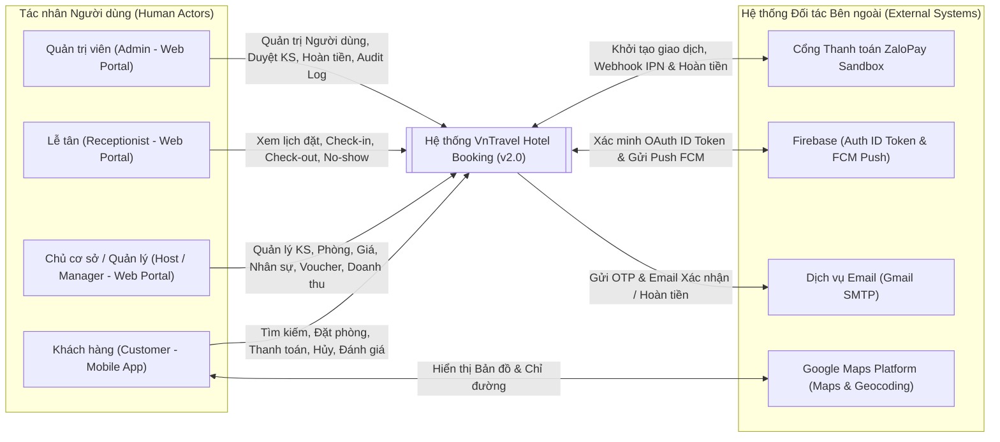
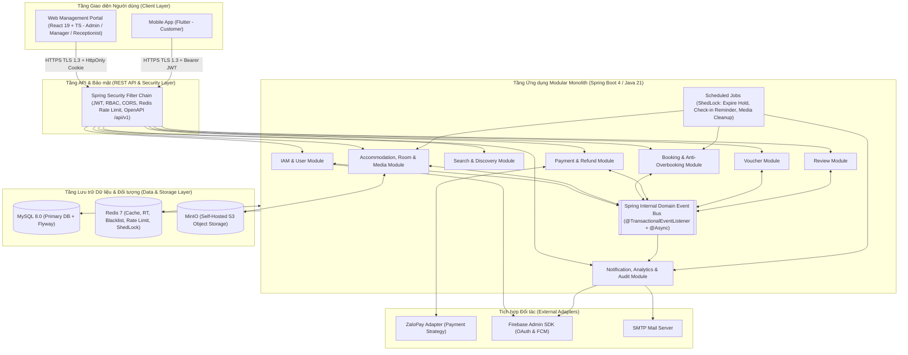
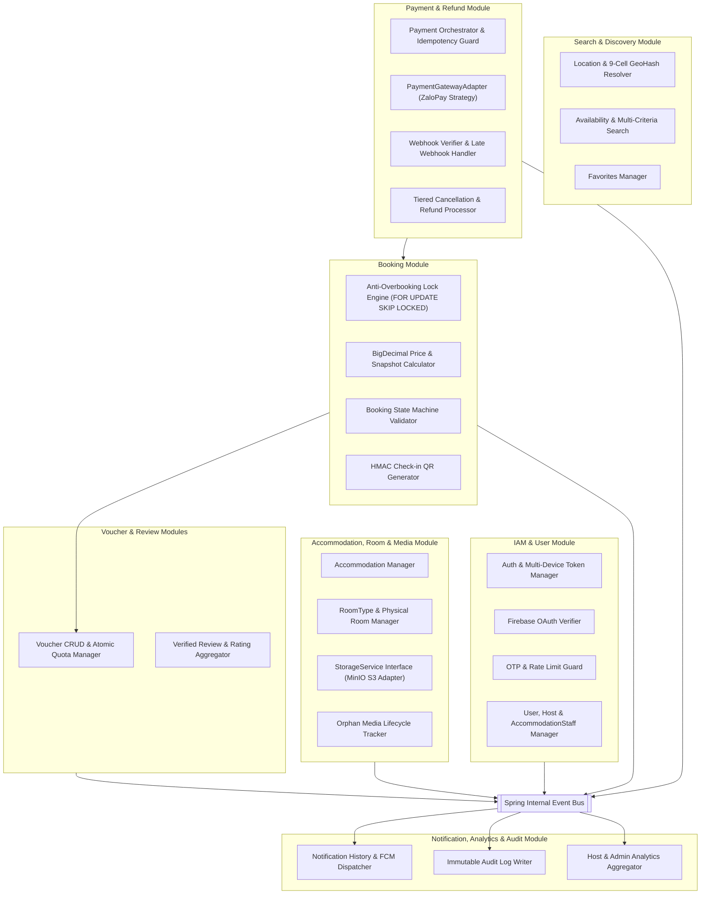

# DỰ ÁN VNTRAVEL HOTEL BOOKING - TÀI LIỆU ĐẶC TẢ YÊU CẦU PHẦN MỀM (SRS)
## Nền tảng Đặt phòng Khách sạn & Quản trị Lưu trú Đa vai trò (Multi-Role Hotel Booking & Hospitality Management Platform)

---

- **Tên dự án:** VnTravel Hotel Booking Platform
- **Tài liệu:** Software Requirement Specification (SRS) - Đặc tả Yêu cầu Phần mềm
- **Phiên bản:** 2.0 (Production-Ready Upgrade Specification)
- **Người lập tài liệu:** Senior Business Analyst (Business Analyst)
- **Địa điểm & Thời gian:** TP. Hồ Chí Minh, Việt Nam — Tháng 11/2026
- **Lần sửa đổi gần nhất:** 22/11/2026 09:55:00

---

## Trang Phê Duyệt (Approval Page)

| Vai trò | Chức danh | Chữ ký | Ngày |
| :--- | :--- | :--- | :--- |
| **Người lập (Prepared by):** | Business Analyst | *(Đã ký)* | `22 / 11 / 2026` |
| **Người kiểm tra (Reviewed by):** | Business Analyst | *(Đã ký)* | `____ / ____ / ______` |
| **Người hỗ trợ (Supported by):** | Technical Lead / Solution Architect | *(Đã ký)* | `____ / ____ / ______` |
| **Người phê duyệt (Approved by):** | Project Manager / Product Owner | *(Đã ký)* | `____ / ____ / ______` |

---

## Lịch Sử Thay Đổi (Revision History)

| Ngày | Phiên bản | Tác giả | Mô tả thay đổi |
| :--- | :--- | :--- | :--- |
| 09/09/2026 | 1.0 | Development Team | Phiên bản đồ án nền tảng ban đầu (Spring Boot Layered Monolith, Web Host Portal JSX, Flutter Customer App, Cloudinary, ZaloPay Sandbox). |
| 22/11/2026 | 2.0 | Senior Business Analyst | Tái thiết kế toàn diện chuẩn Production: kiến trúc Modular Monolith + Internal Domain Events, chuyển lưu trữ ảnh sang MinIO (S3-compatible), mở rộng Web Management Portal đa vai trò (Admin / Host-Manager / Receptionist), Pessimistic Lock chống Overbooking, Tiered Cancellation & Refund, Voucher/Promotion, Notification History, Immutable Audit Log và chuẩn hóa NFRs/Testcontainers. |

---

## MỤC LỤC (TABLE OF CONTENTS)

1. [Giới thiệu (Introduction)](#1-giới-thiệu-introduction)
   - 1.1 [Mục đích (Purpose)](#11-mục-đích-purpose)
   - 1.2 [Phạm vi dự án (Scope of Project)](#12-phạm-vi-dự-án-scope-of-project)
2. [Mô tả Tổng quan Hệ thống (Overall Description)](#2-mô-tả-tổng-quan-hệ-thống-overall-description)
   - 2.1 [Bối cảnh nghiệp vụ (Business Context)](#21-bối-cảnh-nghiệp-vụ-business-context)
   - 2.2 [Sơ đồ ngữ cảnh hệ thống (System Context Diagram)](#22-sơ-đồ-ngữ-cảnh-hệ-thống-system-context-diagram)
   - 2.3 [Các tác nhân hệ thống (System Actors)](#23-các-tác-nhân-hệ-thống-system-actors)
   - 2.4 [Kiến trúc logic mức cao (High-Level Logical Architecture)](#24-kiến-trúc-logic-mức-cao-high-level-logical-architecture)
   - 2.5 [Sơ đồ thành phần (Component Diagram)](#25-sơ-đồ-thành-phần-component-diagram)
   - 2.6 [Danh mục cấu hình hệ thống (Configurations List)](#26-danh-mục-cấu-hình-hệ-thống-configurations-list)
   - 2.7 [Danh sách quyền hạn (Privileges List)](#27-danh-sách-quyền-hạn-privileges-list)
   - 2.8 [Bảng thông điệp sự kiện Domain (Event Message Table)](#28-bảng-thông-điệp-sự-kiện-domain-event-message-table)
3. [Đặc tả Yêu cầu Chức năng Phần mềm (Software Requirements Specification)](#3-đặc-tả-yêu-cầu-chức-năng-phần-mềm-software-requirements-specification)
   - 3.1 [Phân hệ Định danh & Xác thực (IAM & Authentication Module)](#31-phân-hệ-định-danh--xác-thực-iam--authentication-module)
   - 3.2 [Phân hệ Quản lý Người dùng, Chủ cơ sở & Nhân sự (User, Host & Staff Management Module)](#32-phân-hệ-quản-lý-người-dùng-chủ-cơ-sở--nhân-sự-user-host--staff-management-module)
   - 3.3 [Phân hệ Quản lý Cơ sở Lưu trú, Phòng & Media (Accommodation, Room & MinIO Media Module)](#33-phân-hệ-quản-lý-cơ-sở-lưu-trú-phòng--media-accommodation-room--minio-media-module)
   - 3.4 [Phân hệ Tìm kiếm, Khám phá & Yêu thích (Search, Discovery & Favorites Module)](#34-phân-hệ-tìm-kiếm-khám-phá--yêu-thích-search-discovery--favorites-module)
   - 3.5 [Phân hệ Đặt phòng & Chống Đặt trùng (Booking & Anti-Overbooking Module)](#35-phân-hệ-đặt-phòng--chống-đặt-trùng-booking--anti-overbooking-module)
   - 3.6 [Phân hệ Thanh toán, Hủy phòng & Hoàn tiền (Payment, Cancellation & Refund Module)](#36-phân-hệ-thanh-toán-hủy-phòng--hoàn-tiền-payment-cancellation--refund-module)
   - 3.7 [Phân hệ Khuyến mãi & Mã giảm giá (Voucher & Promotion Module)](#37-phân-hệ-khuyến-mãi--mã-giảm-giá-voucher--promotion-module)
   - 3.8 [Phân hệ Đánh giá & Xếp hạng (Review & Rating Module)](#38-phân-hệ-đánh-giá--xếp-hạng-review--rating-module)
   - 3.9 [Phân hệ Thông báo, Thống kê & Kiểm toán (Notification, Analytics & Audit Module)](#39-phân-hệ-thông-báo-thống-kê--kiểm-toán-notification-analytics--audit-module)
4. [Các Yêu cầu Triển khai Khác (Other Requirements)](#4-các-yêu-cầu-triển-khai-khác-other-requirements)
   - 4.1 [Nguyên tắc thiết kế & hiện thực dịch vụ (General implementation principles)](#41-nguyên-tắc-thiết-kế--hiện-thực-dịch-vụ-general-implementation-principles)
   - 4.2 [Quản lý API & Giao ước dữ liệu (API & Contract Management)](#42-quản-lý-api--giao-ước-dữ-liệu-api--contract-management)
   - 4.3 [Quản lý Cấu hình & Thông tin bảo mật (Configuration & Secrets Management)](#43-quản-lý-cấu-hình--thông-tin-bảo-mật-configuration--secrets-management)
5. [Yêu cầu Phi chức năng (Non-functional Requirements)](#5-yêu-cầu-phi-chức-năng-non-functional-requirements)
   - 5.1 [Hiệu năng & Khả năng mở rộng (Performance & Scalability)](#51-hiệu-năng--khả-năng-mở-rộng-performance--scalability)
   - 5.2 [Độ sẵn sàng & Độ tin cậy (Availability & Reliability)](#52-độ-sẵn-sàng--độ-tin-cậy-availability--reliability)
   - 5.3 [Tính nhất quán & Toàn vẹn dữ liệu (Data Consistency & Integrity)](#53-tính-nhất-quán--toàn-vẹn-dữ-liệu-data-consistency--integrity)
   - 5.4 [Bảo mật & Tuân thủ tiêu chuẩn (Security & Compliance)](#54-bảo-mật--tuân-thủ-tiêu-chuẩn-security--compliance)
   - 5.5 [Khả năng quan sát & Giám sát hệ thống (Observability & Monitoring)](#55-khả-năng-quan-sát--giám-sát-hệ-thống-observability--monitoring)
   - 5.6 [Khả năng bảo trì & Mở rộng mã nguồn (Maintainability & Extensibility)](#56-khả-năng-bảo-trì--mở-rộng-mã-nguồn-maintainability--extensibility)
   - 5.7 [Quy trình Triển khai & Vận hành (Deployment & Operations)](#57-quy-trình-triển-khai--vận-hành-deployment--operations)
   - 5.8 [Lưu trữ dữ liệu & Kiểm toán (Data Retention & Auditing)](#58-lưu-trữ-dữ-liệu--kiểm-toán-data-retention--auditing)

---

# 1. Giới thiệu (Introduction)

### 1.1 Mục đích (Purpose)
Tài liệu này định nghĩa đầy đủ các yêu cầu chức năng (functional requirements) và yêu cầu phi chức năng (non-functional requirements) cho phiên bản nâng cấp **2.0** của hệ thống **"VnTravel Hotel Booking Platform"**. Tài liệu đóng vai trò là nguồn thông tin chuẩn mực duy nhất (single source of truth) dành cho đội ngũ phát triển Backend (`hotel-booking-be`), Web Frontend (`hotel-booking-fe`), Mobile App (`hotel-booking-app`), kiểm thử chất lượng (QA) và các bên liên quan nhằm nâng cấp hệ thống từ mức đồ án nền tảng lên chuẩn vận hành thực tế (Production-Ready), khắc phục triệt để các lỗ hổng bảo mật, xung đột dữ liệu đồng thời (concurrency), sai lệch giao ước API giữa 3 lớp và hoàn thiện nghiệp vụ đặt phòng khách sạn hiện đại.

### 1.2 Phạm vi dự án (Scope of Project)
Hệ thống **"VnTravel Hotel Booking Platform"** là nền tảng công nghệ du lịch trực tuyến (Online Travel Agency - OTA) kết nối trực tiếp khách du lịch có nhu cầu đặt phòng với các cơ sở lưu trú (khách sạn, homestay, căn hộ dịch vụ, hostel, resort) thông qua hệ sinh thái 3 thành phần đồng bộ gồm Máy chủ lõi (Backend API), Cổng quản trị Web đa vai trò (Web Management Portal) và Ứng dụng di động dành cho khách hàng (Mobile Customer App).

#### Các tính năng thuộc phạm vi phiên bản 2.0 (In-Scope Features):
- **Kiến trúc Backend Modular Monolith (`hotel-booking-be`):** Xây dựng trên Java 21 / Spring Boot 4, MySQL 8.0 (quản lý schema bằng Flyway), Redis 7 (Cache, Multi-device Refresh Token, Token Blacklist, Rate Limiting, ShedLock), **MinIO Object Storage (tương thích S3 tự chủ qua Docker Compose, thay thế hoàn toàn Cloudinary ở v1.0)** và cơ chế Sự kiện Domain nội bộ (Spring Internal Domain Events với `@TransactionalEventListener` + `@Async`).
- **Cổng Quản trị Web Đa vai trò (`hotel-booking-fe`):** Chuẩn hóa sang TypeScript + React 19 + Ant Design + TanStack Query + React Hook Form/Zod, tách biệt dashboard và quyền hạn chặt chẽ cho 3 vai trò: **Quản trị viên hệ thống (`ROLE_ADMIN`)**, **Chủ cơ sở / Quản lý (`ROLE_HOST` + `ROLE_MANAGER`)** và **Lễ tân (`ROLE_HOST` + `ROLE_RECEPTIONIST`)**.
- **Ứng dụng Di động Khách hàng (`hotel-booking-app`):** Tái cấu trúc Flutter theo kiến trúc Feature-first + Riverpod/Bloc + Dio Singleton (auto-refresh token queue) + `flutter_secure_storage`, phục vụ trọn vẹn vòng đời của **Khách hàng (`ROLE_CUSTOMER`)**: đăng ký/đăng nhập (Local & Google OAuth), tìm kiếm đa tiêu chí & bản đồ lân cận, danh sách yêu thích, đặt phòng, áp dụng Voucher, thanh toán ZaloPay, hủy phòng/theo dõi hoàn tiền, mã QR Check-in, đánh giá sau lưu trú và hộp thư thông báo.
- **Nghiệp vụ Lõi & Nâng cao (Core & Value-Add Domains):**
  - Xác thực đa thiết bị, xác minh chữ ký Firebase/Google ID Token bắt buộc, OTP 6 chữ số chống brute-force và ma trận phân quyền RBAC 4 vai trò.
  - Quản trị trọn vòng đời Cơ sở lưu trú, Loại phòng, Phòng vật lý và lưu trữ hình ảnh thống nhất qua `StorageService` (MinIO).
  - Đặt phòng nguyên tử chống đặt trùng (Anti-Overbooking) bằng khóa bi quan `SELECT ... FOR UPDATE SKIP LOCKED`, giữ phòng 15 phút, chuẩn hóa giờ nhận/trả phòng `14:00`/`12:00` và ShedLock tự động giải phóng phòng hết hạn.
  - Thanh toán bọc sau **Payment Strategy/Adapter Pattern** (hiện thực ZaloPay Sandbox), tính lũy biến Webhook (Idempotency), xử lý thanh toán trễ (Late Webhook) an toàn và Chính sách Hủy phòng & Hoàn tiền theo bậc thời gian (Tiered Cancellation & Refund Policy).
  - Hệ thống Mã giảm giá (Voucher/Promotion), Đánh giá xác thực sau trả phòng (Verified Reviews), Lịch sử Thông báo (Notification History DB + FCM), Báo cáo Thống kê Vận hành và Nhật ký Kiểm toán Bất biến (Immutable Audit Logs) cùng Xóa mềm (Soft Delete).

#### Các tính năng nằm ngoài phạm vi phiên bản 2.0 (Out-of-Scope Features for Version 2.0):
- **Giao diện Đặt phòng cho Khách hàng trên Web (Guest Web Booking Portal):** Khách hàng đặt phòng tập trung trên Mobile App Flutter ở v2.0; Web Portal dành riêng cho công tác quản trị và vận hành nội bộ (Admin, Host/Manager, Receptionist). Kênh Guest Web được hoạch định cho Phase 2.
- **Đặt nhiều phòng trong một đơn (Multi-room Booking):** Phiên bản 2.0 áp dụng quy tắc 1 phòng vật lý / 1 đơn đặt phòng nhằm tối ưu hóa độ tin cậy của khóa bi quan và hoàn tiền; đặt nhiều phòng cùng lúc thuộc Phase 2.
- **Định giá động theo mùa / ngày lễ / cuối tuần (Dynamic & Seasonal Pricing):** Phiên bản 2.0 tính giá theo đơn giá cố định của loại phòng kết hợp phần trăm giảm giá (`discountPercent`) và mã Voucher; động cơ định giá động thuộc Phase 2.
- **Tích hợp thực tế cổng thanh toán VNPay / Stripe / MoMo:** Phiên bản 2.0 thiết kế sẵn giao diện `PaymentGatewayAdapter` theo Strategy Pattern để sẵn sàng mở rộng, nhưng chỉ hiện thực và kiểm thử thực tế với ZaloPay Sandbox.
- **Hệ thống Kế toán nội bộ (ERP), Xuất hóa đơn điện tử và Nhắn tin trực tiếp (In-App Live Chat):** Không thuộc phạm vi nền tảng v2.0.

---

# 2. Mô tả Tổng quan Hệ thống (Overall Description)

### 2.1 Bối cảnh nghiệp vụ (Business Context)
Thị trường đặt phòng lưu trú trực tuyến đòi hỏi sự chính xác tuyệt đối về tồn kho phòng trống theo thời gian thực, tính minh bạch trong định giá - thanh toán - hoàn tiền, và khả năng phân tách trách nhiệm chặt chẽ giữa chủ khách sạn, nhân viên lễ tân và đội ngũ quản trị sàn.

Qua quá trình kiểm toán mã nguồn phiên bản 1.0, hệ thống tồn tại nhiều điểm nghẽn nghiêm trọng mang tính chất đồ án demo: nguy cơ đặt trùng phòng (Overbooking) do điều kiện tranh chấp TOCTOU và sai lệch giờ nhận/trả phòng; thiếu tính lũy biến thanh toán dẫn tới thanh toán trễ hồi sinh đơn đã hủy; lộ khóa bí mật trong mã nguồn; lệch giao ước dữ liệu (ảnh Cloudinary vs đường dẫn tĩnh, phân trang mảng thuần vs `PagedModel`, đơn vị giảm giá VNĐ vs phần trăm) giữa Backend, Web Frontend và Mobile App; thiếu phân quyền giữa Quản lý và Lễ tân; và thiếu hoàn toàn chính sách hủy phòng, hoàn tiền, mã giảm giá cũng như nhật ký kiểm toán.

Phiên bản **2.0** giải quyết triệt để toàn bộ các vấn đề trên thông qua kiến trúc **Modular Monolith** sạch, giao ước API thống nhất (`/api/v1`), hạ tầng lưu trữ **MinIO S3** tự chủ trong Docker, cơ chế khóa bi quan chống overbooking ở tầng cơ sở dữ liệu, máy trạng thái nghiêm ngặt cho Booking/Payment/Refund và bộ kiểm thử tích hợp thực tế bằng **Testcontainers**.

### 2.2 Sơ đồ ngữ cảnh hệ thống (System Context Diagram)
Hệ thống VnTravel Hotel Booking Platform đóng vai trò trung tâm kết nối 4 nhóm tác nhân người dùng (qua Web Management Portal và Mobile App) với các hệ thống đối tác bên thứ ba phục vụ thanh toán, xác thực định danh, thông báo đẩy, gửi thư điện tử và định vị bản đồ.

### 2.3 Các tác nhân hệ thống (System Actors)

| Tác nhân (Actor) | Mô tả vai trò |
| :--- | :--- |
| **Customer (Khách hàng)** | Người dùng cuối sử dụng ứng dụng di động Flutter (`ROLE_CUSTOMER`) để đăng ký/đăng nhập, tìm kiếm cơ sở lưu trú và phòng trống, lưu yêu thích, đặt phòng, áp dụng mã giảm giá, thanh toán trực tuyến qua ZaloPay, nhận mã QR Check-in, hủy phòng theo chính sách, theo dõi hoàn tiền, gửi đánh giá sau lưu trú và quản lý thông báo cá nhân. |
| **Host / Manager (Chủ cơ sở / Quản lý khách sạn)** | Đối tác vận hành cơ sở lưu trú sử dụng Web Management Portal (`ROLE_HOST` kèm vai trò cơ sở `ROLE_MANAGER`) để cập nhật thông tin khách sạn được giao, quản lý loại phòng, giá phòng, phòng vật lý, hình ảnh (MinIO), tuyển/khóa nhân viên lễ tân, tạo mã giảm giá cấp khách sạn, xử lý nhận/trả/hủy phòng và xem báo cáo doanh thu - công suất. Mọi thao tác bị giới hạn trong phạm vi các cơ sở lưu trú đang được phân công ở trạng thái `ACTIVE`. |
| **Receptionist (Lễ tân)** | Nhân sự vận hành trực tiếp tại quầy sử dụng Web Management Portal (`ROLE_HOST` kèm vai trò cơ sở `ROLE_RECEPTIONIST`) để tra cứu danh sách đặt phòng của cơ sở được giao, quét/đối chiếu mã QR Check-in, thực hiện Check-in, Check-out và đánh dấu `NO_SHOW`. Không có quyền chỉnh sửa thông tin khách sạn, thay đổi giá phòng, quản lý nhân sự hay xem báo cáo doanh thu. |
| **Administrator (Quản trị viên - Admin)** | Quản trị viên toàn sàn sử dụng Web Management Portal (`ROLE_ADMIN`) chịu trách nhiệm khởi tạo/khóa/khôi phục tài khoản người dùng và Chủ cơ sở, tạo/duyệt/khóa cơ sở lưu trú, quản lý Voucher cấp toàn sàn, phê duyệt/đối soát yêu cầu hoàn tiền (kể cả ngoại lệ Late Webhook), kiểm duyệt đánh giá vi phạm, xem thống kê toàn hệ thống và tra cứu Nhật ký Kiểm toán Bất biến (Audit Logs). |
| **External System (Hệ thống bên ngoài)** | Các dịch vụ đối tác thứ ba tích hợp vào nền tảng gồm: **ZaloPay Sandbox** (khởi tạo đơn thanh toán, callback IPN, hoàn tiền), **Firebase** (xác thực chữ ký Google/Firebase ID Token và phân phối thông báo đẩy FCM), **Gmail SMTP** (gửi mã OTP và email giao dịch) và **Google Maps Platform** (hiển thị vị trí cơ sở lưu trú và chỉ đường trên Mobile App). |

### 2.4 Kiến trúc Logic Mức cao (High-Level Logical Architecture)
Hệ thống VnTravel Hotel Booking v2.0 áp dụng kiến trúc **Modular Monolith** có ranh giới module chặt chẽ (Bounded Context), kết hợp giao tiếp bất đồng bộ nội bộ bằng **Spring Internal Domain Events (`@TransactionalEventListener` + `@Async`)** và điều phối tác vụ định kỳ an toàn đa phiên bản bằng **ShedLock**. Tầng lưu trữ hợp nhất gồm **MySQL 8.0** (dữ liệu giao dịch chính quản lý bằng Flyway), **Redis 7** (Cache, Refresh Token đa thiết bị, Token Blacklist, Rate Limiting, ShedLock) và **MinIO** (lưu trữ đối tượng tương thích S3 chạy tự chủ trong cụm Docker).

### 2.5 Sơ đồ Thành phần (Component Diagram)
Sơ đồ dưới đây phân rã các thành phần chức năng nội bộ trong từng module của Modular Monolith, nêu rõ các cổng trừu tượng (`StorageService` cho MinIO, `PaymentGatewayAdapter` cho ZaloPay) và đường truyền sự kiện nội bộ giúp giảm sự phụ thuộc chặt giữa các phân hệ.

### 2.6 Danh mục Cấu hình Hệ thống (Configurations List)
Bảng dưới đây định nghĩa toàn bộ các tham số cấu hình được sử dụng trong hệ thống. Mọi tham số đều có thể điều chỉnh qua biến môi trường hoặc tệp cấu hình theo từng môi trường (`DEV` / `STAGING` / `PROD`) mà không cần thay đổi mã nguồn.

| Tên cấu hình (Configuration Name) | Mô tả chi tiết | Giá trị mặc định |
| :--- | :--- | :--- |
| `SYSTEM_ENV` | Môi trường triển khai hệ thống (`DEV` / `STAGING` / `PROD`) | `DEV` |
| `SYSTEM_TIMEZONE` | Múi giờ chuẩn dùng cho lịch nhận/trả phòng và báo cáo | `Asia/Ho_Chi_Minh` |
| `ACCESS_TOKEN_EXPIRY_MINUTES` | Thời gian hiệu lực của Access Token JWT (phút) | `15` |
| `REFRESH_TOKEN_EXPIRY_DAYS` | Thời gian hiệu lực của Refresh Token lưu trên Redis (ngày) | `7` |
| `MAX_ACTIVE_SESSIONS_PER_USER` | Số thiết bị/phiên đăng nhập đồng thời tối đa cho một tài khoản | `5` |
| `MAX_LOGIN_ATTEMPTS` | Số lần nhập sai mật khẩu liên tiếp tối đa trước khi khóa tạm thời | `5` |
| `LOGIN_LOCKOUT_MINUTES` | Thời gian khóa tạm thời tài khoản sau khi vượt ngưỡng đăng nhập sai (phút) | `15` |
| `PASSWORD_MIN_LENGTH` | Độ dài tối thiểu của mật khẩu người dùng (ký tự) | `8` |
| `OTP_LENGTH` | Độ dài mã xác thực OTP một lần (chữ số) | `6` |
| `OTP_TTL_MINUTES` | Thời gian hiệu lực của mã OTP lưu trên Redis (phút) | `5` |
| `OTP_MAX_VERIFY_ATTEMPTS` | Số lần nhập sai mã OTP tối đa trước khi vô hiệu hóa OTP hiện tại | `5` |
| `OTP_RESEND_COOLDOWN_SECONDS` | Khoảng thời gian chờ tối thiểu giữa 2 lần yêu cầu gửi lại OTP (giây) | `60` |
| `AUTH_RATE_LIMIT_PER_MINUTE` | Số yêu cầu tối đa mỗi phút/IP tới nhóm endpoint xác thực (`/auth/**`) | `10` |
| `API_RATE_LIMIT_PER_MINUTE` | Số yêu cầu tối đa mỗi phút/người dùng tới các API nghiệp vụ chung | `120` |
| `USER_SOFT_DELETE` | Áp dụng cơ chế xóa mềm (Soft Delete) thay vì xóa vật lý cho tài khoản | `true` |
| `DEFAULT_PAGE_SIZE` | Số lượng bản ghi mặc định trên mỗi trang phân trang (0-based) | `10` |
| `MAX_PAGE_SIZE` | Giới hạn số lượng bản ghi tối đa trên mỗi trang để chống tấn công DoS | `50` |
| `MINIO_BUCKET_AVATARS` | Tên bucket trên MinIO lưu trữ ảnh đại diện người dùng (bao gồm ảnh mặc định `defaults/default-avatar.png`) | `hotel-avatars` |
| `MINIO_BUCKET_ACCOMMODATIONS` | Tên bucket trên MinIO lưu trữ ảnh bìa cơ sở lưu trú, ảnh đại diện và ảnh xem trước loại phòng | `hotel-accommodations` |
| `MINIO_BUCKET_PUBLIC` | Tên bucket trên MinIO lưu trữ tài nguyên công khai dùng chung của nền tảng (banner, icon, tài sản tĩnh) | `hotel-public` |
| `MAX_IMAGE_FILE_SIZE_MB` | Dung lượng tối đa cho phép của mỗi tệp ảnh tải lên (MB) | `5` |
| `ALLOWED_IMAGE_MIME_TYPES` | Danh sách định dạng MIME hình ảnh hợp lệ (kiểm tra magic bytes) | `image/jpeg,image/png,image/webp` |
| `MAX_ROOM_TYPE_PREVIEW_IMAGES` | Số lượng ảnh xem trước tối đa cho mỗi loại phòng | `8` |
| `ORPHAN_MEDIA_RETENTION_HOURS` | Thời gian giữ an toàn trước khi tác vụ ShedLock xóa vật lý đối tượng ở trạng thái `TEMPORARY` hoặc `PENDING_DELETE` trên MinIO (giờ) | `24` |
| `GEOHASH_NEARBY_PRECISION` | Độ chính xác GeoHash dùng để quét 9 ô (1 ô tâm + 8 ô lân cận) tìm khách sạn gần đây | `5` |
| `NEARBY_DEFAULT_RADIUS_KM` | Bán kính mặc định lọc kết quả tìm kiếm khách sạn lân cận (km) | `10` |
| `CACHE_LOCATION_TTL_MINUTES` | Thời gian sống trong Redis Cache cho danh mục địa điểm (phút) | `60` |
| `CACHE_CATALOG_TTL_MINUTES` | Thời gian sống trong Redis Cache cho chi tiết cơ sở lưu trú và loại phòng (phút) | `15` |
| `STANDARD_CHECKIN_HOUR` | Giờ nhận phòng tiêu chuẩn áp dụng thống nhất khi tìm phòng và lưu đơn | `14:00` |
| `STANDARD_CHECKOUT_HOUR` | Giờ trả phòng tiêu chuẩn áp dụng thống nhất khi tìm phòng và lưu đơn | `12:00` |
| `MIN_BOOKING_NIGHTS` | Số đêm lưu trú tối thiểu cho một đơn đặt phòng | `1` |
| `MAX_BOOKING_NIGHTS` | Số đêm lưu trú tối đa cho một đơn đặt phòng | `30` |
| `MAX_ADVANCE_BOOKING_DAYS` | Số ngày đặt trước tối đa tính từ ngày hiện tại đến ngày check-in | `365` |
| `BOOKING_HOLD_TIMEOUT_MINUTES` | Thời hạn giữ phòng chờ thanh toán trước khi tự động hết hạn (phút) | `15` |
| `BOOKING_EXPIRE_CRON_SECONDS` | Chu kỳ chạy tác vụ định kỳ (bảo vệ bởi ShedLock) để quét và hết hạn đơn quá hạn (giây) | `60` |
| `MAX_DISCOUNT_PERCENT` | Phần trăm giảm giá tối đa cho phép cấu hình trên loại phòng (%) | `100` |
| `ALLOW_OVERBOOKING` | Cờ cho phép đặt vượt số lượng phòng khả dụng (bắt buộc khóa `false`) | `false` |
| `ALLOW_DELETE_ACCOMMODATION_WITH_BOOKING` | Cho phép xóa cơ sở lưu trú khi đã có đơn đặt phòng liên kết | `false` |
| `ALLOW_DELETE_ROOMTYPE_WITH_ACTIVE_BOOKING` | Cho phép xóa loại phòng khi đang có đơn ở trạng thái hiệu lực (`WAITING_FOR_PAYMENT`/`CONFIRMED`/`CHECKED_IN`) | `false` |
| `ALLOW_DELETE_ROOM_WITH_ACTIVE_BOOKING` | Cho phép xóa phòng vật lý khi đang có đơn ở trạng thái hiệu lực | `false` |
| `PAYMENT_IDEMPOTENCY_WINDOW_MINUTES` | Cửa sổ thời gian kiểm tra tính lũy biến (Idempotency) cho yêu cầu tạo giao dịch & webhook (phút) | `60` |
| `PAYMENT_GATEWAY_TIMEOUT_MS` | Thời gian chờ tối đa khi gọi API cổng thanh toán bên ngoài (ms) | `5000` |
| `PAYMENT_RETRY_LIMIT` | Số lần thử lại tối đa khi gọi cổng thanh toán gặp lỗi mạng tạm thời | `3` |
| `FREE_CANCEL_BEFORE_HOURS` | Ngưỡng thời gian tối thiểu trước giờ check-in để được hủy miễn phí hoàn 100% (giờ) | `48` |
| `PARTIAL_REFUND_BEFORE_HOURS` | Ngưỡng thời gian tối thiểu trước giờ check-in để được hoàn tiền một phần (giờ) | `24` |
| `PARTIAL_REFUND_PERCENT` | Tỷ lệ phần trăm hoàn tiền khi hủy trong khung thời gian hoàn một phần (%) | `50` |
| `NO_SHOW_GRACE_HOURS` | Thời gian gia hạn sau giờ check-in tiêu chuẩn trước khi lễ tân được đánh dấu `NO_SHOW` (giờ) | `6` |
| `CHECKIN_QR_HMAC_TTL_HOURS` | Thời hạn hiệu lực của mã token ký HMAC dùng để sinh QR Check-in (giờ) | `24` |
| `MAX_VOUCHERS_PER_BOOKING` | Số lượng mã giảm giá (Voucher) tối đa được áp dụng trên một đơn đặt phòng | `1` |
| `ALLOW_VOUCHER_DELETE_WITH_USAGE` | Cho phép xóa mã giảm giá đã có lượt sử dụng trong đơn đặt phòng | `false` |
| `REVIEW_MIN_RATING` | Điểm đánh giá tối thiểu (sao) | `1` |
| `REVIEW_MAX_RATING` | Điểm đánh giá tối đa (sao) | `5` |
| `REVIEW_MAX_COMMENT_LENGTH` | Độ dài ký tự tối đa của nội dung bình luận đánh giá | `1000` |
| `REVIEW_EDIT_WINDOW_HOURS` | Khoảng thời gian cho phép khách hàng chỉnh sửa đánh giá sau khi gửi (giờ) | `24` |
| `CHECKIN_REMINDER_CRON_HOUR` | Khung giờ hằng ngày chạy tác vụ gửi thông báo nhắc lịch check-in cho khách | `08:00` |
| `NOTIFICATION_RETRY_LIMIT` | Số lần thử lại tối đa khi gửi email SMTP hoặc thông báo đẩy FCM thất bại | `3` |
| `AUDIT_LOG_IMMUTABLE` | Khóa bảo vệ bất biến chống chỉnh sửa và xóa bản ghi Nhật ký Kiểm toán | `true` |
| `FEATURE_VOUCHER_ENABLED` | Cờ bật/tắt tính năng áp dụng mã giảm giá (Voucher) trên toàn hệ thống | `true` |
| `FEATURE_FCM_PUSH_ENABLED` | Cờ bật/tắt tính năng gửi thông báo đẩy qua Firebase Cloud Messaging | `true` |

---

### 2.7 Danh sách Quyền hạn (Privileges List)
Ma trận phân quyền chi tiết dựa trên vai trò (**RBAC Matrix**) cho 4 tác nhân: **Admin** (`ROLE_ADMIN`), **Host / Manager** (`ROLE_HOST` + `ROLE_MANAGER`), **Receptionist** (`ROLE_HOST` + `ROLE_RECEPTIONIST`), và **Customer** (`ROLE_CUSTOMER`).

> [!NOTE]
> Mọi quyền hạn của **Host / Manager** và **Receptionist** đều chịu ràng buộc phạm vi cơ sở (Resource-Scoped Authorization): người dùng bắt buộc phải có bản ghi `AccommodationStaff` gắn với cơ sở lưu trú mục tiêu ở trạng thái `status = ACTIVE` và `isDeleted = false`.

| Mã quyền (Privilege) | Mô tả nghiệp vụ | Admin | Host / Manager | Receptionist | Customer |
| :--- | :--- | :---: | :---: | :---: | :---: |
| `AUTH.LOGIN` | Đăng nhập bằng Email và Mật khẩu | X | X | X | X |
| `AUTH.OAUTH_LOGIN` | Đăng nhập qua Google / Firebase OAuth (có xác minh chữ ký) | | | | X |
| `AUTH.REGISTER` | Đăng ký tài khoản Khách hàng mới | | | | X |
| `AUTH.REFRESH` | Làm mới Access Token bằng Refresh Token hợp lệ | X | X | X | X |
| `AUTH.LOGOUT` | Đăng xuất phiên hiện tại hoặc toàn bộ thiết bị (thu hồi token) | X | X | X | X |
| `AUTH.PASSWORD.RESET` | Đặt lại mật khẩu qua OTP hoặc đổi mật khẩu cá nhân | X | X | X | X |
| `PROFILE.VIEW` | Xem thông tin hồ sơ cá nhân của chính mình | X | X | X | X |
| `PROFILE.UPDATE` | Cập nhật hồ sơ cá nhân và ảnh đại diện của chính mình | X | X | X | X |
| `USER.LIST` | Xem danh sách toàn bộ người dùng trong hệ thống | X | | | |
| `USER.VIEW` | Xem chi tiết hồ sơ của một người dùng bất kỳ | X | | | |
| `USER.STATUS.UPDATE` | Kích hoạt hoặc khóa tài khoản người dùng (kèm thu hồi phiên) | X | | | |
| `USER.DELETE` | Xóa mềm tài khoản người dùng | X | | | |
| `USER.RESTORE` | Khôi phục tài khoản người dùng đã xóa mềm | X | | | |
| `HOST.CREATE` | Tạo tài khoản Chủ cơ sở (Host/Manager) và gán vào khách sạn | X | | | |
| `HOST.LIST` | Xem danh sách các Chủ cơ sở và nhóm cơ sở quản lý | X | | | |
| `STAFF.CREATE` | Tạo tài khoản nhân sự Lễ tân cho cơ sở lưu trú mình quản lý | X | X | | |
| `STAFF.LIST` | Xem danh sách nhân sự thuộc cơ sở lưu trú mình quản lý | X | X | | |
| `STAFF.STATUS.UPDATE` | Kích hoạt hoặc vô hiệu hóa quyền vận hành của nhân sự cơ sở | X | X | | |
| `STAFF.DELETE` | Xóa mềm nhân sự khỏi cơ sở lưu trú | X | X | | |
| `STAFF.RESTORE` | Khôi phục nhân sự đã xóa mềm tại cơ sở lưu trú | X | X | | |
| `ACCOMMODATION.CREATE` | Tạo mới cơ sở lưu trú trên hệ thống | X | | | |
| `ACCOMMODATION.UPDATE` | Cập nhật thông tin cơ sở lưu trú | X | X | | |
| `ACCOMMODATION.LIST_ALL` | Xem toàn bộ danh sách cơ sở lưu trú (bao gồm cả trạng thái đã xóa) | X | | | |
| `ACCOMMODATION.LIST_OWN` | Xem danh sách cơ sở lưu trú được phân công quản lý/vận hành | | X | X | |
| `ACCOMMODATION.VIEW` | Xem thông tin chi tiết cơ sở lưu trú đang hoạt động | X | X | X | X |
| `ACCOMMODATION.DELETE` | Xóa mềm / khóa cơ sở lưu trú khỏi hệ thống | X | | | |
| `ACCOMMODATION.RESTORE` | Khôi phục cơ sở lưu trú đã khóa/xóa mềm | X | | | |
| `ACCOMMODATION.FAVORITE.MANAGE` | Thêm, gỡ và xem danh sách cơ sở lưu trú yêu thích cá nhân | | | | X |
| `ROOMTYPE.CREATE` | Tạo mới loại phòng cho cơ sở lưu trú mình quản lý | X | X | | |
| `ROOMTYPE.UPDATE` | Cập nhật thông tin mô tả, tiện ích, hình ảnh loại phòng | X | X | | |
| `ROOMTYPE.PRICE.UPDATE` | Cập nhật đơn giá và phần trăm giảm giá (`discountPercent`) loại phòng | X | X | | |
| `ROOMTYPE.LIST` | Xem danh sách loại phòng của cơ sở lưu trú | X | X | X | X |
| `ROOMTYPE.VIEW` | Xem chi tiết loại phòng | X | X | X | X |
| `ROOMTYPE.DELETE` | Xóa mềm loại phòng | X | X | | |
| `ROOMTYPE.RESTORE` | Khôi phục loại phòng đã xóa mềm | X | X | | |
| `ROOM.CREATE` | Tạo mới một hoặc nhiều phòng vật lý thuộc loại phòng | X | X | | |
| `ROOM.UPDATE_STATUS` | Cập nhật trạng thái hoạt động của phòng vật lý (`ACTIVE`/`INACTIVE`) | X | X | | |
| `ROOM.LIST` | Xem danh sách phòng vật lý thuộc loại phòng của cơ sở | X | X | X | |
| `ROOM.DELETE` | Xóa mềm phòng vật lý | X | X | | |
| `ROOM.RESTORE` | Khôi phục phòng vật lý đã xóa mềm | X | X | | |
| `MEDIA.UPLOAD` | Tải tệp hình ảnh lên MinIO Object Storage | X | X | X | X |
| `MEDIA.DELETE` | Xóa tệp hình ảnh không còn sử dụng trên MinIO | X | X | | |
| `SEARCH.ACCOMMODATION` | Tìm kiếm cơ sở lưu trú theo từ khóa, loại hình, địa điểm | X | X | X | X |
| `SEARCH.ROOMTYPE` | Tìm kiếm loại phòng khả dụng theo ngày, số khách, giá, tiện ích | X | X | X | X |
| `SEARCH.NEARBY` | Tìm kiếm cơ sở lưu trú lân cận theo tọa độ GPS và GeoHash 9 ô | X | X | X | X |
| `LOCATION.VIEW` | Tra cứu danh mục tỉnh/thành, quận/huyện và địa điểm | X | X | X | X |
| `BOOKING.CREATE` | Khởi tạo đơn đặt phòng mới | | | | X |
| `BOOKING.VIEW_OWN` | Xem danh sách, chi tiết và mã QR Check-in đơn đặt phòng cá nhân | | | | X |
| `BOOKING.VIEW_ACCOMMODATION` | Xem danh sách và chi tiết đơn đặt phòng thuộc cơ sở được gán | | X | X | |
| `BOOKING.VIEW_ALL` | Xem toàn bộ đơn đặt phòng trên toàn nền tảng | X | | | |
| `BOOKING.CANCEL_OWN` | Hủy đơn đặt phòng cá nhân theo chính sách hủy phòng | | | | X |
| `BOOKING.CANCEL_BY_HOST` | Hủy đơn đặt phòng thuộc cơ sở (có lý do bắt buộc & kích hoạt hoàn tiền) | X | X | | |
| `BOOKING.CHECKIN` | Xác nhận khách nhận phòng (`CONFIRMED` -> `CHECKED_IN`) | | X | X | |
| `BOOKING.CHECKOUT` | Xác nhận khách trả phòng (`CHECKED_IN` -> `CHECKED_OUT`) | | X | X | |
| `BOOKING.MARK_NO_SHOW` | Đánh dấu khách không đến nhận phòng (`CONFIRMED` -> `NO_SHOW`) | | X | X | |
| `PAYMENT.CREATE` | Khởi tạo giao dịch thanh toán cho đơn đặt phòng cá nhân | | | | X |
| `PAYMENT.VIEW_OWN` | Xem trạng thái và lịch sử giao dịch thanh toán cá nhân | | | | X |
| `PAYMENT.VIEW_ACCOMMODATION` | Xem giao dịch thanh toán của các đơn thuộc cơ sở mình quản lý | | X | | |
| `PAYMENT.VIEW_ALL` | Xem toàn bộ giao dịch thanh toán và đối soát toàn sàn | X | | | |
| `REFUND.LIST` | Xem danh sách yêu cầu hoàn tiền (phạm vi toàn sàn với Admin, theo KS với Manager) | X | X | | |
| `REFUND.APPROVE` | Phê duyệt, thực thi hoàn tiền qua cổng thanh toán hoặc xác nhận đối soát thủ công | X | | | |
| `VOUCHER.CREATE_PLATFORM` | Tạo mới mã giảm giá áp dụng toàn sàn (`PLATFORM`) | X | | | |
| `VOUCHER.CREATE_ACCOMMODATION` | Tạo mới mã giảm giá áp dụng riêng cho cơ sở lưu trú (`ACCOMMODATION`) | X | X | | |
| `VOUCHER.UPDATE` | Cập nhật thông tin, hạn dùng, quota của mã giảm giá thuộc phạm vi sở hữu | X | X | | |
| `VOUCHER.LIST` | Xem danh sách mã giảm giá (Customer chỉ xem mã công khai còn hiệu lực) | X | X | | X |
| `VOUCHER.DELETE` | Vô hiệu hóa hoặc xóa mã giảm giá thuộc phạm vi sở hữu | X | X | | |
| `VOUCHER.APPLY` | Kiểm tra hợp lệ và áp dụng mã giảm giá khi đặt phòng | | | | X |
| `REVIEW.CREATE` | Gửi và chỉnh sửa đánh giá cho đơn đặt phòng cá nhân đã `CHECKED_OUT` | | | | X |
| `REVIEW.LIST` | Xem danh sách đánh giá theo loại phòng hoặc cơ sở lưu trú | X | X | X | X |
| `REVIEW.MODERATE` | Ẩn hoặc khôi phục đánh giá vi phạm quy chuẩn cộng đồng | X | | | |
| `DEVICE.REGISTER` | Đăng ký, làm mới và hủy token FCM của thiết bị cá nhân | X | X | X | X |
| `NOTIFICATION.LIST` | Xem hộp thư lịch sử thông báo cá nhân | X | X | X | X |
| `NOTIFICATION.MARK_READ` | Đánh dấu đã đọc một hoặc tất cả thông báo cá nhân | X | X | X | X |
| `ANALYTICS.VIEW_ACCOMMODATION` | Xem bảng điều khiển KPI, doanh thu và báo cáo công suất theo cơ sở | X | X | | |
| `ANALYTICS.VIEW_PLATFORM` | Xem báo cáo tổng quan GMV, tăng trưởng và vận hành toàn sàn | X | | | |
| `AUDIT_LOG.LIST` | Tra cứu, lọc và xem chi tiết Nhật ký Kiểm toán Bất biến | X | | | |
| `SYSTEM.HEALTH.VIEW` | Kiểm tra tình trạng sức khỏe dịch vụ và chỉ số vận hành (Actuator) | X | | | |

---

### 2.8 Bảng Thông điệp Sự kiện Domain (Event Message Table)
Trong kiến trúc **Modular Monolith**, các phân hệ giao tiếp bất đồng bộ thông qua **Spring Internal Domain Events** (`ApplicationEventPublisher` kết hợp `@TransactionalEventListener(phase = TransactionPhase.AFTER_COMMIT)` và `@Async`) nhằm kích hoạt các tác vụ phụ trợ (gửi email SMTP, đẩy thông báo FCM, ghi sổ cái Audit Log, làm mới Cache Redis) mà không chặn luồng giao dịch chính và đảm bảo chỉ phát sự kiện sau khi giao dịch CSDL đã commit thành công.

| Tên sự kiện (Event ID) | Mô tả ý nghĩa sự kiện |
| :--- | :--- |
| `UserRegistered` | Một tài khoản người dùng mới đã được đăng ký thành công vào hệ thống. |
| `UserUpdated` | Thông tin hồ sơ của tài khoản người dùng đã được cập nhật. |
| `UserStatusChanged` | Trạng thái hoạt động của tài khoản người dùng (`ACTIVE`/`INACTIVE`) đã thay đổi, kích hoạt thu hồi phiên nếu bị khóa. |
| `UserDeleted` | Tài khoản người dùng đã bị đánh dấu xóa mềm khỏi hệ thống. |
| `UserRestored` | Tài khoản người dùng đã xóa mềm được khôi phục trạng thái hoạt động. |
| `OtpRequested` | Yêu cầu tạo và gửi mã OTP xác thực 6 chữ số qua Email SMTP. |
| `PasswordResetCompleted` | Mật khẩu tài khoản đã được đặt lại thành công, kích hoạt thu hồi toàn bộ phiên đăng nhập cũ và gửi email cảnh báo. |
| `HostAccountCreated` | Quản trị viên đã tạo mới tài khoản Chủ cơ sở (Host/Manager) và gửi thông tin kích hoạt ban đầu. |
| `StaffAssigned` | Một nhân sự (Manager hoặc Receptionist) đã được gán vào cơ sở lưu trú. |
| `StaffStatusChanged` | Trạng thái làm việc của nhân sự tại cơ sở lưu trú đã thay đổi (`ACTIVE`/`INACTIVE`). |
| `AccommodationCreated` | Một cơ sở lưu trú mới đã được khởi tạo và xác nhận quyền sở hữu ảnh bìa trên MinIO. |
| `AccommodationUpdated` | Thông tin cơ sở lưu trú đã được cập nhật, kích hoạt xóa cache catalog tương ứng trên Redis. |
| `AccommodationDeleted` | Cơ sở lưu trú đã bị khóa/xóa mềm và loại khỏi kết quả tìm kiếm. |
| `AccommodationRestored` | Cơ sở lưu trú đã được khôi phục hoạt động trở lại. |
| `RoomTypeCreated` | Một loại phòng mới đã được tạo kèm xác nhận danh sách hình ảnh trên MinIO. |
| `RoomTypeUpdated` | Thông tin mô tả, tiện ích hoặc hình ảnh của loại phòng đã được cập nhật và làm mới cache. |
| `RoomTypePriceChanged` | Đơn giá hoặc tỷ lệ giảm giá (`discountPercent`) của loại phòng đã thay đổi. |
| `RoomTypeDeleted` | Loại phòng đã bị đánh dấu xóa mềm. |
| `RoomStatusChanged` | Trạng thái vận hành của phòng vật lý (`ACTIVE`/`INACTIVE`/`DELETED`) đã thay đổi. |
| `BookingCreated` | Một đơn đặt phòng mới đã được khởi tạo thành công ở trạng thái `WAITING_FOR_PAYMENT` và khóa giữ phòng trong thời hạn cấu hình. |
| `BookingConfirmed` | Đơn đặt phòng đã được thanh toán thành công và chuyển sang trạng thái `CONFIRMED`, kích hoạt gửi email xác nhận và thông báo FCM. |
| `BookingExpired` | Đơn đặt phòng quá thời hạn giữ phòng chưa thanh toán đã tự động chuyển sang `EXPIRED` và giải phóng phòng. |
| `BookingCheckedIn` | Khách hàng đã làm thủ tục nhận phòng thành công (`CHECKED_IN`). |
| `BookingCheckedOut` | Khách hàng đã hoàn tất trả phòng (`CHECKED_OUT`), mở quyền gửi đánh giá xác thực và gửi thông báo mời đánh giá. |
| `BookingCanceled` | Đơn đặt phòng đã bị hủy bởi Khách hàng hoặc Chủ cơ sở/Quản trị viên, giải phóng phòng khả dụng. |
| `BookingMarkedNoShow` | Đơn đặt phòng đã bị đánh dấu khách không đến nhận phòng (`NO_SHOW`). |
| `PaymentOrderCreated` | Một phiên giao dịch thanh toán mới đã được khởi tạo thành công với cổng thanh toán (ZaloPay). |
| `PaymentSucceeded` | Webhook thanh toán hợp lệ đã xác nhận thu tiền thành công cho đơn đặt phòng. |
| `PaymentFailed` | Giao dịch thanh toán bị từ chối, hủy bỏ hoặc thất bại từ phía cổng thanh toán. |
| `LatePaymentDetected` | Hệ thống phát hiện webhook thanh toán thành công gửi đến sau khi đơn đặt phòng đã chuyển sang `EXPIRED` hoặc `CANCELED`, kích hoạt quy trình hoàn tiền bảo vệ chống Overbooking. |
| `RefundRequested` | Một yêu cầu hoàn tiền mới đã được tạo ở trạng thái `REFUND_PENDING` (do hủy phòng đủ điều kiện hoàn tiền hoặc do Late Webhook). |
| `RefundCompleted` | Khoản hoàn tiền đã được thực thi thành công và chuyển sang trạng thái `REFUNDED`, kích hoạt gửi thông báo cho khách hàng. |
| `VoucherCreated` | Một mã giảm giá (Voucher) mới đã được tạo thành công. |
| `VoucherUpdated` | Thông tin cấu hình hoặc hạn mức của mã giảm giá đã được cập nhật. |
| `VoucherDeactivated` | Mã giảm giá đã bị vô hiệu hóa hoặc xóa mềm. |
| `VoucherRedeemed` | Một lượt sử dụng mã giảm giá đã được giữ/khấu trừ nguyên tử khi khởi tạo đơn đặt phòng. |
| `VoucherReleased` | Một lượt sử dụng mã giảm giá đã được hoàn trả lại quota do đơn đặt phòng hết hạn hoặc bị hủy trước khi thanh toán. |
| `ReviewSubmitted` | Khách hàng đã gửi hoặc cập nhật đánh giá xác thực, kích hoạt tính toán lại điểm sao trung bình của loại phòng và cơ sở lưu trú. |
| `NotificationDispatched` | Bản ghi thông báo đã được lưu vào hộp thư CSDL và phân phối (FCM/Email) tới người nhận. |
| `AuditLogRecorded` | Một hành động nghiệp vụ nhạy cảm đã được ghi nhận bất biến vào bảng Nhật ký Kiểm toán. |
| `PaymentGatewayUnavailable` | Kết nối tới cổng thanh toán đối tác vượt quá ngưỡng timeout hoặc số lần thử lại, kích hoạt cảnh báo vận hành. |

---

# 3. Đặc tả Yêu cầu Chức năng Phần mềm (Software Requirements Specification)

## 3.1 Phân hệ Định danh & Xác thực (IAM & Authentication Module)

### 3.1.1 Đăng ký, Đăng nhập & Xác thực OAuth (Registration, Login & OAuth Verification)
- **3.1.1.1 Đăng ký Tài khoản Khách hàng (Register Customer Account):**
  - Hệ thống cung cấp chức năng (`AUTH.REGISTER`) trên ứng dụng di động Flutter cho phép người dùng mới tạo tài khoản với vai trò mặc định `ROLE_CUSTOMER`.
  - Các trường thông tin bắt buộc gồm: Họ tên (`fullName`), Địa chỉ Email (`email`), Số điện thoại (`phone`), và Mật khẩu (`password`).
  - Hệ thống kiểm tra tính hợp lệ (validate): định dạng Email chuẩn và chưa tồn tại trong CSDL (ràng buộc `UNIQUE` ở tầng DB), định dạng số điện thoại hợp lệ, mật khẩu đạt độ dài tối thiểu (`PASSWORD_MIN_LENGTH = 8`) và bao gồm chữ hoa, chữ thường, chữ số. Nếu vi phạm hoặc vượt giới hạn tốc độ (`AUTH_RATE_LIMIT_PER_MINUTE = 10`), hệ thống từ chối lưu và trả về mã lỗi chi tiết.
  - Nếu hợp lệ, mật khẩu được băm một chiều bằng BCrypt, tài khoản được lưu ở trạng thái `ACTIVE`, ảnh đại diện mặc định lưu `objectKey` chuẩn `hotel-avatars/defaults/default-avatar.png` trên bucket MinIO (`MINIO_BUCKET_AVATARS = hotel-avatars`) để Backend tự động phân giải (resolve) thành full public URL trong Response DTO thay vì lưu tên tệp tương đối, phát sự kiện `UserRegistered` và ghi nhận vào Nhật ký Kiểm toán (`AuditLogRecorded`).

- **3.1.1.2 Đăng nhập Cục bộ & Chống Brute-Force (Local Login & Lockout Protection):**
  - Cho phép tất cả vai trò có quyền (`AUTH.LOGIN`) đăng nhập bằng Email và Mật khẩu trên Web Management Portal (dành cho `ROLE_ADMIN`, `ROLE_HOST` gồm `ROLE_MANAGER` / `ROLE_RECEPTIONIST`) hoặc Mobile App (dành cho `ROLE_CUSTOMER`).
  - Hệ thống kiểm tra giới hạn tốc độ theo IP (`AUTH_RATE_LIMIT_PER_MINUTE = 10`), trạng thái tài khoản (`isActive = true`, `isDeleted = false`, `status = ACTIVE`) và kiểm tra đối chiếu mật khẩu băm BCrypt.
  - Nếu nhập sai mật khẩu quá số lần cho phép (`MAX_LOGIN_ATTEMPTS = 5`), hệ thống khóa tạm thời quyền đăng nhập của tài khoản trong thời hạn cấu hình (`LOGIN_LOCKOUT_MINUTES = 15`) lưu trên Redis và trả về thông báo lỗi rõ ràng mà không tiết lộ Email có tồn tại hay không.
  - Đối với Web Management Portal, hệ thống xác thực vai trò hợp lệ; nếu tài khoản `ROLE_CUSTOMER` đăng nhập vào Web Portal thì từ chối truy cập với mã lỗi `403 Forbidden`. Nếu tài khoản `ROLE_HOST` không có bất kỳ bản ghi `AccommodationStaff` nào ở trạng thái `ACTIVE`, hệ thống từ chối truy cập các chức năng quản trị cơ sở.

- **3.1.1.3 Đăng nhập OAuth Qua Google / Firebase (Verified OAuth Login):**
  - Cho phép Khách hàng (`AUTH.OAUTH_LOGIN`) trên Mobile App đăng nhập bằng tài khoản Google thông qua Firebase Authentication.
  - Mobile App bắt buộc gửi chuỗi JWT `idToken` thật do Firebase Authentication cấp (nghiêm cấm gửi `uid` thuần).
  - Backend bắt buộc xác minh chữ ký số, hạn dùng (`exp`), nhà phát hành (`iss`) và `aud` của `idToken` bằng **Firebase Admin SDK** (`FirebaseAuth.verifyIdToken`). Nghiêm cấm tuyệt đối bất kỳ nhánh xử lý dự phòng (fallback) nào giải mã Base64 không kiểm chứng chữ ký hay tin tưởng `email`/`sub` từ phần thân yêu cầu (request body).
  - Chỉ liên kết tài khoản OAuth vào tài khoản hiện có nếu trường `email_verified = true` từ payload đã được Firebase xác minh và tài khoản đích có trạng thái `ACTIVE`, `isDeleted = false`. Nếu chưa tồn tại tài khoản, hệ thống tạo mới vai trò `ROLE_CUSTOMER`, ràng buộc `UNIQUE(providerType, providerUserId)` và phát sự kiện `UserRegistered`.

### 3.1.2 Quản lý Phiên Đăng nhập Đa thiết bị & Thu hồi Token (Multi-Device Session & Token Revocation)
- **3.1.2.1 Cấp phát & Xoay vòng Token Đa thiết bị (Access & Multi-Device Refresh Token Rotation):**
  - Khi đăng nhập thành công, hệ thống sinh cặp JWT Access Token có thời hạn (`ACCESS_TOKEN_EXPIRY_MINUTES = 15`) và Refresh Token có thời hạn (`REFRESH_TOKEN_EXPIRY_DAYS = 7`) lưu trên Redis theo cấu trúc `userId + deviceId/tokenFamily`.
  - Mỗi tài khoản được phép duy trì đồng thời tối đa số phiên hoạt động cấu hình (`MAX_ACTIVE_SESSIONS_PER_USER = 5`); khi vượt ngưỡng, hệ thống tự động thu hồi phiên lâu nhất chưa sử dụng.
  - Cơ chế lưu trữ phía Client:
    - **Web Management Portal**: Backend thiết lập Refresh Token trong Cookie có cờ `HttpOnly`, `Secure`, `SameSite=Lax/Strict`; Web FE chỉ lưu Access Token trong bộ nhớ RAM (in-memory) nhằm chống đánh cắp qua XSS.
    - **Mobile App**: Lưu cả Access Token và Refresh Token trong bộ nhớ mã hóa an toàn (`flutter_secure_storage`) và sử dụng hàng đợi làm mới tự động (Dio `QueuedInterceptor`) khi nhận mã `401 Unauthorized`.
  - Khi gọi làm mới phiên (`AUTH.REFRESH`), hệ thống kiểm tra Refresh Token trên Redis, xác minh lại trạng thái tài khoản (`isActive = true`, `isDeleted = false`), vô hiệu hóa Refresh Token cũ và cấp cặp Token mới (Refresh Token Rotation). Nếu phát hiện tái sử dụng Refresh Token đã xoay vòng (Token Reuse Detection), hệ thống lập tức thu hồi toàn bộ họ token (`tokenFamily`) để phòng chống đánh cắp phiên.

- **3.1.2.2 Kiểm soát Hiệu lực Token trên Mỗi Yêu cầu & Đăng xuất Sạch (Token Validation & Clean Logout):**
  - Tại bộ lọc bảo mật JWT trên mọi API bảo vệ, hệ thống kiểm tra chữ ký, hạn dùng, danh sách đen (Token Blacklist trên Redis theo `jti` hoặc `tokenVersion` của người dùng) và xác nhận tài khoản chưa bị khóa hoặc xóa mềm.
  - Khi người dùng đăng xuất (`AUTH.LOGOUT`): hệ thống xóa Refresh Token của thiết bị hiện tại (hoặc toàn bộ thiết bị nếu chọn "Đăng xuất mọi nơi") khỏi Redis, đưa `jti` của Access Token hiện tại vào Redis Blacklist đến hết hạn còn lại (`ACCESS_TOKEN_EXPIRY_MINUTES = 15`), xóa Cookie `HttpOnly` (với Web), và hủy liên kết token FCM + đăng xuất Google/Firebase (với Mobile App).

### 3.1.3 Quên Mật khẩu & Xác thực OTP An toàn (Secure OTP & Password Reset)
- **3.1.3.1 Yêu cầu Gửi mã OTP (Request OTP):**
  - Người dùng nhập Email cần khôi phục mật khẩu; hệ thống kiểm tra giới hạn tốc độ (`AUTH_RATE_LIMIT_PER_MINUTE = 10`) và thời gian chờ giữa hai lần gửi lại (`OTP_RESEND_COOLDOWN_SECONDS = 60`).
  - Hệ thống sinh mã OTP ngẫu nhiên an toàn mật mã có đúng 6 chữ số (`OTP_LENGTH = 6`), lưu bản băm trên Redis với thời gian sống (`OTP_TTL_MINUTES = 5`), đặt bộ đếm số lần thử sai bằng `0` và phát sự kiện `OtpRequested` để gửi Email bất đồng bộ qua SMTP.

- **3.1.3.2 Xác minh OTP & Đặt lại Mật khẩu (Verify OTP & Reset Password):**
  - Người dùng gửi Email và mã OTP qua JSON Request Body. Hệ thống kiểm tra tài khoản không bị khóa/xóa mềm và số lần thử sai chưa vượt quá ngưỡng (`OTP_MAX_VERIFY_ATTEMPTS = 5`). Nếu nhập sai, tăng bộ đếm; nếu chạm ngưỡng, lập tức hủy mã OTP hiện tại và yêu cầu chờ cấp lại.
  - Xác minh OTP thành công chỉ cấp một **Reset Token tạm thời** (phạm vi hẹp, dùng một lần, không cấp phiên đăng nhập toàn quyền cho tài khoản Admin/Host/Customer).
  - Yêu cầu đặt lại mật khẩu (`AUTH.PASSWORD.RESET`) bắt buộc truyền `resetToken` (hoặc `oldPassword` khi đổi mật khẩu trong hồ sơ) và `newPassword` trong **JSON Request Body** (nghiêm cấm truyền mật khẩu trên URL Query String). Mật khẩu mới phải thỏa mãn `PASSWORD_MIN_LENGTH = 8`.
  - Khi thành công: cập nhật mật khẩu băm BCrypt, xóa Reset Token, thu hồi toàn bộ Refresh Token và tăng `tokenVersion` để vô hiệu hóa mọi Access Token cũ trên tất cả thiết bị, phát sự kiện `PasswordResetCompleted` và ghi Audit Log (`AuditLogRecorded`).

---

## 3.2 Phân hệ Quản lý Người dùng, Chủ cơ sở & Nhân sự (User, Host & Staff Management Module)

### 3.2.1 Quản lý Hồ sơ Cá nhân (Personal Profile Management)
- **3.2.1.1 Xem Hồ sơ Cá nhân (View Own Profile):**
  - Cho phép người dùng đã đăng nhập (`PROFILE.VIEW`) xem thông tin tài khoản của chính mình gồm: Họ tên, Email, Số điện thoại, Giới tính (`MALE`/`FEMALE`/`OTHER`), Ngày sinh, Địa chỉ, Vai trò hệ thống, Danh sách cơ sở được gán (nếu là Host/Receptionist) và URL ảnh đại diện (từ MinIO).
- **3.2.1.2 Cập nhật Hồ sơ Cá nhân (Update Own Profile):**
  - Cho phép người dùng (`PROFILE.UPDATE`) chỉnh sửa các trường: Họ tên, Số điện thoại, Giới tính, Ngày sinh, Địa chỉ và Ảnh đại diện. Các trường Email đăng nhập, Vai trò và Trạng thái tài khoản là bất biến trong tác vụ này.
  - Nếu người dùng không tải ảnh đại diện mới, hệ thống giữ nguyên `objectKey` ảnh đại diện hiện tại trong CSDL (tuyệt đối không ghi đè thành `null` hay đánh dấu xóa ảnh cũ trên MinIO). Nếu có tải ảnh mới lên bucket (`MINIO_BUCKET_AVATARS = hotel-avatars`), hệ thống lưu `objectKey` mới, chuyển trạng thái bản ghi ảnh mới sang `ATTACHED` và đánh dấu `objectKey` cũ sang `PENDING_DELETE` trong bảng `media_assets` (tuyệt đối không xóa vật lý ngay lúc commit và không bao giờ đánh dấu xóa `defaults/default-avatar.png`); tác vụ ShedLock sẽ dọn vật lý sau thời hạn an toàn (`ORPHAN_MEDIA_RETENTION_HOURS = 24`).
  - Khi cập nhật thành công: lưu CSDL, phát sự kiện `UserUpdated` và ghi Audit Log (`AuditLogRecorded`).

### 3.2.2 Quản trị Người dùng & Tài khoản Chủ cơ sở (Admin User & Host Management)
- **3.2.2.1 Tạo Tài khoản Chủ cơ sở (Create Host Account):**
  - Chỉ Quản trị viên (`HOST.CREATE`) có quyền tạo mới tài khoản Chủ cơ sở (`ROLE_HOST`) và gán đồng thời vào một hoặc nhiều cơ sở lưu trú với vai trò cơ sở `ROLE_MANAGER` (hỗ trợ gán thêm cơ sở mới cho Host đã tồn tại).
  - Các trường thông tin bắt buộc gồm: Họ tên, Email (duy nhất), Số điện thoại, Danh sách mã cơ sở lưu trú (`accommodationIds`). Mật khẩu khởi tạo được hệ thống sinh ngẫu nhiên an toàn đạt chuẩn (`PASSWORD_MIN_LENGTH = 8`) và gửi qua Email thay vì dùng mật khẩu mặc định cố định.
  - Nếu thiếu thông tin hoặc Email trùng lặp, từ chối lưu và trả thông báo lỗi chi tiết. Nếu hợp lệ, lưu tài khoản ở trạng thái `ACTIVE`, tạo liên kết `AccommodationStaff(ROLE_MANAGER, ACTIVE)`, phát sự kiện `HostAccountCreated`, `StaffAssigned` và ghi Audit Log (`AuditLogRecorded`).

- **3.2.2.2 Lấy danh sách Người dùng / Chủ cơ sở (Get list of Users & Hosts):**
  - Chỉ Quản trị viên (`USER.LIST`, `HOST.LIST`) được phép xem danh sách người dùng toàn sàn hoặc danh sách Chủ cơ sở (hỗ trợ nhóm theo cơ sở lưu trú).
  - Hỗ trợ tìm kiếm theo từ khóa (Họ tên, Email, Số điện thoại), lọc (filter) theo Vai trò (`ROLE_ADMIN`, `ROLE_HOST`, `ROLE_CUSTOMER`), Trạng thái (`ACTIVE`, `INACTIVE`), Trạng thái xóa (`includeDeleted`), và sắp xếp (sort) theo Họ tên hoặc Ngày tạo. Phân trang chuẩn 0-based theo `DEFAULT_PAGE_SIZE = 10`, tối đa `MAX_PAGE_SIZE = 50`.
  - Mặc định, danh sách được sắp xếp theo **Họ và tên tăng dần (A-Z)**.
  - Thông tin hiển thị trên mỗi dòng gồm: Mã người dùng, Ảnh đại diện, Họ tên, Email, Số điện thoại, Vai trò, Trạng thái hoạt động, Ngày tạo và Danh sách cơ sở quản lý (với danh sách Host).
  - Nếu không có dữ liệu nào phù hợp, hệ thống hiển thị thông báo `"No Data"` thay vì để trống giao diện.

- **3.2.2.3 Xem Chi tiết & Cập nhật Trạng thái Người dùng (View & Update User Status):**
  - Chỉ Quản trị viên (`USER.VIEW`) được quyền xem hồ sơ chi tiết của một người dùng bất kỳ theo `userId` (triệt tiêu lỗ hổng IDOR cho phép Customer/Host đọc PII người khác). Bản ghi phải đang tồn tại; nếu không tìm thấy trả mã `404 Not Found`.
  - Quản trị viên (`USER.STATUS.UPDATE`) được thay đổi trạng thái tài khoản giữa `ACTIVE` và `INACTIVE` (không được tự khóa tài khoản của chính mình). Khi chuyển sang `INACTIVE`, hệ thống lập tức thu hồi toàn bộ Refresh Token và vô hiệu hóa Access Token hiện hành trên Redis, phát sự kiện `UserStatusChanged` và ghi Audit Log (`AuditLogRecorded`).

- **3.2.2.4 Xóa mềm & Khôi phục Người dùng (Soft Delete & Restore User):**
  - Quản trị viên (`USER.DELETE`) thực hiện xóa tài khoản theo cơ chế xóa mềm bắt buộc (`USER_SOFT_DELETE = true`), ghi nhận `deletedAt` và `deletedBy`, không cho phép tự xóa tài khoản Admin hiện hành. Thu hồi toàn bộ phiên đăng nhập trên Redis, phát sự kiện `UserDeleted` và ghi Audit Log (`AuditLogRecorded`).
  - Quản trị viên (`USER.RESTORE`) có quyền khôi phục tài khoản đã xóa mềm, phát sự kiện `UserRestored` và ghi Audit Log (`AuditLogRecorded`).

### 3.2.3 Quản lý Nhân sự Cơ sở Lưu trú (Accommodation Staff Management)
- **3.2.3.1 Tạo mới Nhân sự Lễ tân (Create Receptionist Staff):**
  - Cho phép Quản trị viên hoặc Chủ cơ sở/Quản lý (`STAFF.CREATE`) tạo tài khoản nhân sự với vai trò cơ sở `ROLE_RECEPTIONIST` thuộc đúng cơ sở lưu trú mình đang quản lý (`status = ACTIVE`).
  - Các trường bắt buộc gồm: Họ tên, Email (duy nhất), Số điện thoại, Mã cơ sở lưu trú (`accommodationId`), Vai trò cơ sở (`ROLE_RECEPTIONIST` hoặc `ROLE_MANAGER` nếu do Admin tạo).
  - Hệ thống kiểm tra ràng buộc duy nhất `UNIQUE(accommodationId, userId)`; nếu hợp lệ, lưu nhân sự ở trạng thái `ACTIVE`, phát sự kiện `StaffAssigned` và ghi Audit Log (`AuditLogRecorded`).

- **3.2.3.2 Lấy danh sách Nhân sự Cơ sở (Get list of Accommodation Staff):**
  - Cho phép Quản trị viên hoặc Quản lý cơ sở (`STAFF.LIST`) xem danh sách nhân sự thuộc cơ sở của mình.
  - Hỗ trợ tìm kiếm theo Họ tên/Email/SĐT, lọc theo Cơ sở lưu trú, Vai trò cơ sở (`ROLE_MANAGER`, `ROLE_RECEPTIONIST`), Trạng thái (`ACTIVE`, `INACTIVE`), và sắp xếp theo các cột khả dụng.
  - Mặc định, danh sách được sắp xếp theo **Họ và tên tăng dần (A-Z)**.
  - Thông tin hiển thị trên mỗi dòng gồm: Mã nhân sự, Họ tên, Email, Số điện thoại, Cơ sở lưu trú, Vai trò cơ sở, Trạng thái hoạt động và Ngày phân công.
  - Nếu không có dữ liệu nào phù hợp, hệ thống hiển thị thông báo `"No Data"` thay vì để trống giao diện.

- **3.2.3.3 Cập nhật Trạng thái, Xóa mềm & Khôi phục Nhân sự (Update Status, Delete & Restore Staff):**
  - Quản trị viên hoặc Quản lý (`STAFF.STATUS.UPDATE`) có quyền bật/tắt trạng thái `ACTIVE`/`INACTIVE` của Lễ tân trong cơ sở mình. Ngay khi chuyển sang `INACTIVE`, mọi API nghiệp vụ của nhân sự đó tại cơ sở liên quan lập tức bị từ chối với mã `403 Forbidden`, phát sự kiện `StaffStatusChanged` và ghi Audit Log (`AuditLogRecorded`).
  - Quản trị viên hoặc Quản lý (`STAFF.DELETE`, `STAFF.RESTORE`) được xóa mềm (`deletedAt`, `deletedBy`) hoặc khôi phục bản ghi phân công nhân sự (chỉ khi bản ghi tồn tại và đúng phạm vi cơ sở), đồng thời ghi nhận đầy đủ vào Audit Log (`AuditLogRecorded`).

---

## 3.3 Phân hệ Quản lý Cơ sở Lưu trú, Phòng & Media (Accommodation, Room & MinIO Media Module)

### 3.3.1 Quản lý Cơ sở Lưu trú (Accommodation Management)
- **3.3.1.1 Tạo Cơ sở Lưu trú mới (Create Accommodation):**
  - Chỉ Quản trị viên (`ACCOMMODATION.CREATE`) có quyền tạo mới cơ sở lưu trú.
  - Các trường thông tin bắt buộc gồm: Tên cơ sở lưu trú (`name`), Loại hình (`type`: `HOTEL`, `HOMESTAY`, `APARTMENT`, `HOSTEL`, `RESORT`), Địa chỉ chi tiết (`address`), Mã địa điểm hành chính (`locationId`), Tọa độ địa lý (`latitude`, `longitude`), Mô tả (`description`), và Ảnh bìa (`image` — `objectKey` hợp lệ đã tải lên bucket `MINIO_BUCKET_ACCOMMODATIONS = hotel-accommodations`).
  - Hệ thống kiểm tra tính hợp lệ dữ liệu, tự động tính mã `geoHash` theo độ chính xác (`GEOHASH_NEARBY_PRECISION = 5`), lưu `objectKey` ảnh bìa vào CSDL và chuyển trạng thái bản ghi trong `media_assets` sang `ATTACHED` (không bị cron dọn rác xóa sau `ORPHAN_MEDIA_RETENTION_HOURS = 24`), lưu trạng thái hoạt động, phát sự kiện `AccommodationCreated` và ghi Audit Log (`AuditLogRecorded`).

- **3.3.1.2 Cập nhật Cơ sở Lưu trú (Update Accommodation):**
  - Cho phép Quản trị viên hoặc Chủ cơ sở/Quản lý của chính cơ sở đó (`ACCOMMODATION.UPDATE`) chỉnh sửa: Tên, Loại hình, Địa chỉ, Mã địa điểm, Tọa độ (tự tính lại `geoHash`), Mô tả và Ảnh bìa. Lễ tân (`ROLE_RECEPTIONIST`) bị chặn quyền cập nhật (`403 Forbidden`).
  - Nếu ảnh bìa thay đổi, hệ thống lưu `objectKey` mới, chuyển trạng thái bản ghi ảnh mới sang `ATTACHED` và đánh dấu `objectKey` ảnh cũ sang `PENDING_DELETE` trong bảng `media_assets` (không xóa vật lý ngay lúc commit; tác vụ ShedLock chỉ xóa vật lý sau `ORPHAN_MEDIA_RETENTION_HOURS = 24` kèm kiểm tra ngược không còn tham chiếu DB).
  - Khi thành công: lưu CSDL, xóa cache catalog Redis (`CACHE_CATALOG_TTL_MINUTES = 15`), phát sự kiện `AccommodationUpdated` và ghi Audit Log (`AuditLogRecorded`).

- **3.3.1.3 Lấy danh sách Cơ sở Lưu trú (Get list of Accommodations):**
  - Quản trị viên (`ACCOMMODATION.LIST_ALL`) xem toàn bộ cơ sở lưu trú (có thể lọc kèm bản ghi đã xóa); Chủ cơ sở/Quản lý và Lễ tân (`ACCOMMODATION.LIST_OWN`) chỉ xem các cơ sở mình đang được phân công với `status = ACTIVE`.
  - Hỗ trợ tìm kiếm theo tên/địa chỉ, lọc theo Loại hình (`type`), Địa điểm (`locationId`), Số sao, Trạng thái hoạt động và sắp xếp theo Tên, Số sao, Ngày tạo.
  - Mặc định, danh sách quản trị được sắp xếp theo **Thời gian tạo mới nhất lên đầu (giảm dần)**.
  - Thông tin hiển thị trên mỗi dòng gồm: Mã cơ sở, Ảnh bìa, Tên cơ sở, Loại hình, Tỉnh/Quận, Điểm đánh giá trung bình, Tổng số loại phòng, Trạng thái và Ngày tạo.
  - Nếu không có dữ liệu nào phù hợp, hệ thống hiển thị thông báo `"No Data"` thay vì để trống giao diện.

- **3.3.1.4 Xem Chi tiết Cơ sở Lưu trú (View Accommodation):**
  - Cho phép các tác nhân có quyền (`ACCOMMODATION.VIEW`) xem thông tin chi tiết cơ sở lưu trú cùng danh sách các loại phòng đang hoạt động (đọc từ Redis Cache theo `CACHE_CATALOG_TTL_MINUTES = 15` cho khách công khai). Nếu cơ sở đã bị xóa mềm, chỉ Quản trị viên mới được phép xem; người dùng khác nhận mã lỗi `404 Not Found`.

- **3.3.1.5 Xóa mềm & Khôi phục Cơ sở Lưu trú (Delete & Restore Accommodation):**
  - Chỉ Quản trị viên (`ACCOMMODATION.DELETE`) có quyền xóa mềm cơ sở lưu trú.
  - Trước khi xóa, hệ thống kiểm tra ràng buộc: bản ghi phải tồn tại và chưa bị xóa; nếu cơ sở đang có đơn đặt phòng liên kết ở trạng thái hiệu lực và cấu hình cấm xóa (`ALLOW_DELETE_ACCOMMODATION_WITH_BOOKING = false`), hệ thống từ chối xóa và thông báo lỗi chi tiết.
  - Nếu đủ điều kiện: đánh dấu xóa mềm (`isDeleted = true`, `deletedAt`, `deletedBy`), loại bỏ khỏi chỉ mục tìm kiếm/cache, phát sự kiện `AccommodationDeleted` và ghi Audit Log (`AuditLogRecorded`). Quản trị viên (`ACCOMMODATION.RESTORE`) được khôi phục cơ sở, phát sự kiện `AccommodationRestored` và ghi Audit Log (`AuditLogRecorded`).

### 3.3.2 Quản lý Loại phòng (RoomType Management)
- **3.3.2.1 Tạo Loại phòng mới (Create RoomType):**
  - Cho phép Quản trị viên hoặc Chủ cơ sở/Quản lý (`ROOMTYPE.CREATE`) tạo mới loại phòng thuộc cơ sở được quản lý.
  - Các trường bắt buộc gồm: Mã cơ sở lưu trú (`accommodationId`), Tên loại phòng (`name`), Mô tả (`description`), Đơn giá gốc/đêm (`price` — kiểu `BigDecimal` $> 0$), Phần trăm giảm giá (`discountPercent` — số thập phân trong đoạn $[0, \text{MAX\_DISCOUNT\_PERCENT}]$ với `MAX_DISCOUNT_PERCENT = 100`), Sức chứa tối đa (`capacity` $\ge 1$), Số phòng ngủ (`bedroom` $\ge 1$), Danh sách tiện ích (`amenities`), Ảnh đại diện (`image`) và Ảnh xem trước (`imagesPreview`, tối đa `MAX_ROOM_TYPE_PREVIEW_IMAGES = 8`).
  - Nếu thiếu trường bắt buộc, giá $\le 0$, hoặc vượt quá số lượng ảnh cho phép, từ chối lưu và báo lỗi chi tiết. Khi hợp lệ: lưu CSDL, xác nhận sở hữu toàn bộ ảnh trên MinIO, xóa cache catalog, phát sự kiện `RoomTypeCreated` và ghi Audit Log (`AuditLogRecorded`).

- **3.3.2.2 Cập nhật Thông tin & Giá Loại phòng (Update RoomType & Pricing):**
  - Cho phép Quản trị viên hoặc Chủ cơ sở/Quản lý (`ROOMTYPE.UPDATE`, `ROOMTYPE.PRICE.UPDATE`) cập nhật toàn bộ các trường: Tên, Mô tả, Sức chứa, Số phòng ngủ, Tiện ích, Ảnh đại diện, Ảnh xem trước, Đơn giá (`BigDecimal`) và `discountPercent` ($\le$ `MAX_DISCOUNT_PERCENT = 100`). Lễ tân bị chặn quyền chỉnh sửa (`403 Forbidden`).
  - **Quy tắc xử lý vòng đời ảnh an toàn:** Khi cập nhật ảnh mới (trên bucket `MINIO_BUCKET_ACCOMMODATIONS = hotel-accommodations`), hệ thống lưu `objectKey` mới, chuyển bản ghi của **ảnh mới** trong bảng `media_assets` sang trạng thái `ATTACHED` và đánh dấu `objectKey` của **ảnh cũ** sang trạng thái `PENDING_DELETE` (không xóa vật lý ngay lúc commit; tác vụ ShedLock sẽ kiểm tra ngược tham chiếu DB và dọn vật lý sau `ORPHAN_MEDIA_RETENTION_HOURS = 24`), chấm dứt hoàn toàn lỗi đảo ngược hàm xóa gây crash 404 và xóa nhầm ảnh mới ở v1.0.
  - Việc thay đổi giá chỉ áp dụng cho các đơn đặt phòng khởi tạo sau thời điểm cập nhật và **tuyệt đối không làm thay đổi** bản sao giá (snapshot) của các đơn đã tạo trước đó.
  - Phát sự kiện `RoomTypeUpdated` (và `RoomTypePriceChanged` nếu đơn giá hoặc `discountPercent` thay đổi), xóa cache Redis và ghi Audit Log (`AuditLogRecorded`).

- **3.3.2.3 Lấy danh sách & Xem chi tiết Loại phòng (Get list & View RoomType):**
  - Cho phép các vai trò có quyền (`ROOMTYPE.LIST`, `ROOMTYPE.VIEW`) xem danh sách loại phòng theo cơ sở lưu trú với tìm kiếm theo tên, lọc theo khoảng giá/sức chứa/trạng thái và sắp xếp theo Giá, Điểm sao, Tên.
  - Mặc định, danh sách được sắp xếp theo **Đơn giá tăng dần**.
  - Thông tin hiển thị trên mỗi dòng gồm: Mã loại phòng, Ảnh đại diện, Tên loại phòng, Sức chứa, Số phòng ngủ, Đơn giá gốc (`BigDecimal`), Phần trăm giảm giá (`discountPercent`), Giá sau giảm, Điểm đánh giá trung bình, Tổng số phòng vật lý và Trạng thái.
  - Nếu không có dữ liệu nào phù hợp, hệ thống hiển thị thông báo `"No Data"` thay vì để trống giao diện.

- **3.3.2.4 Xóa mềm & Khôi phục Loại phòng (Delete & Restore RoomType):**
  - Cho phép Quản trị viên hoặc Chủ cơ sở/Quản lý (`ROOMTYPE.DELETE`) xóa mềm loại phòng thuộc phạm vi cơ sở mình.
  - Hệ thống kiểm tra điều kiện: nếu loại phòng đang có đơn đặt phòng hiệu lực (`WAITING_FOR_PAYMENT`, `CONFIRMED`, `CHECKED_IN`) và cấu hình cấm xóa (`ALLOW_DELETE_ROOMTYPE_WITH_ACTIVE_BOOKING = false`), hệ thống từ chối xóa và thông báo rõ số đơn đang ràng buộc.
  - Nếu hợp lệ: xóa mềm (`deletedAt`, `deletedBy`), xóa cache, phát sự kiện `RoomTypeDeleted` và ghi Audit Log (`AuditLogRecorded`). Quyền khôi phục (`ROOMTYPE.RESTORE`) khôi phục bản ghi và ghi Audit Log (`AuditLogRecorded`).

### 3.3.3 Quản lý Phòng Vật lý (Physical Room Management)
- **3.3.3.1 Tạo mới, Liệt kê & Cập nhật Trạng thái Phòng Vật lý (Room CRUD & Status):**
  - Quản trị viên hoặc Chủ cơ sở/Quản lý (`ROOM.CREATE`) tạo đơn lẻ hoặc hàng loạt phòng vật lý (VD: `P101`, `P102`...) với ràng buộc duy nhất `UNIQUE(roomTypeId, roomNumber)` ở tầng DB.
  - Xem danh sách phòng (`ROOM.LIST`, bao gồm cả Lễ tân để vận hành; khách công khai bị chặn xem danh sách phòng vật lý hoặc bản ghi đã xóa): hỗ trợ lọc theo trạng thái (`ACTIVE`, `INACTIVE`, `DELETED`), sắp xếp mặc định theo **Số phòng tăng dần (A-Z)**; hiển thị các cột: Mã phòng, Số phòng, Loại phòng, Trạng thái hoạt động, Ngày cập nhật; hiển thị `"No Data"` khi rỗng.
  - Cập nhật trạng thái phòng (`ROOM.UPDATE_STATUS`) qua phương thức chuẩn hóa `PATCH` (`ACTIVE` <-> `INACTIVE`), phát sự kiện `RoomStatusChanged` và ghi Audit Log (`AuditLogRecorded`).
  - Xóa mềm phòng (`ROOM.DELETE`) bắt buộc kiểm tra điều kiện không có đơn hiệu lực (`ALLOW_DELETE_ROOM_WITH_ACTIVE_BOOKING = false`), phát sự kiện `RoomStatusChanged` và ghi Audit Log (`AuditLogRecorded`). Khôi phục (`ROOM.RESTORE`) thực hiện tương tự và ghi Audit Log.

### 3.3.4 Quản lý Lưu trữ Hình ảnh qua MinIO (MinIO S3-Compatible Media Management)
- **3.3.4.1 Tải lên & Xác thực Hình ảnh Thống nhất (Unified Image Upload via `StorageService`):**
  - Hệ thống trừu tượng hóa lưu trữ đối tượng sau giao diện `StorageService` với bản hiện thực chính là **MinIO S3 Adapter** vận hành trong cụm Docker Compose với 3 phân vùng bucket chuẩn hóa: `MINIO_BUCKET_AVATARS = hotel-avatars` (ảnh đại diện người dùng), `MINIO_BUCKET_ACCOMMODATIONS = hotel-accommodations` (ảnh cơ sở lưu trú & loại phòng) và `MINIO_BUCKET_PUBLIC = hotel-public` (tài nguyên tĩnh công khai của nền tảng), thay thế hoàn toàn Cloudinary ở v1.0.
  - Mọi client (Web Management Portal và Mobile App) sử dụng chung nhóm endpoint tải ảnh chuẩn hóa (`MEDIA.UPLOAD`): `POST /api/v1/files/upload` (tải đơn lẻ) và `POST /api/v1/files/upload/multiple` (tải nhiều tệp).
  - Trước khi ghi lên MinIO, hệ thống kiểm tra dung lượng tệp ($\le$ `MAX_IMAGE_FILE_SIZE_MB = 5`), kiểm tra định dạng MIME thực tế bằng **magic bytes** (chỉ chấp nhận `ALLOWED_IMAGE_MIME_TYPES = image/jpeg,image/png,image/webp`) nhằm chống tải mã độc/tệp giả mạo.
  - Kết quả trả về thống nhất chứa `{ objectKey, url, contentType, size }`. Trong tầng CSDL, hệ thống **lưu `objectKey`** (mặc định avatar là `hotel-avatars/defaults/default-avatar.png`) và tầng **Backend tự động phân giải (resolve) thành full public URL trong Response DTO** để cả Web FE và Mobile App hiển thị trực tiếp mà không ghép chuỗi đường dẫn cục bộ.

- **3.3.4.2 Quản lý Vòng đời Tệp Ảnh & Dọn rác An toàn (Media Asset Lifecycle & Orphan Cleanup):**
  - Mọi tệp mới tải lên được ghi nhận vào bảng **`media_assets`** với trạng thái khởi tạo `TEMPORARY`.
  - Ngay khi `objectKey` được gắn vào một thực thể (`Users`, `Accommodations`, `RoomTypes`), hệ thống chuyển trạng thái bản ghi trong `media_assets` sang `ATTACHED` trong cùng giao dịch lưu thực thể.
  - Khi người dùng/quản trị thay thế hoặc gỡ ảnh khỏi thực thể, `objectKey` cũ không bị xóa vật lý ngay lúc commit mà được đánh dấu chuyển sang trạng thái `PENDING_DELETE` trong `media_assets`.
  - Tác vụ định kỳ bảo vệ bằng **ShedLock** (`MEDIA.DELETE`) chỉ thực hiện xóa vật lý đối tượng trên MinIO đối với các bản ghi `media_assets` ở trạng thái `TEMPORARY` hoặc `PENDING_DELETE` đã quá thời hạn giữ an toàn (`ORPHAN_MEDIA_RETENTION_HOURS = 24`), kèm bước **kiểm tra ngược không còn tham chiếu nào trong CSDL** và **tuyệt đối không bao giờ xóa** tệp ảnh mặc định `defaults/default-avatar.png`.

---

## 3.4 Phân hệ Tìm kiếm, Khám phá & Yêu thích (Search, Discovery & Favorites Module)

### 3.4.1 Tra cứu Địa điểm & Tìm kiếm Lân cận (Location Catalog & 9-Cell GeoHash Nearby Search)
- **3.4.1.1 Tra cứu Danh mục Địa điểm (Get Locations & Reverse Geolocation):**
  - Cho phép mọi người dùng (`LOCATION.VIEW`) tìm kiếm tỉnh/thành, quận/huyện theo từ khóa hoặc ánh xạ từ tọa độ GPS. Dữ liệu địa điểm được lưu đệm trên Redis (`CACHE_LOCATION_TTL_MINUTES = 60`) để giảm tải CSDL.
  - Trên Mobile App, nếu người dùng từ chối quyền GPS hoặc vị trí ngoài vùng phủ sóng dữ liệu, giao diện bắt buộc hiển thị bộ chọn thành phố dự phòng (Fallback City Selector) thay vì treo trạng thái tải vô hạn.

- **3.4.1.2 Tìm kiếm Cơ sở Lưu trú Lân cận (Nearby Search via 9-Cell GeoHash):**
  - Cho phép người dùng (`SEARCH.NEARBY`) tìm các cơ sở lưu trú đang hoạt động (`isDeleted = false`) quanh tọa độ `(latitude, longitude)` hiện tại hoặc tâm bản đồ người dùng kéo tới.
  - Hệ thống tính mã GeoHash tại ô trung tâm với độ chính xác (`GEOHASH_NEARBY_PRECISION = 5`) cùng **8 ô lân cận (tổng cộng 9 ô)** nhằm khắc phục hoàn toàn lỗi biên địa lý (edge-case boundary), sau đó tính khoảng cách Haversine thực tế và lọc trong bán kính (`NEARBY_DEFAULT_RADIUS_KM = 10`).
  - Mặc định sắp xếp theo **Khoảng cách gần nhất tăng dần**, hỗ trợ phân trang chuẩn (`DEFAULT_PAGE_SIZE = 10`, tối đa `MAX_PAGE_SIZE = 50`), trả về khoảng cách thực tế (km) thay vì số cố định, và hiển thị `"No Data"` khi không tìm thấy cơ sở nào.

### 3.4.2 Tìm kiếm Cơ sở & Loại phòng Khả dụng Đa tiêu chí (Multi-Criteria Availability Search)
- **3.4.2.1 Tìm kiếm Cơ sở Lưu trú (Search Accommodations):**
  - Cho phép tìm kiếm (`SEARCH.ACCOMMODATION`) theo từ khóa, loại hình (`HOTEL`, `HOMESTAY`, `APARTMENT`, `HOSTEL`, `RESORT`), `locationId` (tùy chọn), mức sao tối thiểu; chỉ trả về các cơ sở chưa bị xóa mềm (`isDeleted = false`).
  - Hỗ trợ sắp xếp theo Phổ biến, Điểm đánh giá cao nhất, Giá tham chiếu thấp nhất (mặc định theo **Điểm đánh giá giảm dần**). Thông tin mỗi thẻ/dòng gồm: Mã cơ sở, Ảnh bìa (MinIO URL), Tên, Loại hình, Địa chỉ/Địa điểm, Điểm sao trung bình (số thực 2 chữ số thập phân), Giá thấp nhất sau giảm và Trạng thái yêu thích. Hiển thị `"No Data"` khi rỗng.

- **3.4.2.2 Tìm kiếm Loại phòng Khả dụng theo Ngày (Search Available RoomTypes):**
  - Cho phép tìm kiếm (`SEARCH.ROOMTYPE`) theo bộ lọc: `locationId` (**thực sự tùy chọn** — khi để trống tìm trên toàn quốc thay vì trả mảng rỗng), ngày `checkInDate` và `checkOutDate` (chuẩn hóa giờ `STANDARD_CHECKIN_HOUR = 14:00` và `STANDARD_CHECKOUT_HOUR = 12:00`), số lượng khách (`capacity`), số phòng ngủ (`bedrooms`), khoảng giá (`minPrice`, `maxPrice`), mức sao và danh sách tiện ích (`amenities`).
  - Hệ thống chỉ trả về các loại phòng thuộc cơ sở đang hoạt động (`accommodation.isDeleted = false`) và có ít nhất 1 phòng vật lý trạng thái `ACTIVE` không trùng lịch với bất kỳ đơn nào ở trạng thái giữ chỗ (`WAITING_FOR_PAYMENT`, `CONFIRMED`, `CHECKED_IN`).
  - Phân trang 0-based thống nhất (`page = 0`, `size` mặc định `DEFAULT_PAGE_SIZE = 10`, tối đa `MAX_PAGE_SIZE = 50`). Mặc định sắp xếp theo **Giá sau giảm tăng dần**. Trên Mobile App, các tham số ngày check-in/out và số khách đã chọn phải được truyền xuyên suốt từ màn hình Tìm kiếm sang Chi tiết Loại phòng và Màn hình Đặt phòng. Hiển thị `"No Data"` nếu không có phòng trống phù hợp.

### 3.4.3 Quản lý Danh sách Yêu thích (Favorites Management)
- **3.4.3.1 Thêm, Gỡ & Xem Danh sách Yêu thích (Manage Favorites):**
  - Cho phép Khách hàng (`ACCOMMODATION.FAVORITE.MANAGE`) bật/tắt trạng thái yêu thích cho cơ sở lưu trú đang hoạt động.
  - Xem danh sách yêu thích: hỗ trợ phân trang chuẩn, mặc định sắp xếp theo **Thời gian thêm yêu thích mới nhất lên đầu**, hiển thị Ảnh bìa, Tên cơ sở, Loại hình, Địa điểm, Điểm sao trung bình và Giá thấp nhất. Khi danh sách trống, hiển thị `"No Data"` kèm thông báo lỗi riêng nếu gọi API thất bại (không nhầm lẫn trạng thái lỗi với trạng thái rỗng).

---

## 3.5 Phân hệ Đặt phòng & Chống Đặt trùng (Booking & Anti-Overbooking Module)

### 3.5.1 Khởi tạo Đặt phòng & Kiểm tra Điều kiện Hợp lệ (Booking Initiation & Validation)
- **3.5.1.1 Khởi tạo Đơn Đặt phòng (Create Booking):**
  - Chỉ Khách hàng đã đăng nhập (`BOOKING.CREATE`) mới có quyền tạo đơn đặt phòng.
  - Các trường thông tin đầu vào bắt buộc gồm: Mã loại phòng (`roomTypeId`), Ngày nhận phòng (`checkInDate`), Ngày trả phòng (`checkOutDate`), Tên khách lưu trú (`guestName`), Số điện thoại khách (`guestPhone`), Email khách (`guestEmail`); trường tùy chọn: Mã giảm giá (`voucherCode`), Ghi chú đặc biệt (`specialRequest`), và Khóa lũy biến (`idempotencyKey`).
  - Quy tắc kiểm tra điều kiện tiên quyết:
    - Loại phòng và Cơ sở lưu trú chủ quản phải đang tồn tại và chưa bị xóa mềm (`isDeleted = false`).
    - Ngày nhận phòng phải $\ge$ ngày hiện tại theo múi giờ chuẩn (`SYSTEM_TIMEZONE = Asia/Ho_Chi_Minh`) và cách hiện tại không quá số ngày đặt trước tối đa (`MAX_ADVANCE_BOOKING_DAYS = 365`).
    - Số đêm lưu trú `Nights = checkOutDate - checkInDate` phải thỏa mãn `MIN_BOOKING_NIGHTS <= Nights <= MAX_BOOKING_NIGHTS` (`MIN_BOOKING_NIGHTS = 1`, `MAX_BOOKING_NIGHTS = 30`).
    - Giờ nhận phòng và trả phòng được hệ thống gán nhất quán cho cả truy vấn kiểm tra phòng trống lẫn lưu CSDL: `checkInAt = checkInDate + STANDARD_CHECKIN_HOUR` (`14:00`) và `checkOutAt = checkOutDate + STANDARD_CHECKOUT_HOUR` (`12:00`).
    - Nếu có nhập `voucherCode`, tính năng khuyến mãi phải đang bật (`FEATURE_VOUCHER_ENABLED = true`), tối đa `MAX_VOUCHERS_PER_BOOKING = 1` và vượt qua toàn bộ kiểm tra ở Mục 3.7.2.
  - **Snapshot Dữ liệu:** Đơn đặt phòng bắt buộc lưu bản sao chép bất biến tại thời điểm tạo gồm: Tên cơ sở lưu trú, Địa chỉ, Tên loại phòng, Đơn giá gốc/đêm (`nightlyPrice`), Phần trăm giảm giá loại phòng (`roomDiscountPercent`), Mã & số tiền giảm từ Voucher (`voucherCode`, `voucherDiscountAmount`) và Tổng tiền cuối cùng (`finalPrice`). Mọi cập nhật sau đó trên bảng `RoomTypes` hay `Vouchers` tuyệt đối không làm biến đổi số liệu đơn hàng đã tạo.

### 3.5.2 Công thức Tính giá Chuẩn `BigDecimal` (Pricing Formulas & Invariants)
- **3.5.2.1 Tính toán Minh bạch trên Backend (Server-Side Authoritative Pricing):**
  - Toàn bộ giá trị tiền tệ được tính toán và lưu trữ bằng kiểu số thập phân chính xác **`BigDecimal`** (đơn vị VNĐ, làm tròn `RoundingMode.HALF_UP` về số nguyên VNĐ), nghiêm cấm dùng kiểu `Double`/`Float` và nghiêm cấm tin tưởng giá do Client gửi lên.
  - Hệ thống tính giá tuần tự theo công thức tường minh:
    - $\text{BaseTotal} = \text{NightlyPrice} \times \text{Nights}$
    - $\text{RoomDiscountAmount} = \text{BaseTotal} \times \frac{\text{discountPercent}}{100}$ *(với $0 \le \text{discountPercent} \le \text{MAX\_DISCOUNT\_PERCENT}$)*
    - $\text{PriceAfterRoomDiscount} = \text{BaseTotal} - \text{RoomDiscountAmount}$
    - $\text{VoucherDiscountAmount} = \text{giá trị giảm từ Voucher hợp lệ (hoặc } 0 \text{)}$
    - $\text{FinalPrice} = \max(0,\; \text{PriceAfterRoomDiscount} - \text{VoucherDiscountAmount})$
  - API tạo đơn và API xem trước báo giá trả về đầy đủ breakdown (`baseTotal`, `roomDiscountPercent`, `roomDiscountAmount`, `voucherDiscountAmount`, `finalPrice`) để Mobile App và Web Portal hiển thị đồng nhất 100%, không tự suy đoán đơn vị giảm giá ở Client.

### 3.5.3 Cơ chế Chống Đặt trùng Nguyên tử (Atomic Anti-Overbooking Engine)
- **3.5.3.1 Khóa Bi quan Bỏ qua Khóa (`SELECT ... FOR UPDATE SKIP LOCKED`) & Re-verify:**
  - Nghiêm cấm đặt vượt số lượng phòng khả dụng (`ALLOW_OVERBOOKING = false`).
  - Trong cùng một giao dịch CSDL (`@Transactional`), hệ thống truy vấn tìm một phòng vật lý thuộc `roomTypeId` có `room.status = ACTIVE`, `room.isDeleted = false`, `accommodation.isDeleted = false` và **không tồn tại** bất kỳ đơn đặt phòng nào thỏa mãn điều kiện giao khoảng thời gian:
    - `existing.checkInAt < newCheckOutAt AND existing.checkOutAt > newCheckInAt`
    - với `existing.status IN ('WAITING_FOR_PAYMENT', 'CONFIRMED', 'CHECKED_IN')`.
  - Câu truy vấn áp dụng khóa bi quan **`SELECT ... FOR UPDATE SKIP LOCKED LIMIT 1`** trên bảng `Rooms`:
    - Nếu 2 khách đặt đồng thời cùng loại phòng khi còn $\ge 2$ phòng trống: luồng thứ 2 tự động bỏ qua phòng đang bị luồng 1 khóa và nhận ngay phòng trống kế tiếp (loại bỏ hoàn toàn lỗi `409 Conflict` giả).
    - Nếu 20 khách đặt đồng thời khi chỉ còn đúng 1 phòng trống: chỉ duy nhất 1 luồng giành được khóa và tạo đơn thành công; 19 luồng còn lại không tìm thấy phòng khả dụng và nhận mã lỗi `409 Conflict` rõ ràng, đảm bảo **0 overbooking**.
  - Trước khi `INSERT` bản ghi `Bookings`, hệ thống thực hiện kiểm tra lại điều kiện không giao khoảng thời gian (DB transaction re-verify) trên phòng vừa khóa và khấu trừ nguyên tử quota Voucher (nếu có).
  - Yêu cầu tạo Booking hỗ trợ **Tính lũy biến (Idempotency)** theo `idempotencyKey` trong cửa sổ (`PAYMENT_IDEMPOTENCY_WINDOW_MINUTES = 60`): việc người dùng bấm nút đặt phòng nhiều lần liên tiếp không tạo ra nhiều đơn rác `WAITING_FOR_PAYMENT`.
  - Khi thành công: lưu đơn ở trạng thái `WAITING_FOR_PAYMENT` với `expiredAt = now + BOOKING_HOLD_TIMEOUT_MINUTES` (`BOOKING_HOLD_TIMEOUT_MINUTES = 15`), phát sự kiện `BookingCreated` (và `VoucherRedeemed` nếu có Voucher) và ghi Audit Log (`AuditLogRecorded`).

### 3.5.4 Vòng đời & Máy Trạng thái Đặt phòng (Booking State Machine)
- **3.5.4.1 Chuỗi Trạng thái Hợp lệ & Ma trận Chuyển đổi Nghiêm ngặt:**
  - Vòng đời đơn đặt phòng gồm đúng **7 trạng thái chuẩn hóa**: `WAITING_FOR_PAYMENT`, `CONFIRMED` *(thay thế `PENDING` mơ hồ ở v1.0)*, `CHECKED_IN`, `CHECKED_OUT`, `EXPIRED`, `CANCELED`, `NO_SHOW`.
  - Hệ thống chỉ cho phép các bước chuyển trạng thái hợp lệ dưới đây và **ngăn chặn tuyệt đối** mọi bước nhảy trái luật (VD: `CANCELED -> CHECKED_OUT`, `WAITING_FOR_PAYMENT -> CHECKED_IN`, `CHECKED_OUT -> CANCELED` đều trả mã lỗi `409 Conflict`):

| Trạng thái hiện tại | Trạng thái đích hợp lệ | Tác nhân / Cơ chế kích hoạt | Mã quyền / Sự kiện phát ra |
| :--- | :--- | :--- | :--- |
| `WAITING_FOR_PAYMENT` | `CONFIRMED` | Webhook thanh toán hợp lệ | `PaymentSucceeded`, `BookingConfirmed` |
| `WAITING_FOR_PAYMENT` | `EXPIRED` | Scheduler hết hạn giữ phòng (ShedLock) | `BookingExpired`, `VoucherReleased` |
| `WAITING_FOR_PAYMENT` | `CANCELED` | Customer chủ đơn hoặc Host/Admin | `BOOKING.CANCEL_OWN` / `BOOKING.CANCEL_BY_HOST`, `BookingCanceled`, `VoucherReleased` |
| `CONFIRMED` | `CHECKED_IN` | Host/Manager hoặc Receptionist tại quầy | `BOOKING.CHECKIN`, `BookingCheckedIn` |
| `CONFIRMED` | `CANCELED` | Customer (theo chính sách hủy) hoặc Host/Admin | `BOOKING.CANCEL_OWN` / `BOOKING.CANCEL_BY_HOST`, `BookingCanceled`, `RefundRequested` |
| `CONFIRMED` | `NO_SHOW` | Host/Manager hoặc Receptionist sau giờ gia hạn | `BOOKING.MARK_NO_SHOW`, `BookingMarkedNoShow` |
| `CHECKED_IN` | `CHECKED_OUT` | Host/Manager hoặc Receptionist tại quầy | `BOOKING.CHECKOUT`, `BookingCheckedOut` |

- **3.5.4.2 Quy tắc Vận hành Nhận phòng, Trả phòng & No-Show:**
  - Lễ tân và Quản lý (`BOOKING.CHECKIN`) chỉ được chuyển `CONFIRMED -> CHECKED_IN` đối với đơn thuộc cơ sở mình đang hoạt động (`status = ACTIVE`) vào đúng ngày check-in (hỗ trợ đối chiếu mã QR Check-in).
  - Chuyển `CHECKED_IN -> CHECKED_OUT` (`BOOKING.CHECKOUT`) ghi nhận thời điểm trả phòng thực tế và mở quyền đánh giá cho Khách hàng.
  - Chuyển `CONFIRMED -> NO_SHOW` (`BOOKING.MARK_NO_SHOW`) chỉ được phép thực hiện sau thời điểm `checkInAt + NO_SHOW_GRACE_HOURS` (`NO_SHOW_GRACE_HOURS = 6`), giải phóng phòng cho các đêm còn lại nếu phù hợp và không hoàn tiền.
  - Mọi chuyển đổi trạng thái đều bắt buộc ghi nhận vào Nhật ký Kiểm toán (`AuditLogRecorded`).

### 3.5.5 Tự động Hết hạn Giữ phòng (Automated Hold Expiration with ShedLock)
- **3.5.5.1 Tác vụ Định kỳ Thu hồi Phòng Quá hạn:**
  - Tác vụ định kỳ chạy theo chu kỳ cấu hình (`BOOKING_EXPIRE_CRON_SECONDS = 60`) và được bảo vệ bởi **ShedLock** (trên Redis/JDBC) nhằm bảo đảm chỉ 1 thực thể (instance) thực thi tại một thời điểm khi mở rộng ngang.
  - Tác vụ quét các đơn có `status = WAITING_FOR_PAYMENT` và `expiredAt <= now`, khóa từng bản ghi, chuyển sang trạng thái `EXPIRED`, giải phóng phòng vật lý về trạng thái khả dụng, hoàn trả quota Voucher (nếu có) và phát sự kiện `BookingExpired` (và `VoucherReleased`).

### 3.5.6 Tra cứu Đơn Đặt phòng & Mã QR Check-in An toàn (Booking Listing, Details & Signed Check-in QR)
- **3.5.6.1 Lấy danh sách Đơn Đặt phòng (Get list of Bookings):**
  - Khách hàng (`BOOKING.VIEW_OWN`) xem toàn bộ lịch sử đơn cá nhân trên cả màn Lịch tháng (hiển thị đủ các trạng thái, không ẩn đơn `CONFIRMED`/`CHECKED_IN`...) và màn Quản lý đơn theo tab trạng thái.
  - Chủ cơ sở/Quản lý và Lễ tân (`BOOKING.VIEW_ACCOMMODATION`) xem danh sách đơn thuộc cơ sở mình quản lý trên Web Management Portal (kèm các nút thao tác thực tế Nhận phòng / Trả phòng / Hủy phòng / Đánh dấu No-show tương ứng đúng trạng thái và quyền).
  - Quản trị viên (`BOOKING.VIEW_ALL`) xem toàn bộ đơn đặt phòng toàn sàn.
  - Hỗ trợ tìm kiếm theo mã đơn/tên khách/SĐT, lọc theo trạng thái (`BookingStatusEnum`), khoảng ngày check-in/out và sắp xếp theo Ngày tạo, Ngày nhận phòng, Tổng tiền. Phân trang chuẩn 0-based (`DEFAULT_PAGE_SIZE = 10`, tối đa `MAX_PAGE_SIZE = 50`).
  - Mặc định, danh sách được sắp xếp theo **Thời gian tạo mới nhất lên đầu (giảm dần)**.
  - Thông tin hiển thị trên mỗi dòng gồm: Mã đơn, Tên cơ sở & Loại phòng, Số phòng, Tên & SĐT khách, Ngày nhận - trả phòng, Tổng tiền cuối cùng (`BigDecimal`), Trạng thái đơn và Trạng thái thanh toán.
  - Nếu không có dữ liệu nào phù hợp, hệ thống hiển thị thông báo `"No Data"` thay vì để trống giao diện.

- **3.5.6.2 Xem Chi tiết Đơn & Sinh Mã QR Check-in Ký Số (View Booking & Signed Offline QR):**
  - Xem chi tiết đơn (`BOOKING.VIEW_OWN` / `BOOKING.VIEW_ACCOMMODATION` / `BOOKING.VIEW_ALL`) bắt buộc kiểm tra quyền sở hữu (Customer chỉ xem đơn mình; Host/Receptionist phải có `AccommodationStaff.status = ACTIVE` tại cơ sở của đơn; Admin xem toàn sàn).
  - Khi đơn ở trạng thái `CONFIRMED`, Backend cấp một mã token Check-in đã được ký số HMAC-SHA256 gồm `(bookingId, roomId, checkInDate, issuedAt, signature)` có thời hạn hiệu lực (`CHECKIN_QR_HMAC_TTL_HOURS = 24`). Mobile App tự kết xuất (render) mã QR hoàn toàn ngoại tuyến (offline) từ chuỗi ký số này mà không gửi dữ liệu đơn hàng qua dịch vụ tạo ảnh QR bên thứ ba.

---

## 3.6 Phân hệ Thanh toán, Hủy phòng & Hoàn tiền (Payment, Cancellation & Refund Module)

### 3.6.1 Khởi tạo Thanh toán & Payment Strategy/Adapter Pattern (Payment Initiation & Adapter)
- **3.6.1.1 Khởi tạo Giao dịch Thanh toán Lũy biến (Idempotent Payment Creation):**
  - Chỉ Khách hàng là **chủ sở hữu đơn đặt phòng** (`PAYMENT.CREATE`) mới được khởi tạo giao dịch thanh toán cho `bookingId` đó (chặn tuyệt đối lỗ hổng IDOR thanh toán đơn của người khác).
  - Hệ thống kiểm tra điều kiện tiên quyết: đơn phải tồn tại, thuộc về user đang đăng nhập, đang ở trạng thái `WAITING_FOR_PAYMENT` và chưa vượt quá thời điểm hết hạn (`now < booking.expiredAt`).
  - **Tách biệt bước Tạo Đơn & Thanh toán + Tính Lũy biến:** Mobile App tách rõ bước tạo Booking (Mục 3.5) và bước gọi tạo đơn thanh toán kèm khóa `idempotencyKey`. Trong cửa sổ lũy biến (`PAYMENT_IDEMPOTENCY_WINDOW_MINUTES = 60`), nếu khách bấm thanh toán lại cho cùng một đơn còn hiệu lực và đã tồn tại giao dịch `PENDING` hợp lệ, hệ thống trả lại `orderUrl` hiện có thay vì tạo mới giao dịch hay đơn đặt phòng trùng lặp.
  - Hệ thống trừu tượng hóa cổng thanh toán qua giao diện **`PaymentGatewayAdapter`** (Strategy Pattern), hiện thực mặc định **`ZaloPayAdapter`** (sẵn sàng mở rộng VNPay/Stripe ở Phase 2 mà không sửa logic lõi).
  - Kết nối tới ZaloPay sử dụng Spring `RestClient`/`WebClient` có cấu hình thời gian chờ tối đa (`PAYMENT_GATEWAY_TIMEOUT_MS = 5000`) và cơ chế thử lại tối đa (`PAYMENT_RETRY_LIMIT = 3`) đối với lỗi kết nối mạng tạm thời (không thử lại với lỗi nghiệp vụ `4xx`). Nếu cổng thanh toán không khả dụng sau ngưỡng thử lại, hệ thống phát sự kiện `PaymentGatewayUnavailable`, ghi log cảnh báo và trả mã `503 Service Unavailable`.
  - Khi thành công: lưu bản ghi `Payments` trạng thái `PENDING` kèm `provider = ZALOPAY`, `providerTransId (appTransId)` có ràng buộc `UNIQUE(provider, providerTransId)` ở DB, phát sự kiện `PaymentOrderCreated` và trả `orderUrl` cho Mobile App.

### 3.6.2 Xử lý Webhook IPN, Tính Lũy biến & Ngoại lệ Thanh toán Trễ (Webhook Idempotency & Late Webhook)
- **3.6.2.1 Xác thực & Xử lý Webhook Thanh toán (Payment Callback / IPN):**
  - Endpoint nhận Webhook IPN từ ZaloPay thực hiện tuần tự 5 lớp kiểm chứng bảo mật và toàn vẹn trong giao dịch ACID:
    1. **Xác thực chữ ký MAC (HMAC-SHA256)** bằng khóa bí mật `key2` (nạp từ biến môi trường, không lưu cứng). Nếu sai chữ ký, từ chối lập tức và ghi cảnh báo bảo mật.
    2. **Kiểm tra Tính lũy biến (Idempotency):** Tra cứu bản ghi `Payments` theo `(provider, providerTransId)` trong cửa sổ (`PAYMENT_IDEMPOTENCY_WINDOW_MINUTES = 60`). Nếu giao dịch đã ở trạng thái `SUCCESS` hoặc `REFUND_PENDING`/`REFUNDED`, hệ thống trả phản hồi xác nhận thành công ngay lập tức mà **không xử lý lặp** và **không gửi trùng email/FCM**.
    3. **Đối chiếu Số tiền (Amount Verification):** Xác nhận chính xác `webhook.amount == booking.finalPrice` (so sánh `BigDecimal`). Nếu sai lệch số tiền, từ chối xác nhận đơn, ghi nhận cảnh báo gian lận vào Audit Log (`AuditLogRecorded`).
    4. **Trường hợp Chuẩn (Happy Path):** Nếu `booking.status == WAITING_FOR_PAYMENT` và chưa hết hạn: cập nhật `Payments.status = SUCCESS`, cập nhật `Bookings.status = CONFIRMED`, lưu `paidAt`, phát sự kiện `PaymentSucceeded` và `BookingConfirmed` (gửi email xác nhận & push FCM bất đồng bộ sau commit `@TransactionalEventListener(AFTER_COMMIT)`). Nếu cổng báo giao dịch thất bại, chuyển `Payments.status = FAILED` và phát sự kiện `PaymentFailed`.
    5. **Luật Xử lý Thanh toán Trễ (Late Webhook Protection):** Nếu nhận Webhook thanh toán thành công từ ZaloPay nhưng `booking.status` đã chuyển sang `EXPIRED` hoặc `CANCELED` (ví dụ khách bấm xác nhận tiền ở giây cuối ngay lúc cron vừa nhả phòng): hệ thống **TUYỆT ĐỐI KHÔNG** mở lại phòng và **KHÔNG** chuyển đơn về `CONFIRMED` (ngăn chặn tuyệt đối Overbooking). Thay vào đó, hệ thống cập nhật `Payments.status = REFUND_PENDING`, tự động khởi tạo bản ghi yêu cầu hoàn tiền 100% (lý do `LATE_PAYMENT_AFTER_EXPIRY`), phát sự kiện `LatePaymentDetected` và `RefundRequested`, đồng thời ghi Audit Log (`AuditLogRecorded`) để Admin ưu tiên hoàn tiền cho khách.

### 3.6.3 Xác minh Trạng thái Thanh toán trên Mobile App (Client-Side Payment Verification)
- **3.6.3.1 Luồng Deep Link & Truy vấn Trạng thái Thực tế:**
  - Sau khi hoàn tất thao tác trên ZaloPay WebView/App, Mobile App tiếp nhận Deep Link callback (`hotelbooking://payment-result`) qua GoRouter (hoặc khi người dùng đóng WebView) và **bắt buộc gọi API kiểm tra trạng thái thực tế** (`PAYMENT.VIEW_OWN`) với cơ chế polling ngắn hạn có giới hạn cho đến khi nhận được kết quả dứt khoát (`SUCCESS`, `FAILED`, `PENDING` hoặc `REFUND_PENDING`).
  - Nghiêm cấm hành vi điều hướng mù sang màn hình lịch đặt bất kể kết quả thanh toán; Mobile App bắt buộc hiển thị Màn hình Kết quả Thanh toán rõ ràng (Thành công kèm mã đặt phòng & nút xem QR, Đang chờ đối soát, hoặc Thất bại kèm nút thử thanh toán lại nếu đơn chưa hết hạn).

### 3.6.4 Chính sách Hủy phòng Theo bậc & Quy trình Hoàn tiền (Tiered Cancellation & Refund Workflow)
- **3.6.4.1 Quy tắc Hủy phòng của Khách hàng & Chủ cơ sở (Cancellation Rules):**
  - **Hủy đơn chưa thanh toán (`WAITING_FOR_PAYMENT`):** Khách hàng (`BOOKING.CANCEL_OWN`) hoặc Chủ cơ sở/Admin (`BOOKING.CANCEL_BY_HOST`) được hủy miễn phí tức thì; phòng được giải phóng, quota Voucher được hoàn trả (`VoucherReleased`), đơn chuyển `CANCELED` và phát sự kiện `BookingCanceled`.
  - **Hủy đơn đã xác nhận (`CONFIRMED`) bởi Khách hàng (`BOOKING.CANCEL_OWN`):** Hệ thống tính khoảng thời gian còn lại trước giờ nhận phòng chuẩn $\Delta t = \text{booking.checkInAt} - \text{now}$ theo múi giờ (`SYSTEM_TIMEZONE = Asia/Ho_Chi_Minh`) và áp dụng bảng hoàn tiền theo bậc cấu hình:
    - $\Delta t \ge$ `FREE_CANCEL_BEFORE_HOURS` (`48` giờ): Hoàn **100%** `booking.finalPrice`.
    - `PARTIAL_REFUND_BEFORE_HOURS` (`24` giờ) $\le \Delta t <$ `FREE_CANCEL_BEFORE_HOURS` (`48` giờ): Hoàn tỷ lệ `PARTIAL_REFUND_PERCENT` (`50%`) của `booking.finalPrice` ($\text{RefundAmount} = \text{FinalPrice} \times \frac{\text{PARTIAL\_REFUND\_PERCENT}}{100}$).
    - $\Delta t <$ `PARTIAL_REFUND_BEFORE_HOURS` (`24` giờ): Hoàn **0%** (không hoàn tiền; giao diện phải yêu cầu hộp thoại xác nhận tường minh hiển thị rõ số tiền hoàn = `0 VNĐ` trước khi khách bấm đồng ý).
  - **Hủy đơn đã xác nhận (`CONFIRMED`) bởi Chủ cơ sở / Quản trị viên (`BOOKING.CANCEL_BY_HOST`):** Bắt buộc nhập lý do hủy; hệ thống luôn khởi tạo yêu cầu hoàn **100%** `booking.finalPrice` cho khách hàng để đảm bảo công bằng.
  - **Chặn hủy trái luật:** Tuyệt đối cấm Khách hàng hủy đơn ở trạng thái `CHECKED_IN`, `CHECKED_OUT`, `EXPIRED`, `NO_SHOW` hoặc `CANCELED` (trả `409 Conflict`).

- **3.6.4.2 Vòng đời Giao dịch Hoàn tiền & Quản trị Đối soát (Refund Lifecycle & Management):**
  - Máy trạng thái Thanh toán chuẩn gồm **5 trạng thái**: `PENDING` -> `SUCCESS` | `FAILED` | `REFUND_PENDING` -> `REFUNDED`.
  - Khi phát sinh yêu cầu hoàn tiền có `refundAmount > 0`, hệ thống tạo bản ghi `Refunds` trạng thái `REFUND_PENDING`, cập nhật `Payments.status = REFUND_PENDING` và phát sự kiện `RefundRequested`.
  - **Lấy danh sách Yêu cầu Hoàn tiền (`REFUND.LIST`):** Admin xem toàn sàn, Chủ cơ sở/Quản lý xem các yêu cầu thuộc cơ sở mình (`PAYMENT.VIEW_ACCOMMODATION`, `PAYMENT.VIEW_ALL`). Hỗ trợ tìm theo mã đơn/mã giao dịch, lọc theo Trạng thái (`REFUND_PENDING`, `REFUNDED`) và Lý do (`CUSTOMER_CANCEL`, `HOST_CANCEL`, `LATE_PAYMENT_AFTER_EXPIRY`). Mặc định sắp xếp theo **Thời gian yêu cầu mới nhất lên đầu (ưu tiên `REFUND_PENDING`)**. Các cột hiển thị: Mã hoàn tiền, Mã đơn, Tên khách, Số tiền gốc, Số tiền hoàn (`BigDecimal`), Tỷ lệ hoàn, Lý do, Trạng thái, Thời gian tạo. Hiển thị `"No Data"` khi rỗng.
  - **Phê duyệt & Thực thi Hoàn tiền (`REFUND.APPROVE`):** Quản trị viên kích hoạt lệnh hoàn tiền qua `PaymentGatewayAdapter` (ZaloPay Refund API) hoặc ghi nhận mã chứng từ đối soát thủ công khi cổng thanh toán bảo trì. Khi thành công: chuyển trạng thái sang `REFUNDED`, lưu `refundedAt` và mã tham chiếu hoàn tiền, phát sự kiện `RefundCompleted` và ghi Audit Log (`AuditLogRecorded`).

---

## 3.7 Phân hệ Khuyến mãi & Mã giảm giá (Voucher & Promotion Module)

### 3.7.1 Quản lý Mã giảm giá (Voucher CRUD Management)
- **3.7.1.1 Tạo Mã giảm giá mới (Create Voucher):**
  - Khi tính năng được bật (`FEATURE_VOUCHER_ENABLED = true`), Quản trị viên (`VOUCHER.CREATE_PLATFORM`) có quyền tạo mã áp dụng toàn sàn (`scope = PLATFORM`); Chủ cơ sở/Quản lý (`VOUCHER.CREATE_ACCOMMODATION`) có quyền tạo mã áp dụng riêng cho cơ sở lưu trú mình quản lý (`scope = ACCOMMODATION`, gắn `accommodationId`).
  - Các trường thông tin bắt buộc gồm: Mã giảm giá (`code` — chữ in hoa không dấu, duy nhất `UNIQUE`), Tên chương trình (`title`), Phạm vi (`scope`), Loại giảm (`discountType`: `PERCENTAGE` hoặc `FIXED_AMOUNT`), Giá trị giảm (`discountValue` — kiểu `BigDecimal`, nếu `PERCENTAGE` thì $\le$ `MAX_DISCOUNT_PERCENT = 100`), Giá trị giảm tối đa (`maxDiscountAmount`, bắt buộc khi giảm theo `%`), Giá trị đơn tối thiểu (`minOrderValue` $\ge 0$), Tổng hạn mức lượt dùng (`totalQuota` $\ge 1$), Giới hạn mỗi khách hàng (`maxUsagePerUser` $\ge 1$), Thời gian bắt đầu (`startAt`) và Thời gian kết thúc (`endAt` $> \text{startAt}$).
  - Nếu dữ liệu không hợp lệ hoặc trùng `code`, từ chối lưu và trả thông báo lỗi chi tiết. Nếu hợp lệ, lưu trạng thái `ACTIVE`, phát sự kiện `VoucherCreated` và ghi Audit Log (`AuditLogRecorded`).

- **3.7.1.2 Cập nhật Mã giảm giá (Update Voucher):**
  - Cho phép chủ sở hữu (`VOUCHER.UPDATE`) chỉnh sửa Tên, Mô tả, Tổng hạn mức (`totalQuota >= usedCount`), Thời gian kết thúc và Trạng thái bật/tắt (`ACTIVE`/`INACTIVE`). Các trường `code`, `scope`, `discountType` là bất biến sau khi mã đã phát sinh lượt sử dụng.
  - Khi cập nhật thành công: lưu CSDL, phát sự kiện `VoucherUpdated` và ghi Audit Log (`AuditLogRecorded`).

- **3.7.1.3 Lấy danh sách & Xem chi tiết Mã giảm giá (Get list & View Vouchers):**
  - Quản trị viên và Chủ cơ sở (`VOUCHER.LIST`) xem danh sách mã trong phạm vi sở hữu; Khách hàng (`VOUCHER.LIST`) chỉ xem các mã công khai đang `ACTIVE`, còn hạn và còn quota khả dụng.
  - Hỗ trợ tìm theo mã `code`/tên chương trình, lọc theo Phạm vi (`PLATFORM`/`ACCOMMODATION`), Trạng thái và Hạn dùng; sắp xếp theo Hạn dùng hoặc Ngày tạo.
  - Mặc định, danh sách sắp xếp theo **Thời gian hết hạn gần nhất lên đầu** (với Customer) hoặc **Ngày tạo mới nhất lên đầu** (với Admin/Manager).
  - Thông tin hiển thị trên mỗi dòng gồm: Mã code, Tên chương trình, Phạm vi, Mức giảm & Giảm tối đa, Đơn tối thiểu, Số lượt đã dùng / Tổng quota, Hiệu lực từ - đến và Trạng thái.
  - Nếu không có dữ liệu nào phù hợp, hệ thống hiển thị thông báo `"No Data"` thay vì để trống giao diện.

- **3.7.1.4 Vô hiệu hóa / Xóa Mã giảm giá (Deactivate / Delete Voucher):**
  - Cho phép chủ sở hữu (`VOUCHER.DELETE`) xóa hoặc vô hiệu hóa mã giảm giá.
  - Nếu mã đã có lượt sử dụng (`usedCount > 0`) và cấu hình cấm xóa (`ALLOW_VOUCHER_DELETE_WITH_USAGE = false`), hệ thống ngăn chặn xóa bản ghi (chỉ cho phép chuyển trạng thái sang `INACTIVE` để giữ toàn vẹn lịch sử giao dịch).
  - Phát sự kiện `VoucherDeactivated` và ghi Audit Log (`AuditLogRecorded`).

### 3.7.2 Quy tắc Áp dụng, Khấu trừ & Hoàn trả Quota Nguyên tử (Atomic Voucher Redemption)
- **3.7.2.1 Kiểm tra & Khấu trừ Quota Nguyên tử (`VOUCHER.APPLY`):**
  - Mỗi đơn đặt phòng chỉ được áp dụng tối đa `MAX_VOUCHERS_PER_BOOKING = 1` mã giảm giá.
  - Khi Khách hàng kiểm tra mã hoặc khởi tạo Booking, hệ thống xác nhận đồng bộ: `FEATURE_VOUCHER_ENABLED = true`, mã tồn tại & `ACTIVE`, `startAt <= now <= endAt`, đúng phạm vi cơ sở lưu trú, `PriceAfterRoomDiscount >= minOrderValue`, tổng `usedCount < totalQuota`, và số lượt đã dùng của `userId` hiện tại `< maxUsagePerUser`.
  - Công thức giảm giá Voucher (`BigDecimal`):
    - Nếu `FIXED_AMOUNT`: $\text{VoucherDiscountAmount} = \min(\text{discountValue},\; \text{PriceAfterRoomDiscount})$.
    - Nếu `PERCENTAGE`: $\text{VoucherDiscountAmount} = \min(\text{PriceAfterRoomDiscount} \times \frac{\text{discountValue}}{100},\; \text{maxDiscountAmount},\; \text{PriceAfterRoomDiscount})$.
  - Trong giao dịch tạo Booking (Mục 3.5.3), hệ thống thực hiện cập nhật điều kiện nguyên tử (`UPDATE vouchers SET used_count = used_count + 1 WHERE id = :id AND used_count < total_quota`) để triệt tiêu hoàn toàn nguy cơ vượt hạn mức khi nhiều người áp cùng một mã đồng thời, lưu bản ghi `VoucherUsage` và phát sự kiện `VoucherRedeemed`.
  - **Hoàn trả Quota Tự động:** Khi đơn đặt phòng hết hạn (`BookingExpired`) hoặc bị hủy trước khi thanh toán (`BookingCanceled` từ `WAITING_FOR_PAYMENT`), hệ thống hoàn trả lại 1 lượt vào `usedCount` (`used_count = used_count - 1`), đánh dấu `VoucherUsage` là `RELEASED` và phát sự kiện `VoucherReleased`.

---

## 3.8 Phân hệ Đánh giá & Xếp hạng (Review & Rating Module)

### 3.8.1 Gửi & Chỉnh sửa Đánh giá Xác thực (Verified Review Submission)
- **3.8.1.1 Tạo & Chỉnh sửa Đánh giá (Create & Edit Review):**
  - Chỉ Khách hàng (`REVIEW.CREATE`) là chủ sở hữu của đơn đặt phòng đã hoàn tất trả phòng (`Booking.status == CHECKED_OUT`) mới được phép gửi đánh giá cho đơn đó.
  - Các trường bắt buộc gồm: Mã đơn đặt phòng (`bookingId`), Số sao (`rating` nguyên từ `REVIEW_MIN_RATING = 1` đến `REVIEW_MAX_RATING = 5`), Nội dung nhận xét (`comment`, tối đa `REVIEW_MAX_COMMENT_LENGTH = 1000` ký tự).
  - Ràng buộc toàn vẹn: Mỗi đơn đặt phòng chỉ được phép có duy nhất **01 đánh giá**, được bảo vệ đồng thời bằng kiểm tra nghiệp vụ và ràng buộc **`UNIQUE(bookingId)`** ở tầng CSDL để chống race condition gửi trùng lặp.
  - Khách hàng được phép chỉnh sửa đánh giá của mình duy nhất trong cửa sổ thời gian sau khi tạo (`REVIEW_EDIT_WINDOW_HOURS = 24`); quá thời hạn, đánh giá được khóa chỉnh sửa.
  - Khi thành công: lưu CSDL, phát sự kiện `ReviewSubmitted` để tính toán lại điểm sao trung bình bất đồng bộ và ghi Audit Log (`AuditLogRecorded`).

### 3.8.2 Tra cứu, Tính Điểm Trung bình & Kiểm duyệt Đánh giá (Review Listing, Aggregation & Moderation)
- **3.8.2.1 Lấy danh sách Đánh giá (Get list of Reviews):**
  - Cho phép tất cả tác nhân (`REVIEW.LIST`) xem danh sách đánh giá đang hiển thị (`isHidden = false`) theo `roomTypeId` hoặc `accommodationId` (Admin xem cả đánh giá bị ẩn).
  - Hỗ trợ lọc theo số sao (1–5 sao) và sắp xếp theo Thời gian hoặc Số sao; phân trang 0-based chuẩn (`DEFAULT_PAGE_SIZE = 10`, tối đa `MAX_PAGE_SIZE = 50`, có trường `hasNext` giúp Mobile App dừng tải trang cuối mà không gọi lặp API).
  - Mặc định, danh sách sắp xếp theo **Thời gian đánh giá mới nhất lên đầu (giảm dần)**.
  - Thông tin hiển thị trên mỗi dòng gồm: Ảnh đại diện & Họ tên khách hàng, Số sao, Nội dung bình luận, Tên loại phòng đã lưu trú và Ngày đánh giá.
  - Nếu không có đánh giá nào phù hợp, hệ thống hiển thị thông báo `"No Data"` thay vì để trống giao diện.

- **3.8.2.2 Tính Điểm Trung bình Chính xác & Kiểm duyệt (Accurate Rating Aggregation & Moderation):**
  - Điểm đánh giá trung bình của `RoomType` và `Accommodation` được lưu trữ và trả về dưới dạng số thập phân chính xác **`BigDecimal` (thang điểm `1.00` – `5.00`, làm tròn 2 chữ số thập phân)** thay vì kiểu `Integer` làm tròn thô; chỉ tính trung bình trên các đánh giá đang hiển thị và các loại phòng chưa bị xóa mềm (`isDeleted = false`).
  - Quản trị viên (`REVIEW.MODERATE`) có quyền ẩn hoặc khôi phục đánh giá vi phạm quy chuẩn cộng đồng (kèm lý do), kích hoạt tính lại điểm trung bình và ghi Audit Log (`AuditLogRecorded`).

---

## 3.9 Phân hệ Thông báo, Thống kê & Kiểm toán (Notification, Analytics & Audit Module)

### 3.9.1 Quản lý Thiết bị FCM & Hộp thư Lịch sử Thông báo (Device Tokens & Notification History)
- **3.9.1.1 Đăng ký, Làm mới & Hủy Thiết bị Nhận Thông báo (`DEVICE.REGISTER`):**
  - Khi người dùng đăng nhập trên Mobile App, thiết bị đăng ký cặp định danh duy nhất `(userId, deviceId)` kèm `fcmToken` và `platform` (`ANDROID`/`IOS`).
  - Mọi thao tác làm mới hoặc hủy thiết bị bắt buộc xác thực theo chính `userId` đang đăng nhập kết hợp `deviceId` (khắc phục hoàn toàn lỗi IDOR ghi đè thiết bị người khác theo `deviceType` ở v1.0). Khi người dùng đăng xuất (`AUTH.LOGOUT`), App và Backend bắt buộc vô hiệu hóa `fcmToken` của thiết bị đó để người dùng kế tiếp không nhận nhầm thông báo.

- **3.9.1.2 Phân phối Thông báo Đa kênh & Hộp thư Lịch sử (`NOTIFICATION.LIST`, `NOTIFICATION.MARK_READ`):**
  - Lắng nghe các sự kiện Domain (`BookingConfirmed`, `BookingExpired`, `BookingCanceled`, `RefundRequested`, `RefundCompleted`, `BookingCheckedOut`, `OtpRequested`, `PasswordResetCompleted`...) thông qua `@TransactionalEventListener(AFTER_COMMIT)` + `@Async`.
  - Hệ thống luôn lưu bản ghi thông báo vào bảng **`Notifications`** trong CSDL (gồm `userId`, `type`, `title`, `body`, `referenceId`, `isRead`, `createdAt`) trước khi đẩy qua Firebase Cloud Messaging (khi `FEATURE_FCM_PUSH_ENABLED = true`) và/hoặc gửi Email SMTP. Nếu gửi đẩy thất bại, thực hiện thử lại tối đa (`NOTIFICATION_RETRY_LIMIT = 3`); lỗi thông báo tuyệt đối không làm thất bại giao dịch chính.
  - Mobile App bắt buộc hiển thị thông báo cục bộ (`flutter_local_notifications`) khi ứng dụng đang mở (foreground) và hỗ trợ điều hướng sâu (deep-link) thẳng vào chi tiết đơn đặt phòng khi người dùng chạm thông báo.
  - **Lấy danh sách Thông báo (`NOTIFICATION.LIST`):** Hỗ trợ lọc theo Chưa đọc / Tất cả, mặc định sắp xếp theo **Thời gian mới nhất lên đầu**, hiển thị Tiêu đề, Nội dung tóm tắt, Loại thông báo, Trạng thái đọc và Thời gian; hiển thị `"No Data"` khi hộp thư trống. Cho phép đánh dấu đã đọc từng mục hoặc toàn bộ (`NOTIFICATION.MARK_READ`).
  - **Tác vụ Nhắc lịch Check-in Tự động:** Cron chạy hằng ngày vào giờ cấu hình (`CHECKIN_REMINDER_CRON_HOUR = 08:00`, bảo vệ bởi **ShedLock**) truy vấn chính xác các đơn trạng thái `CONFIRMED` có `checkInAt` nằm trong khoảng `[today 00:00, today 23:59:59]` theo `SYSTEM_TIMEZONE = Asia/Ho_Chi_Minh`, cô lập lỗi riêng từng bản ghi để 1 token FCM lỗi không làm dừng cả lô gửi, và phát sự kiện `NotificationDispatched`.

### 3.9.2 Báo cáo & Bảng điều khiển Thống kê Vận hành (Host & Admin Analytics Dashboard)
- **3.9.2.1 Thống kê Vận hành Cơ sở Lưu trú (Host / Manager Dashboard — `ANALYTICS.VIEW_ACCOMMODATION`):**
  - Chỉ Quản trị viên và Chủ cơ sở/Quản lý (không cho phép Lễ tân) được truy cập bảng điều khiển phân tích theo từng cơ sở lưu trú (`accommodationId`) kèm bộ lọc năm/tháng/khoảng thời gian linh hoạt (không lưu cứng năm).
  - Các chỉ số KPI và biểu đồ cung cấp gồm:
    - **Khách đang lưu trú hôm nay:** Đếm chính xác các đơn ở trạng thái **`CHECKED_IN`** (khắc phục lỗi đếm nhầm `PENDING` ở v1.0).
    - **Lượt check-in dự kiến hôm nay:** Đếm các đơn `CONFIRMED` có ngày check-in là hôm nay.
    - **Doanh thu thực nhận (Ngày / Tháng / Năm / Theo từng loại phòng):** Tổng `finalPrice` (`BigDecimal`) chỉ tính trên các đơn có thanh toán thành công và không bị hủy/hoàn tiền (`CONFIRMED`, `CHECKED_IN`, `CHECKED_OUT`, `NO_SHOW`), trừ đi các khoản đã hoàn (`REFUNDED`).
    - **Tổng số đêm lưu trú & Tỷ lệ hủy phòng:** Chỉ cộng số đêm trên các đơn hợp lệ (loại trừ hoàn toàn `CANCELED`, `EXPIRED`, `WAITING_FOR_PAYMENT`).
  - Nếu kỳ báo cáo chưa có dữ liệu phát sinh, trả về giá trị `0` cho các chỉ số KPI và thông báo `"No Data"` cho bảng/biểu đồ chi tiết.

- **3.9.2.2 Thống kê Toàn sàn cho Quản trị viên (Admin Platform Dashboard — `ANALYTICS.VIEW_PLATFORM`):**
  - Quản trị viên xem tổng quan toàn nền tảng: Tổng giá trị giao dịch (GMV), Tổng số cơ sở lưu trú hoạt động, Tổng số người dùng mới theo tháng, Tỷ lệ hoàn tất đặt phòng, Danh sách yêu cầu hoàn tiền chờ duyệt và Tình trạng sức khỏe hệ thống (`SYSTEM.HEALTH.VIEW`).

### 3.9.3 Nhật ký Kiểm toán Bất biến (Immutable Audit Logs)
- **3.9.3.1 Tự động Ghi nhận & Bảo vệ Bất biến (`AUDIT_LOG_IMMUTABLE = true`):**
  - Hệ thống tự động lắng nghe sự kiện `AuditLogRecorded` (và AOP Audit Interceptor) để ghi nhận mọi thao tác nhạy cảm trên toàn nền tảng: đăng nhập/khóa tài khoản, đổi mật khẩu, phân quyền nhân sự, tạo/sửa/xóa cơ sở - loại phòng - giá phòng - Voucher, mọi chuyển đổi trạng thái Booking, xác nhận Webhook/Late Webhook, phê duyệt Hoàn tiền và kiểm duyệt Đánh giá.
  - Mỗi bản ghi Audit Log lưu đầy đủ: `auditId`, `timestamp`, `traceId`, `actorId`, `actorRole`, `action`, `entityType`, `entityId`, `beforeSnapshot` (JSON), `afterSnapshot` (JSON), `ipAddress` (đã che mờ thông tin nhạy cảm).
  - Bản ghi Audit Log được bảo vệ bất biến (`AUDIT_LOG_IMMUTABLE = true`): ứng dụng không cung cấp bất kỳ API cập nhật hoặc xóa nào đối với bảng `audit_logs`, đồng thời thu hồi quyền `UPDATE`/`DELETE` ở tầng tài khoản DB ứng dụng nếu môi trường hỗ trợ.

- **3.9.3.2 Tra cứu Nhật ký Kiểm toán (`AUDIT_LOG.LIST`):**
  - Chỉ Quản trị viên (`AUDIT_LOG.LIST`) được quyền xem và tra cứu Nhật ký Kiểm toán trên Web Management Portal.
  - Hỗ trợ tìm kiếm theo `traceId`/`entityId`, lọc theo Người thực hiện (`actorId`), Hành động (`action`), Loại thực thể (`entityType`), Khoảng thời gian và sắp xếp theo Thời gian.
  - Mặc định, danh sách hiển thị **sự kiện mới nhất lên đầu theo thứ tự thời gian giảm dần**.
  - Thông tin hiển thị trên mỗi dòng gồm: Thời gian, Mã truy vết (`Trace ID`), Người thực hiện & Vai trò, Hành động, Loại & Mã thực thể, Địa chỉ IP và nút xem chi tiết sai khác (`before`/`after`).
  - Nếu không có dữ liệu nào phù hợp, hệ thống hiển thị thông báo `"No Data"` thay vì để trống giao diện.

---

# 4. Các Yêu cầu Triển khai Khác (Other Requirements)

### 4.1 Nguyên tắc Thiết kế & Hiện thực Dịch vụ (General implementation principles)
- **Kiến trúc Modular Monolith & Ranh giới Module (Modular Boundaries):**
  - Backend Spring Boot được tổ chức theo các module miền nghiệp vụ độc lập (**Bounded Context** theo triết lý Domain-Driven Design): `iam`, `user`, `catalog` (accommodation/room/media), `search`, `booking`, `payment`, `voucher`, `review`, `notification`, `audit`.
  - Mỗi module tách biệt rõ các tầng `Controller -> Application Service -> Domain Model / Repository` và có chủ sở hữu trách nhiệm rõ ràng.
  - **Quy tắc giao tiếp nội bộ:** Một module **không được phép** truy cập trực tiếp vào `Repository` hoặc sửa đổi bảng dữ liệu thuộc quyền sở hữu của module khác; mọi tương tác liên module bắt buộc đi qua **Public Service Interface** của module sở hữu hoặc thông qua **Spring Internal Domain Events** (`@TransactionalEventListener(AFTER_COMMIT)`).
  - Các tích hợp hạ tầng ngoài (`MinIO` qua `StorageService`, `ZaloPay` qua `PaymentGatewayAdapter`) bắt buộc được đóng gói sau giao diện trừu tượng (Ports & Adapters) để dễ dàng kiểm thử và thay thế.
- **Quản lý Lược đồ & Hiệu năng Truy vấn CSDL:**
  - Quản lý toàn bộ thay đổi cấu trúc bảng, chỉ mục và ràng buộc `UNIQUE` bằng **Flyway Migrations** (`V1__...sql`, `V2__...sql`); thiết lập `spring.jpa.hibernate.ddl-auto=validate` và `spring.jpa.show-sql=false` trên môi trường `STAGING` và `PROD`.
  - Mọi quan hệ `@ManyToOne` mặc định sử dụng `FetchType.LAZY`; bắt buộc dùng `@EntityGraph`, `JOIN FETCH` hoặc DTO Projection trên các truy vấn danh sách để triệt tiêu hiện tượng truy vấn N+1.
- **Chuẩn hóa Kỹ thuật Web Frontend & Mobile App:**
  - **Web Management Portal (`hotel-booking-fe`):** Hợp nhất mã nguồn sạch về nhánh `main`, chuyển đổi hoàn toàn sang **TypeScript (strict mode)**, sử dụng **TanStack Query** (quản lý cache, loading, error, hủy request, phân trang), **React Hook Form + Zod** (kiểm tra biểu mẫu chặt chẽ), sửa dứt điểm lỗi đường dẫn phân biệt hoa/thường (case-sensitivity) để build thành công trên Linux/Docker, xử lý Error Boundary và làm sạch toàn bộ memory leak (`URL.revokeObjectURL`).
  - **Mobile App (`hotel-booking-app`):** Chuẩn hóa cấu trúc **Feature-first Clean Architecture** với **Riverpod** (hoặc **flutter_bloc**), DI container (`get_it`), một thực thể `Dio` Singleton duy nhất có timeout, retry và `QueuedInterceptor` tự làm mới token, `StatefulShellRoute.indexedStack` giữ trạng thái tab, `cached_network_image`, giải phóng đầy đủ `TextEditingController`, và hoàn thiện cấu hình chạy thực tế cho cả Android lẫn iOS.

### 4.2 Quản lý API & Giao ước Dữ liệu (API & Contract Management)
- **Đánh phiên bản & Tài liệu OpenAPI:**
  - Toàn bộ REST API bắt buộc đánh phiên bản thống nhất dưới tiền tố `/api/v1/...` và duy trì tính tương thích ngược (Backward Compatibility) trong cùng phiên bản chính.
  - Tự động xuất tài liệu **OpenAPI 3 (Swagger UI)** mô tả đầy đủ Endpoints, JSON Request/Response Schema, HTTP Status Codes và các mã lỗi nghiệp vụ (chỉ bật tại `DEV`/`STAGING`, bắt buộc tắt tại `PROD`).
- **Giao ước Phản hồi, Phân trang & Lỗi Thống nhất (Unified API Contracts):**
  - **Cấu trúc phản hồi chuẩn (`ApiResponse<T>`):** Mọi API trả về thống nhất `{ "success": boolean, "code": string, "message": string, "data": T, "timestamp": ISO-8601, "traceId": string }`, kết hợp đúng mã HTTP chuẩn (`200 OK`, `201 Created`, `204 No Content`).
  - **Cấu trúc phân trang thống nhất (`PagedResponse<T>`):** Mọi API danh sách đều bắt buộc trả về `{ "content": T[], "page": int (0-based), "size": int, "totalElements": long, "totalPages": int, "hasNext": boolean }` với giới hạn `size <= MAX_PAGE_SIZE` (`50`), chấm dứt hoàn toàn sự sai lệch giữa mảng thuần của BE và `PagedModel` của FE/App ở v1.0.
  - **Xử lý lỗi tập trung (`GlobalExceptionHandler`):** Bắt đầy đủ `AccessDeniedException` / `AuthorizationDeniedException` của Spring Security trả đúng `403 Forbidden`, `AuthenticationException` trả `401 Unauthorized`, lỗi validate DTO trả `400 Bad Request` kèm chi tiết từng trường, xung đột trạng thái/phòng trả `409 Conflict`, vượt tốc độ trả `429 Too Many Requests`, và ẩn toàn bộ chi tiết ngoại lệ nội bộ ở mã `500 Internal Server Error`.
  - **Giao ước Hình ảnh thống nhất:** Tầng CSDL chỉ lưu **`objectKey`** chuẩn hóa (mặc định avatar `hotel-avatars/defaults/default-avatar.png`) và tầng Backend tự động phân giải (**resolve**) thành **full public URL từ MinIO** trong mọi Response DTO (`avatarUrl`, `image`, `imagesPreview`) để Web FE và Mobile App hiển thị đồng nhất 100%; endpoint tải lên `POST /api/v1/files/upload` (và `/multiple`) trả đầy đủ `{ objectKey, url, contentType, size }`.
- Mọi thay đổi phá vỡ giao ước API hoặc cấu trúc sự kiện Domain đều phải được thẩm định và cập nhật đồng bộ trong tài liệu OpenAPI trước khi phát hành.

### 4.3 Quản lý Cấu hình & Thông tin Bảo mật (Configuration & Secrets Management)
- Tuyệt đối **KHÔNG ĐƯỢC LƯU CỨNG (hardcode)** bất kỳ thông tin nhạy cảm hoặc địa chỉ cục bộ nào vào mã nguồn và kho lưu trữ Git, bao gồm:
  - Mật khẩu ứng dụng Email SMTP, khóa bí mật JWT (`JWT_SECRET_KEY`), thông tin đăng nhập CSDL và Redis.
  - Khóa truy cập MinIO (`MINIO_ROOT_USER`, `MINIO_ROOT_PASSWORD`), khóa ZaloPay (`KEY1`, `KEY2`), khóa Google Maps API, tệp khóa dịch vụ Firebase Admin SDK (`*.json`) và URL tunnel tạm (`ngrok`).
  - Toàn bộ thông tin bí mật từng lộ trong lịch sử Git của phiên bản 1.0 bắt buộc phải được thu hồi và xoay vòng (rotate) trước khi vận hành phiên bản 2.0.
- Quy chuẩn quản lý cấu hình theo môi trường (`SYSTEM_ENV` = `DEV` / `STAGING` / `PROD`):
  - Cung cấp tệp `.env.example` chỉ chứa tên biến và giá trị giữ chỗ mẫu cho lập trình viên; nạp cấu hình bằng **Biến môi trường (Environment Variables)** qua Docker Compose ở `DEV`/`STAGING`.
  - Trên môi trường `PROD`, toàn bộ thông tin bí mật phải được nạp từ **HashiCorp Vault** hoặc dịch vụ quản lý khóa đám mây (**AWS Secrets Manager / Google Secret Manager**).
  - Mobile App nạp URL môi trường và khóa công khai qua `--dart-define` / tệp flavor không commit vào Git; Web FE chỉ đưa biến công khai `VITE_*` vào bundle và tuyệt đối không chứa khóa bí mật.

---

# 5. Yêu cầu Phi chức năng (Non-functional Requirements)

### 5.1 Hiệu năng & Khả năng Mở rộng (Performance & Scalability)
Hệ thống phải đáp ứng các tiêu chuẩn thời gian phản hồi (SLA Response Time — phân vị $p95$) trong điều kiện vận hành bình thường:

| Nghiệp vụ / Tính năng | Tiêu chuẩn Thời gian Phản hồi (SLA) |
| :--- | :--- |
| Đăng nhập / Xác thực & Làm mới Token (Auth / Refresh) | $\le 500\text{ ms}$ |
| Tra cứu Danh mục & Chi tiết từ Redis Cache (Catalog / Location Cache Read) | $\le 300\text{ ms}$ |
| Tìm kiếm Cơ sở Lưu trú & Phòng Khả dụng Đa tiêu chí (Search & Query) | $\le 800\text{ ms}$ |
| Thao tác Quản trị CRUD & Cập nhật Trạng thái (Check-in / Check-out) | $\le 500\text{ ms}$ |
| Khóa phòng & Khởi tạo Đơn Đặt phòng (Availability Check & Create Booking) | $\le 800\text{ ms}$ |
| Xử lý Webhook Thanh toán IPN từ ZaloPay (Payment Callback Processing) | $\le 1\text{ giây}$ |
| Phân phối Thông báo Email SMTP & Push FCM (Notification Delivery) | $\le 1\text{ giây}$ *(Bất đồng bộ)* |

> [!IMPORTANT]
> Luồng **Kiểm tra Phòng Khả dụng & Khởi tạo Đơn Đặt phòng (Availability Check & Create Booking)** kết hợp tra cứu tồn phòng đệm Redis ($\le 300\text{ ms}$) và khóa bi quan `SELECT ... FOR UPDATE SKIP LOCKED` ($\le 800\text{ ms}$) được xác định là **Luồng nghiệp vụ tối quan trọng (Critical Path)** và bắt buộc được tối ưu hóa chỉ mục CSDL, khóa phạm vi hàng tối thiểu nhằm đạt độ trễ thấp và triệt tiêu hoàn toàn đặt trùng phòng.

Hệ thống phải đáp ứng các chỉ tiêu năng lực xử lý tối thiểu (Minimum Throughput Targets):

| Phân hệ / Luồng xử lý (Module / Flow) | Chỉ tiêu Thông lượng Tối thiểu (Target) |
| :--- | :--- |
| **Search & Catalog Read (Có Redis Cache)** | $\ge 500\text{ requests/giây}$ |
| **Booking & Payment Transaction Path** | $\ge 100\text{ giao dịch/giây}$ |
| **Concurrent Lock trên cùng Loại phòng (Peak Contention)** | $\ge 20\text{ luồng đồng thời}$ với $0\%$ Overbooking |
| **Async Notification & Audit Dispatcher** | $\ge 3,000\text{ sự kiện/phút}$ |

- Toàn bộ REST API Backend được thiết kế phi trạng thái (**Stateless APIs**), hỗ trợ **mở rộng theo chiều ngang (Horizontal Scaling)** nhiều bản sao container Backend cùng kết nối chung MySQL 8, Redis 7 (lưu phiên, cache, rate limit, ShedLock) và MinIO Object Storage.
- Áp dụng Redis Rate Limiting (`AUTH_RATE_LIMIT_PER_MINUTE = 10`, `API_RATE_LIMIT_PER_MINUTE = 120`) và Redis Caching (`CACHE_LOCATION_TTL_MINUTES = 60`, `CACHE_CATALOG_TTL_MINUTES = 15`) để bảo vệ tầng CSDL khi lưu lượng tăng đột biến.

### 5.2 Độ Sẵn sàng & Độ Tin cậy (Availability & Reliability)
Cam kết chỉ số sẵn sàng vận hành (Uptime SLA):

| Thành phần hệ thống | Cam kết Độ sẵn sàng (SLA) |
| :--- | :--- |
| **Nền tảng Cốt lõi (Core Platform: API, Booking, Web Portal)** | $\ge 99.9\%$ |
| **Phân hệ Báo cáo & Thống kê (Analytics & Reporting)** | $\ge 99.5\%$ |
| **Lưu trữ Đối tượng Nội bộ (MinIO Object Storage)** | $\ge 99.9\%$ |
| **Tích hợp Đối tác Thứ ba (ZaloPay / Firebase / SMTP / Google Maps)** | Theo cam kết SLA của nhà cung cấp bên thứ ba |

- **Cô lập lỗi dịch vụ phụ trợ (Fault Isolation):** Sự cố tại hệ thống gửi Email SMTP hoặc Firebase FCM không được phép làm rollback giao dịch Booking/Payment hoặc gián đoạn luồng nghiệp vụ chính nhờ cơ chế `@TransactionalEventListener(AFTER_COMMIT)` + `@Async`.
- Khi cổng thanh toán ZaloPay bị timeout vượt ngưỡng (`PAYMENT_GATEWAY_TIMEOUT_MS = 5000`), hệ thống tự động thử lại theo ngưỡng cấu hình (`PAYMENT_RETRY_LIMIT = 3`), phát cảnh báo `PaymentGatewayUnavailable` và cung cấp quy trình đối soát/hoàn tiền thủ công cho Quản trị viên.
- Mọi giao dịch đã commit trên MySQL 8 và tệp đã lưu trên MinIO được cam kết bền vững, không mất dữ liệu khi khởi động lại dịch vụ.

### 5.3 Tính Nhất quán & Toàn vẹn Dữ liệu (Data Consistency & Integrity)
- **Tính nhất quán mạnh (Strong Consistency — ACID):** Áp dụng bắt buộc cho toàn bộ dữ liệu giao dịch lõi gồm: Khóa và phân bổ phòng vật lý (`SELECT ... FOR UPDATE SKIP LOCKED`), Trạng thái Booking, Khấu trừ/Hoàn trả hạn mức Voucher, Giao dịch Thanh toán & Webhook IPN, và Bản ghi Yêu cầu Hoàn tiền. Toàn bộ tiền tệ bắt buộc dùng kiểu chính xác `BigDecimal`.
- **Tính nhất quán sau (Eventual Consistency):** Áp dụng cho các luồng bất đồng bộ sau commit gồm: Phân phối Email/FCM, Lưu hộp thư thông báo, Cập nhật lại điểm sao trung bình sau đánh giá, Xóa/làm mới Redis Cache, Dọn dẹp tệp tạm trên MinIO và Tổng hợp chỉ số báo cáo.
- **Tính Lũy biến bắt buộc (Idempotency):** Mọi thao tác trọng yếu (tạo đơn đặt phòng, khởi tạo thanh toán, nhận Webhook IPN từ ZaloPay, hết hạn giữ phòng bằng ShedLock) đều phải đảm bảo tính lũy biến trong cửa sổ (`PAYMENT_IDEMPOTENCY_WINDOW_MINUTES = 60`), loại trừ hoàn toàn nguy cơ trừ tiền hoặc đặt phòng trùng lặp.

### 5.4 Bảo mật & Tuân thủ Tiêu chuẩn (Security & Compliance)
- **Xác thực & Phân quyền:** Tuân thủ chuẩn **OWASP Top 10**; sử dụng JWT Access Token ngắn hạn (`ACCESS_TOKEN_EXPIRY_MINUTES = 15`), Multi-device Refresh Token Rotation (`REFRESH_TOKEN_EXPIRY_DAYS = 7`), Token Blacklist trên Redis, bắt buộc xác minh chữ ký **Firebase/Google ID Token**, OTP 6 chữ số có giới hạn thử sai (`OTP_MAX_VERIFY_ATTEMPTS = 5`), lưu Refresh Token qua `HttpOnly`/`Secure`/`SameSite` Cookie trên Web và `flutter_secure_storage` trên Mobile App.
- **Kiểm soát Truy cập Đa lớp (RBAC & Resource-Scoped AuthZ):** Thực thi chặt chẽ ma trận quyền tại Mục 2.7 trên cả tầng Controller lẫn Service, bắt buộc kiểm tra chủ sở hữu dữ liệu (chống IDOR) và trạng thái `AccommodationStaff.status == ACTIVE` đối với mọi thao tác của Manager/Receptionist.
- **Mã hóa & Bảo vệ Dữ liệu:** Toàn bộ kết nối ngoài bắt buộc mã hóa qua **HTTPS / TLS 1.3**; mật khẩu băm một chiều bằng **BCrypt** (strength $\ge 10$); thiết lập danh sách **CORS Whitelist** chặt theo tên miền từng môi trường (nghiêm cấm `allowedOrigins("*")`); kiểm tra magic bytes tệp ảnh trước khi lưu lên MinIO.
- **Tuân thủ PCI-DSS & Quyền riêng tư:** Hệ thống tuyệt đối **KHÔNG LƯU TRỮ** số thẻ thanh toán, ngày hết hạn thẻ hay mã CVV/CVC (toàn bộ bước nhập thông tin thanh toán ủy thác hoàn toàn cho cổng ZaloPay); bắt buộc che mờ dữ liệu định danh cá nhân (masked Email, SĐT, Token, mật khẩu) trong toàn bộ nhật ký hệ thống.

### 5.5 Khả năng Quan sát & Giám sát Hệ thống (Observability & Monitoring)
- **Ghi Nhật ký Tập trung (Centralized Structured Logging):** Toàn bộ log Backend xuất theo định dạng **JSON có cấu trúc**, tự động đính kèm `Timestamp`, `Level` (`INFO`, `WARN`, `ERROR`), `Trace ID` / `Request ID` (qua MDC Filter xuyên suốt request và các tác vụ `@Async`), `Module`, và `User ID` đã che mờ. Loại bỏ hoàn toàn `System.out.println` và `e.printStackTrace()`.
- **Kiểm tra Sức khỏe & Chỉ số (Health & Metrics):** Tích hợp **Spring Boot Actuator** (`/actuator/health`, `/actuator/metrics`, `/actuator/prometheus` — chỉ mở trong mạng nội bộ hoặc yêu cầu quyền `SYSTEM.HEALTH.VIEW`) để giám sát tình trạng kết nối MySQL, Redis, MinIO và thu thập các chỉ số: Request Rate, Error Rate, độ trễ phân vị $p95, p99$, số lượng kết nối HikariCP và tỷ lệ Cache Hit/Miss.
- **Cảnh báo Tự động (Alerting):** Kích hoạt cảnh báo vận hành ngay khi tỷ lệ lỗi HTTP `5xx` vượt quá $1\%$, độ trễ $p95$ luồng Critical Path vượt ngưỡng SLA, phát hiện ngoại lệ `LatePaymentDetected`, hoặc cổng thanh toán không phản hồi (`PaymentGatewayUnavailable`).

### 5.6 Khả năng Bảo trì & Mở rộng Mã nguồn (Maintainability & Extensibility)
- Áp dụng nguyên lý **Clean Architecture**, **Modular Monolith (DDD)** và các mẫu thiết kế chuẩn (Strategy/Adapter cho Payment & Storage, State Machine cho Booking/Payment).
- **Tiêu chuẩn Kiểm thử Tự động (Automated Testing Standards):**
  - **Backend (`hotel-booking-be`):** Đạt độ bao phủ kiểm thử tự động (**Unit + Integration Test Coverage**) tối thiểu **$\ge 75\%$** (đo tự động bằng JaCoCo trên CI). Bắt buộc sử dụng **Testcontainers (MySQL 8 + Redis 7 + MinIO)** chạy trên `MockMvc` có tải đầy đủ `Spring Security Filter Chain` nhằm kiểm chứng thực tế:
    1. Kiểm thử đồng thời (Concurrency Test): $\ge 20$ luồng đặt đồng thời 1 phòng vật lý cuối cùng $\Rightarrow$ đúng 1 đơn thành công, 19 đơn nhận `409 Conflict`, **0 overbooking**.
    2. Kiểm thử RBAC & Bảo mật: xác minh `401`/`403` cho toàn bộ 4 vai trò (`ADMIN`, `MANAGER`, `RECEPTIONIST`, `CUSTOMER`), chống IDOR, OAuth từ chối chữ ký giả và khóa OTP sau 5 lần sai.
    3. Kiểm thử ZaloPay Webhook Idempotency, sai lệch `amount`, Late Webhook sinh `REFUND_PENDING` và chuyển trạng thái Booking trái luật.
    4. Kiểm thử tích hợp tải/xác nhận/xóa ảnh thật trên container MinIO.
  - **Web Frontend (`hotel-booking-fe`):** Unit/Component Test (Vitest + React Testing Library) bao phủ các luồng trọng yếu (Auth interceptor, RBAC route guard, Booking state actions, Form validation Zod) và kiểm tra kiểu tĩnh (`tsc --noEmit`).
  - **Mobile App (`hotel-booking-app`):** Unit/Widget Test (`flutter test` + `flutter analyze` đạt 0 lỗi) bao phủ bộ tính giá, Token refresh interceptor, Repository deserialization an toàn và luồng thanh toán.
- Tách biệt hoàn toàn tệp cấu hình theo từng môi trường (`DEV`, `STAGING`, `PROD`) và tuân thủ quy chuẩn định dạng mã nguồn (Checkstyle/Spotless, ESLint + Prettier, Dart Analyzer).

### 5.7 Quy trình Triển khai & Vận hành (Deployment & Operations)
- **Đường ống CI/CD Tự động (GitHub Actions):** Tự động kích hoạt trên mọi Pull Request và nhánh `main` cho cả 3 thành phần: kiểm tra lint/type-check, biên dịch, chạy bộ kiểm thử tự động (bao gồm Testcontainers và cổng kiểm tra coverage $\ge 75\%$ ở BE), đóng gói Docker image.
- **Đóng gói & Điều phối (Containerization):** Cung cấp `Dockerfile` đa tầng (multi-stage, người dùng non-root) cho Backend và Web Frontend (Nginx), cùng tệp `docker-compose.yml` chuẩn hóa khởi chạy trọn bộ 5 dịch vụ: **Backend API**, **Web Portal**, **MySQL 8.0**, **Redis 7** và **MinIO** (kèm kịch bản khởi tạo tự động 3 bucket `MINIO_BUCKET_AVATARS = hotel-avatars`, `MINIO_BUCKET_ACCOMMODATIONS = hotel-accommodations`, `MINIO_BUCKET_PUBLIC = hotel-public`, nạp sẵn `defaults/default-avatar.png` và nạp bí mật qua biến môi trường/volume mount an toàn). Sẵn sàng triển khai lên Kubernetes với chiến lược **Zero-Downtime Deployment** (Rolling Update / Blue-Green) và Flyway migration tương thích ngược.
- **Sao lưu & Khôi phục Thảm họa (Backup & Disaster Recovery):** Thiết lập sao lưu tự động hằng ngày (Daily Backup) cho cả cơ sở dữ liệu MySQL 8 (kèm binary log point-in-time recovery) và bucket dữ liệu hình ảnh MinIO với cam kết khôi phục:
  - **RTO (Recovery Time Objective):** Không quá $4\text{ giờ}$.
  - **RPO (Recovery Point Objective):** Mất mát dữ liệu không quá $15\text{ phút}$.

### 5.8 Lưu trữ Dữ liệu & Kiểm toán (Data Retention & Auditing)
Hệ thống phải tuân thủ thời gian lưu trữ dữ liệu tối thiểu như sau:

| Loại dữ liệu (Data Type) | Thời gian Lưu trữ Tối thiểu (Retention Period) |
| :--- | :--- |
| **Dữ liệu Giao dịch Đặt phòng, Thanh toán & Hoàn tiền (Bookings, Payments & Refunds)** | $\ge 5\text{ năm}$ |
| **Nhật ký Kiểm toán, Lịch sử Đánh giá & Sử dụng Voucher (Audit Logs, Reviews & Voucher Usages)** | $\ge 3\text{ năm}$ |
| **Lịch sử Thông báo Người dùng (Notification History)** | $\ge 1\text{ năm}$ |
| **Nhật ký Hệ thống & Ứng dụng (System & Application Logs)** | $\ge 90\text{ ngày}$ |
| **Tệp Ảnh Tạm / Chờ Xóa trên MinIO (`TEMPORARY` / `PENDING_DELETE` trong `media_assets`)** | Tự động dọn vật lý qua ShedLock sau `ORPHAN_MEDIA_RETENTION_HOURS` ($24\text{ giờ}$) kèm kiểm tra ngược DB |

- Nhật ký kiểm toán (**Audit Logs**) được sinh tự động cho toàn bộ các hoạt động nhạy cảm theo quy định tại Mục 3.9.3 và kết hợp với cơ chế xóa mềm (`deletedAt`, `deletedBy`) cho các thực thể kinh doanh chính.
- Dữ liệu Audit Logs bắt buộc được bảo vệ bất biến (**Immutable** theo `AUDIT_LOG_IMMUTABLE = true`) và tuyệt đối không cho phép chỉnh sửa hay xóa bỏ dưới bất kỳ hình thức nào.
