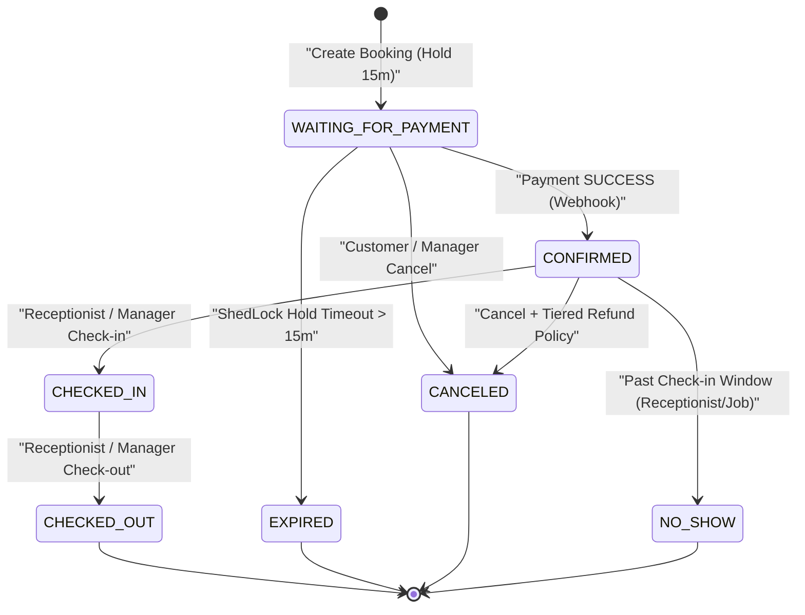
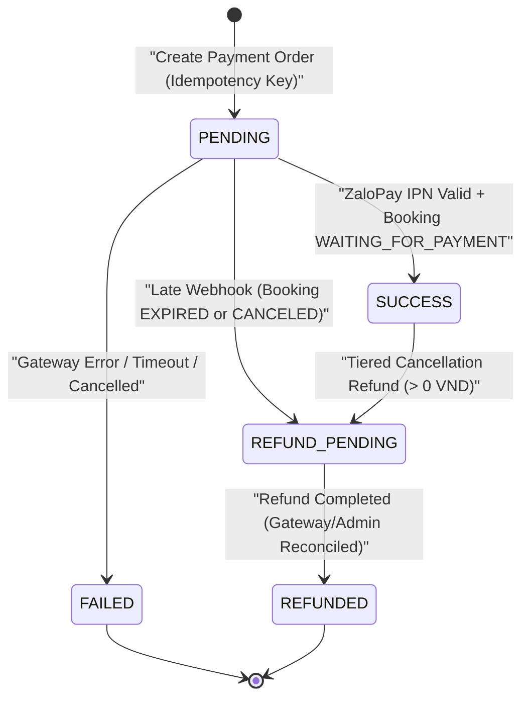
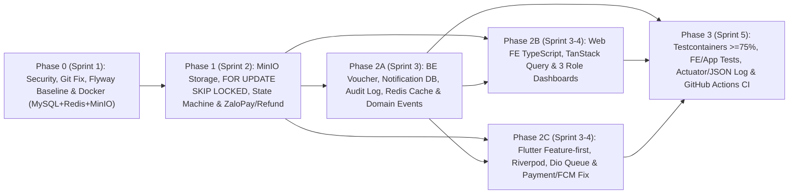

# KẾ HOẠCH TRIỂN KHAI SỬA LỖI & NÂNG CẤP HỆ THỐNG (UPGRADE & IMPLEMENTATION ROADMAP)

## DỰ ÁN: HỆ THỐNG ĐẶT PHÒNG KHÁCH SẠN TRỰC TUYẾN — HOTEL BOOKING PLATFORM (v1.0 → v2.0)

| Thuộc tính | Nội dung |
| :--- | :--- |
| **Tên dự án (Project Name)** | Hotel Booking Platform (`hotel-booking-be`, `hotel-booking-fe`, `hotel-booking-app`) |
| **Tài liệu (Document)** | Kế hoạch Triển khai Sửa lỗi & Nâng cấp (Upgrade & Implementation Roadmap) |
| **Phiên bản (Version)** | `2.0` (Chuẩn Sản phẩm CV — Production-Ready) |
| **Người biên soạn (Author)** | Solution Architect / Upgrade Roadmap Writer |
| **Ngày lập (Date)** | 22/11/2026 |
| **Tài liệu tham chiếu (Related Docs)** | `BA/01-AUDIT-REPORT.md` (Báo cáo Kiểm toán Hiện trạng) · `BA/02-SRS-HOTEL-BOOKING.md` (Đặc tả Yêu cầu Phần mềm SRS v2.0) |

---

## Mục Lục (Table of Contents)

1. [1. Tổng quan Chiến lược Nâng cấp (Upgrade Strategy & Guiding Principles)](#1-tổng-quan-chiến-lược-nâng-cấp-upgrade-strategy--guiding-principles)
   - [1.1 Mục tiêu Chuyển đổi (v1.0 Demo → v2.0 Production-Ready)](#11-mục-tiêu-chuyển-đổi-v10-demo--v20-production-ready)
   - [1.2 Phạm vi Bàn giao & Phân vai 3 Lớp (In-Scope vs. Out-of-Scope)](#12-phạm-vi-bàn-giao--phân-vai-3-lớp-in-scope-vs-out-of-scope)
   - [1.3 Các Nguyên tắc Dẫn dắt Kiến trúc (Guiding Principles)](#13-các-nguyên-tắc-dẫn-dắt-kiến-trúc-guiding-principles)
   - [1.4 Quy ước Git Workflow & Chính sách Zero-Secret (Git Workflow & Zero-Secret Policy)](#14-quy-ước-git-workflow--chính-sách-zero-secret-git-workflow--zero-secret-policy)
2. [2. Hợp đồng API & Dữ liệu Thống nhất v2.0 (Unified Cross-Layer API & Data Contract)](#2-hợp-đồng-api--dữ-liệu-thống-nhất-v20-unified-cross-layer-api--data-contract)
   - [2.1 Chuẩn URL Versioning, Response Envelope, Pagination & Error Mapping](#21-chuẩn-url-versioning-response-envelope-pagination--error-mapping)
   - [2.2 Hợp đồng Object Storage với MinIO (MinIO S3-Compatible Storage Contract)](#22-hợp-đồng-object-storage-với-minio-minio-s3-compatible-storage-contract)
   - [2.3 Hợp đồng Xác thực, Phiên & Token (Auth, Session & Token Contract)](#23-hợp-đồng-xác-thực-phiên--token-auth-session--token-contract)
   - [2.4 Hợp đồng Nghiệp vụ Lõi (Core Domain Contracts: Money, State Machines & Refund)](#24-hợp-đồng-nghiệp-vụ-lõi-core-domain-contracts-money-state-machines--refund)
   - [2.5 Bảng Đối chiếu & Sửa Lệch Endpoints (FE 4 Endpoints & Mobile App Endpoints)](#25-bảng-đối-chiếu--sửa-lệch-endpoints-fe-4-endpoints--mobile-app-endpoints)
3. [3. Kế hoạch Triển khai Theo Giai đoạn (Phased Implementation Roadmap: P0 → P1 → P2 → P3)](#3-kế-hoạch-triển-khai-theo-giai-đoạn-phased-implementation-roadmap-p0--p1--p2--p3)
   - [3.1 Tổng quan Lộ trình & Sơ đồ Phụ thuộc (Roadmap Dependency Flow)](#31-tổng-quan-lộ-trình--sơ-đồ-phụ-thuộc-roadmap-dependency-flow)
   - [3.2 Phase 0 (P0 — Khẩn cấp / Security & Build Blockers — Sprint 1)](#32-phase-0-p0--khẩn-cấp--security--build-blockers--sprint-1)
   - [3.3 Phase 1 (P1 — Core Transaction, Anti-Overbooking, MinIO & Payment/Refund — Sprint 2)](#33-phase-1-p1--core-transaction-anti-overbooking-minio--paymentrefund--sprint-2)
   - [3.4 Phase 2 (P2 — High-Impact CV Features & Client Modernization — Sprint 3 & Sprint 4)](#34-phase-2-p2--high-impact-cv-features--client-modernization--sprint-3--sprint-4)
   - [3.5 Phase 3 (P3 — Testing, Observability & DevOps Production-Ready — Sprint 5)](#35-phase-3-p3--testing-observability--devops-production-ready--sprint-5)
4. [4. Chiến lược Migration CSDL (Flyway) & Chiến lược Kiểm thử (Test Pyramid & Concurrency Verification)](#4-chiến-lược-migration-csdl-flyway--chiến-lược-kiểm-thử-test-pyramid--concurrency-verification)
   - [4.1 Lộ trình Flyway Database Migrations (V1 → V5)](#41-lộ-trình-flyway-database-migrations-v1--v5)
   - [4.2 Chiến lược Kiểm thử & Kịch bản Xác minh Concurrency / Late Webhook](#42-chiến-lược-kiểm-thử--kịch-bản-xác-minh-concurrency--late-webhook)
5. [5. Điểm nhấn Đưa vào CV & Gợi ý Trả lời Phỏng vấn Kỹ thuật (CV Bullet Points & Interview Talking Points)](#5-điểm-nhấn-đưa-vào-cv--gợi-ý-trả-lời-phỏng-vấn-kỹ-thuật-cv-bullet-points--interview-talking-points)
   - [5.1 Gạch đầu dòng chuẩn STAR/XYZ sẵn sàng dán vào CV](#51-gạch-đầu-dòng-chuẩn-starxyz-sẵn-sàng-dán-vào-cv)
   - [5.2 Bộ 5 Câu hỏi Phỏng vấn Kỹ thuật Sâu & Gợi ý Trả lời (Technical Deep-Dive Q&A)](#52-bộ-5-câu-hỏi-phỏng-vấn-kỹ-thuật-sâu--gợi-ý-trả-lời-technical-deep-dive-qa)

---

## 1. Tổng quan Chiến lược Nâng cấp (Upgrade Strategy & Guiding Principles)

### 1.1 Mục tiêu Chuyển đổi (v1.0 Demo → v2.0 Production-Ready)

Tài liệu này là bản kế hoạch kỹ thuật thực thi (Execution Blueprint) nhằm chuyển đổi dự án **Hotel Booking** từ phiên bản đồ án môn học v1.0 (tồn tại nhiều lỗ hổng bảo mật nghiêm trọng, lệch hợp đồng API giữa 3 lớp, lỗi đặt trùng phòng do tranh chấp đồng thời, test giả lập và nhánh Web hỏng build) thành **sản phẩm hoàn chỉnh chuẩn CV v2.0 (Production-Ready Engineering Portfolio)**.

| Trụ cột Nâng cấp | Hiện trạng v1.0 (As-Is Demo) | Đích đến v2.0 (To-Be Production-Ready) |
| :--- | :--- | :--- |
| **Kiến trúc Backend (`hotel-booking-be`)** | Layered Monolith ghép chặt; gửi Mail/FCM đồng bộ trong `@Transactional`; Redis chỉ lưu 1 Refresh Token & OTP. | **Modular Monolith** phân ranh giới theo Bounded Context + **Spring Internal Domain Events (`@TransactionalEventListener` + `@Async`)** + **Redis 7** (Caching, Rate Limiting, Multi-device Token & Blacklist). |
| **Lưu trữ Đối tượng (Object Storage)** | Phụ thuộc Cloudinary v1.0 (lộ secret trên Git), lưu lẫn lộn tên file `avt.png` với URL đầy đủ; App vẫn gọi `/file-upload/image` đã bị xóa → gãy ảnh trên 8/9 màn hình. | Chuyển hoàn toàn sang **MinIO (S3-compatible Object Storage)** tự chủ trên Docker Compose sau giao diện `StorageService`; lưu `objectKey` trong DB, tự động resolve full URL thống nhất BE ↔ Web ↔ App, dọn rác an toàn sau 24 giờ. |
| **Quản trị CSDL (Database & Migration)** | Hibernate `ddl-auto=update` (kể cả trên `prod`), thiếu `UNIQUE` constraints & indexes, tiền tệ dùng `Double`, N+1 queries. | **Flyway Migrations (`V1` → `V5`)** kèm `ddl-auto=validate` ở staging/prod; chuẩn hóa `BigDecimal` + `discountPercent`; diệt N+1 bằng `FetchType.LAZY` + `@EntityGraph`/DTO projection. |
| **Giao dịch & Chống Overbooking** | Lỗi TOCTOU + False `409` với `@Version`; đảo ngược giờ Check-in/out (`12:00`/`14:00`); giữ phòng 3 phút; Late Webhook gây double booking. | **Pessimistic Lock (`SELECT ... FOR UPDATE SKIP LOCKED`)** + DB Transaction re-verify; chuẩn `14:00`/`12:00`; giữ phòng **15 phút** + **ShedLock**; Booking & Payment State Machine nghiêm ngặt; **Tiered Refund** & **ZaloPay Idempotency / Late Webhook Protection**. |
| **Web Management Portal (`hotel-booking-fe`)** | Nhánh `master` hỏng biên dịch; JS thuần trên `origin/feat/login-ui`; 4 endpoint lệch BE; chỉ có `ROLE_HOST`; nút Booking chết; 0% test. | **TypeScript (strict)** + **TanStack Query v5** + **React Hook Form + Zod** + `HttpOnly` Cookie Refresh Queue; 3 Dashboard tách quyền **`ADMIN` + `HOST/MANAGER` + `RECEPTIONIST`**; Vitest + Playwright. |
| **Mobile App (`hotel-booking-app`)** | `StatefulWidget` + raw `Dio()` rải rác; hardcode ngrok & API keys; lưu JWT plaintext trong `SharedPreferences`; bug thanh toán & ResetPassword; 0% test. | **Feature-first Architecture** + **Riverpod (hoặc Bloc)** + **`Dio` Singleton (QueuedInterceptor)** + **`flutter_secure_storage`** + env `--dart-define`; đồng bộ ảnh MinIO, pagination 0-based, Voucher, Deep Link + polling thanh toán, FCM foreground + Notification Center. |
| **Kiểm thử, Giám sát & DevOps** | Test concurrency dùng Mockito `AtomicInteger`, MockMvc standalone bỏ qua Security; Docker crash thiếu Firebase JSON; không CI/CD. | **Testcontainers (MySQL 8 + Redis 7 + MinIO)** đạt BE Coverage **$\ge 75\%$** (chứng minh 20–50 threads concurrency thật); **Spring Boot Actuator** + **JSON Structured Logging (`Trace ID`)**; **Docker Compose** đầy đủ + **GitHub Actions CI**. |

### 1.2 Phạm vi Bàn giao & Phân vai 3 Lớp (In-Scope vs. Out-of-Scope)

- **Phạm vi Triển khai v2.0 (In-Scope)**:
  1. **Backend (`hotel-booking-be`)**: Toàn bộ phân hệ IAM/Auth, User/Profile, Accommodation/RoomType/Room & Media **MinIO**, Search/Discovery/Favorites, Booking & Anti-Overbooking, Payment/Refund & ZaloPay Strategy Adapter, Voucher/Promotion, Review/Rating, Notification History (DB + FCM) và Immutable Audit Log.
  2. **Web Management Portal (`hotel-booking-fe`)**: Ứng dụng quản trị đa vai trò gồm 3 không gian làm việc tách biệt:
     - **`ROLE_ADMIN`**: Duyệt/khóa Cơ sở lưu trú (Accommodation), quản lý tài khoản User/Host, quản lý Voucher toàn sàn, theo dõi Immutable Audit Logs & cảnh báo hoàn tiền.
     - **`ROLE_HOST` / `ROLE_MANAGER`**: Dashboard KPI & doanh thu, CRUD Cơ sở lưu trú/Loại phòng/Phòng vật lý, quản lý nhân sự lễ tân (`ROLE_RECEPTIONIST`), quản lý Voucher theo cơ sở, xem đánh giá & xử lý hoàn tiền.
     - **`ROLE_RECEPTIONIST`**: Bảng điều phối vận hành trong ngày — xem lịch đặt phòng của cơ sở được gán (`status == ACTIVE`), thao tác Check-in (quét/nhập mã QR), Check-out, đánh dấu `NO_SHOW`; **bị chặn tuyệt đối** quyền sửa giá, xóa phòng, quản lý nhân sự và xem báo cáo doanh thu.
  3. **Mobile App (`hotel-booking-app`)**: Ứng dụng khách hàng 100% dành cho vai trò **`ROLE_CUSTOMER`** (Khám phá, tìm kiếm đa tiêu chí, bản đồ, yêu thích, đặt phòng áp Voucher, thanh toán ZaloPay, hủy phòng theo chính sách hoàn tiền, mã QR Check-in offline, đánh giá và hộp thư thông báo).
- **Ngoài phạm vi v2.0 (Out-of-Scope — Dành cho Phase mở rộng sau v2.0)**:
  - Giao diện đặt phòng cho Khách lẻ (Guest Web Booking) trên Web Portal.
  - Đặt nhiều phòng trong cùng một đơn hàng (Multi-room Booking).
  - Định giá động theo mùa/cuối tuần (Dynamic / Seasonal Pricing).
  - Tích hợp thực tế thêm cổng VNPay / Stripe (v2.0 giữ **ZaloPay Sandbox** nhưng đóng gói sau **Payment Strategy/Adapter Pattern** để sẵn sàng cắm thêm cổng mới không sửa nghiệp vụ lõi).

### 1.3 Các Nguyên tắc Dẫn dắt Kiến trúc (Guiding Principles)

1. **Bảo mật Mặc định (Security-by-Default)**: Mọi lỗ hổng ở Phase 0 (rò rỉ secret, Account Takeover OAuth/OTP, IDOR, lỗ hổng RBAC) phải được đóng hoàn toàn trước khi xây dựng tính năng mới. Backend không bao giờ tin tưởng dữ liệu tính toán tiền, `userId`, hay trạng thái từ phía Client.
2. **Backend là Nguồn Chân lý Duy nhất (Single Source of Truth)**: Toàn bộ logic tính giá (`BigDecimal`), áp dụng `discountPercent`/`Voucher`, kiểm tra phòng trống (`14:00`/`12:00`), chuyển trạng thái State Machine và tạo public URL ảnh từ `objectKey` **MinIO** đều được xử lý tập trung tại Backend. Web FE và Mobile App chỉ hiển thị dữ liệu chuẩn hóa.
3. **Khóa Hợp đồng trước khi Code song song (Contract-First Development)**: Hợp đồng API `/api/v1` (Mục 2) được chốt trước Sprint 1 và sinh tài liệu OpenAPI 3 tự động để team BE, Web FE và Mobile App phát triển song song mà không tái diễn tình trạng lệch path/method/payload.
4. **Hạ tầng Tự chủ, Chạy được 1 Lệnh (Self-Contained Local & CI Stack)**: Thay thế hoàn toàn dịch vụ bên thứ ba dễ lộ khóa như Cloudinary bằng **MinIO** trên Docker Compose. Bất kỳ lập trình viên hoặc nhà tuyển dụng nào đều có thể khởi chạy toàn bộ MySQL + Redis + MinIO + Backend bằng `docker compose up` với `.env` mẫu.
5. **Kiểm chứng Bằng Chứng Thực tế (Evidence-Based Verification)**: Mọi cam kết về chống overbooking, idempotency và bảo mật đều phải có bài test tự động chạy trên container thật (**Testcontainers**) trong CI — loại bỏ hoàn toàn các bài test giả lập bằng Mockito cho lớp Concurrency và standalone MockMvc bỏ qua Security.

### 1.4 Quy ước Git Workflow & Chính sách Zero-Secret (Git Workflow & Zero-Secret Policy)

#### A. Quy ước Nhánh, Commit & Pull Request (Git Workflow)
- **Cấu trúc Nhánh (Trunk-Based / Simplified GitFlow)**:
  - `main`: Nhánh sản phẩm luôn biên dịch sạch, vượt qua 100% CI checks (khóa push trực tiếp — bắt buộc qua Pull Request).
  - `develop`: Nhánh tích hợp các task của từng Sprint (hoặc merge trực tiếp vào `main` theo từng Phase tag `v2.0.0-p0` → `v2.0.0`).
  - Nhánh tính năng/sửa lỗi: `fix/<task-id>-<short-desc>`, `feat/<task-id>-<short-desc>`, `refactor/<task-id>-<short-desc>`, `chore/<task-id>-<short-desc>` (VD: `fix/P0-03-oauth-idtoken-verify`, `feat/P1-01-minio-storage`).
- **Quy ước Commit (Conventional Commits)**:
  - Định dạng: `<type>(<scope>): <subject>` với `scope` thuộc `be | fe | app | infra | db | docs`.
  - Ví dụ: `feat(be): implement pessimistic lock skip locked for room booking`, `fix(fe): align 4 mismatched endpoints and fix totalElements pagination`.
- **Cổng Kiểm duyệt Pull Request (PR Quality Gate)**:
  - Không có cảnh báo rò rỉ secret từ `gitleaks`.
  - Vượt qua toàn bộ CI checks của thành phần tương ứng (BE: Maven test + Testcontainers + JaCoCo $\ge 75\%$; FE: `tsc --noEmit` + ESLint + Vitest + Vite build; App: `flutter analyze` + `flutter test`).
  - Không chứa `System.out.println`, `print(...)` chứa JWT/PII, hay `TODO` bỏ dở ở luồng lõi.

#### B. Chính sách Zero-Secret & Quy trình Thu hồi Khóa Cũ (Zero-Secret Policy & Credential Rotation)
> [!CAUTION]
> Các tệp v1.0 đã commit trực tiếp khóa thật lên lịch sử Git gồm: `docker-compose.yml` và `.env.example` (lộ Gmail App Password `yghir***`, Cloudinary `api_secret`, fallback `JWT_SECRET_KEY`), `android/app/src/main/AndroidManifest.xml` (lộ Google Maps API Key), `lib/firebase_options.dart` & `android/app/google-services.json`, cùng `.env.development` trên FE và URL ngrok cứng ở 3 file Flutter.

**Quy trình Xử lý Bắt buộc trong 24 giờ đầu Phase 0**:
1. **Xoay vòng & Thu hồi Ngay lập tức (Immediate Revocation & Rotation)**:
   - Thu hồi (Revoke) Gmail App Password cũ và tạo App Password mới chỉ lưu trong `.env` cục bộ / GitHub Secrets.
   - Xóa tài khoản/API key Cloudinary cũ (không còn sử dụng trong v2.0 sau khi chuyển sang MinIO).
   - Tạo mới `JWT_SECRET_KEY` chuẩn HS256/HS512 ngẫu nhiên độ dài $\ge 256\text{-bit}$ Base64.
   - Giới hạn (Restrict) hoặc xoay vòng Google Maps API Key theo SHA-1 Fingerprint + Package Name (`Android`) và Bundle ID (`iOS`), tiêm qua `local.properties` / `--dart-define`.
   - Kiểm tra & thu hồi Firebase Service Account Private Key nếu từng bị lộ; tuyệt đối giữ ngoài Git và chỉ mount vào Docker qua volume read-only (`./secrets/firebase-sa.json:/app/secrets/firebase-sa.json:ro`).
2. **Làm sạch Lịch sử Git (Git History Purge)**:
   - Dùng `git filter-repo` (hoặc BFG Repo-Cleaner) xóa sạch toàn bộ chuỗi secret/file nhạy cảm khỏi toàn bộ lịch sử commit của 3 repo, sau đó chạy `gitleaks detect --source . --verbose` xác nhận **0 findings**.
3. **Ngăn chặn Tái diễn (Preventive Controls)**:
   - Cập nhật `.gitignore` chặn tuyệt đối `.env`, `.env.*` (trừ `.env.example` chỉ chứa placeholder `<CHANGE_ME>`), `*.json` chứa service account, `*.jks`/`*.keystore`, `local.properties`.
   - Bật bước `gitleaks-action` trong GitHub Actions CI cho mọi Pull Request.

---

## 2. Hợp đồng API & Dữ liệu Thống nhất v2.0 (Unified Cross-Layer API & Data Contract)

Tất cả 3 lớp (`hotel-booking-be`, `hotel-booking-fe`, `hotel-booking-app`) bắt buộc tuân thủ bộ Hợp đồng v2.0 dưới đây. Mọi điểm lệch tồn tại ở v1.0 bị loại bỏ hoàn toàn.

### 2.1 Chuẩn URL Versioning, Response Envelope, Pagination & Error Mapping

#### A. URL Versioning & OpenAPI
- Mọi endpoint v2.0 sử dụng tiền tố chuẩn **`/api/v1/...`** (ví dụ: `/api/v1/auth/login`, `/api/v1/accommodations`, `/api/v1/bookings`, `/api/v1/files/upload`).
- Tài liệu hóa đầy đủ bằng **OpenAPI 3 (Swagger UI)** tại `/swagger-ui.html` ở môi trường `DEV`/`STAGING` và **bắt buộc tắt** (`springdoc.swagger-ui.enabled=false`) ở môi trường `PROD`.
- Chuẩn hóa đường dẫn tài nguyên RESTful: danh từ số nhiều, viết thường nối gạch ngang (`kebab-case`), **không** thêm hậu tố `/page` hay `/cdn`.

#### B. Chuẩn Bao thư Phản hồi Thành công (`ApiResponse<T>`)
Thay thế `ApiResponse` thiếu `code`/`traceId` của v1.0 bằng cấu trúc thống nhất:

```json
{
  "success": true,
  "code": "SUCCESS",
  "message": "Lấy thông tin đặt phòng thành công",
  "data": { },
  "traceId": "9f8c2a1b4e7d6c5a",
  "timestamp": "2026-11-22T09:30:00Z"
}
```

#### C. Chuẩn Phân trang Thống nhất (`PagedResponse<T>`) — 0-Based Page
Giải quyết triệt để mâu thuẫn 3 lớp v1.0 (BE trả `List<T>`, FE đọc `PagedModel` + sai `totalPages`, App gửi `page=1` & `pageSize`):
- **Query Parameters chuẩn**: `?page=0&size=10&sort=createdAt,desc`
  - `page`: Số nguyên **0-based** (`page >= 0`, mặc định `0`).
  - `size`: Số bản ghi mỗi trang (`1 <= size <= 50`, mặc định `DEFAULT_PAGE_SIZE = 10`, giới hạn trần theo cấu hình `MAX_PAGE_SIZE = 50` để chống DoS OOM).
- **JSON Payload bên trong trường `data`**:

```json
{
  "success": true,
  "code": "SUCCESS",
  "message": "Thành công",
  "data": {
    "content": [ ],
    "page": 0,
    "size": 10,
    "totalElements": 54,
    "totalPages": 6,
    "hasNext": true
  },
  "traceId": "9f8c2a1b4e7d6c5a",
  "timestamp": "2026-11-22T09:30:00Z"
}
```

> [!IMPORTANT]
> - **Web FE (`AntD Table`)**: Bắt buộc truyền `pagination={{ current: data.page + 1, pageSize: data.size, total: data.totalElements }}` (tuyệt đối không dùng `totalPages` như lỗi cũ ở `BookingTable.jsx` và `RoomTypeTable.jsx`), đồng thời gửi `page = current - 1` lên BE và reset `page = 0` khi đổi khách sạn hoặc đổi bộ lọc.
> - **Mobile App (`Flutter`)**: Bắt buộc khởi tạo `page = 0`, gửi tham số `size` (xóa bỏ `pageSize` ở `FilterHotelScreen`), kiểm tra điều kiện tải thêm bằng cờ `data.hasNext` (khắc phục lỗi cuộn cuối trang spam API ở `ReviewDetailScreen`).

#### D. Chuẩn Bao thư Phản hồi Lỗi (`ErrorResponse`) & Bảng Ánh xạ HTTP Status

```json
{
  "success": false,
  "code": "VALIDATION_ERROR",
  "message": "Dữ liệu đầu vào không hợp lệ",
  "errors": [
    {
      "field": "discountPercent",
      "rejectedValue": 200000,
      "reason": "Phần trăm giảm giá phải nằm trong khoảng từ 0 đến 100"
    }
  ],
  "traceId": "9f8c2a1b4e7d6c5a",
  "timestamp": "2026-11-22T09:30:00Z"
}
```

| HTTP Status | Mã lỗi chuẩn (`code`) | Ngữ cảnh áp dụng | Quy ước xử lý trên Client (FE & App) |
| :---: | :--- | :--- | :--- |
| **`200 OK`** | `SUCCESS` | Đọc dữ liệu (`GET`), cập nhật (`PUT`/`PATCH`), đăng nhập, đăng xuất. | Kiểm tra `statusCode >= 200 && statusCode < 300` (bỏ hardcode `== 200`). |
| **`201 Created`** | `CREATED` | Tạo tài nguyên mới (`POST /auth/register`, `POST /bookings`, `POST /accommodations`, `POST /room-types`, `POST /vouchers`, `POST /reviews`, `POST /files/upload`). | Client xử lý thành công ngang `200`, điều hướng/refresh cache tương ứng. |
| **`400 Bad Request`** | `VALIDATION_ERROR`, `MALFORMED_REQUEST`, `INVALID_FILE_FORMAT` | Sai kiểu dữ liệu, vi phạm Bean Validation (`@Valid`), sai MIME/magic bytes file tải lên. | Hiển thị lỗi chi tiết theo từng `errors[].field` ngay dưới ô nhập liệu. |
| **`401 Unauthorized`** | `UNAUTHORIZED`, `TOKEN_EXPIRED`, `TOKEN_REVOKED`, `INVALID_CREDENTIALS` | Thiếu JWT, JWT hết hạn/nằm trong Blacklist, sai thông tin đăng nhập, Firebase ID Token không hợp lệ. | Nếu `TOKEN_EXPIRED` → Interceptor tự gọi `/api/v1/auth/refresh-token` (1 lần duy nhất trong queue); nếu thất bại → xóa session và đẩy về `/login`. |
| **`403 Forbidden`** | `ACCESS_DENIED`, `ACCOUNT_LOCKED`, `STAFF_INACTIVE` | Thiếu quyền RBAC (`@PreAuthorize`), vượt phạm vi sở hữu (IDOR), nhân viên `AccommodationStaff.status == INACTIVE`, tài khoản bị khóa. | Hiển thị trang/thông báo `403 Không có quyền truy cập` (không đăng xuất nhầm trừ khi `ACCOUNT_LOCKED`). |
| **`404 Not Found`** | `RESOURCE_NOT_FOUND` | Không tìm thấy ID tài nguyên hoặc tài nguyên đã bị Soft Delete. | Hiển thị trạng thái không tìm thấy / quay lại danh sách. |
| **`409 Conflict`** | `ROOM_NOT_AVAILABLE`, `INVALID_STATE_TRANSITION`, `DUPLICATE_RESOURCE`, `VOUCHER_EXHAUSTED`, `DELETE_CONFLICT_LINKED_DATA` | Tranh chấp hết phòng khi đặt đồng thời, chuyển trạng thái Booking/Payment trái luật (bao gồm yêu cầu hủy đơn ở trạng thái `CHECKED_IN`/`CHECKED_OUT`/`EXPIRED`/`NO_SHOW`/`CANCELED`), trùng email/review/mã voucher, xóa bản ghi đang có booking liên kết. | Hiển thị thông báo nghiệp vụ rõ ràng (từ `message`) để người dùng chọn phòng/hành động khác; **không** hardcode 1 câu lỗi chung chung. |
| **`422 Unprocessable Entity`** | `BUSINESS_RULE_VIOLATION`, `VOUCHER_NOT_ELIGIBLE` | Dữ liệu đúng định dạng nhưng vi phạm luật nghiệp vụ (ngày `checkOutDate <= checkInDate`, số đêm ngoài giới hạn, giá trị đơn thấp hơn `minOrderValue` của voucher). | Hiển thị cảnh báo nghiệp vụ chi tiết theo `message`. |
| **`429 Too Many Requests`** | `RATE_LIMIT_EXCEEDED` | Vượt ngưỡng Redis Rate Limit cho `/auth/login`, `/auth/send-otp`, `/auth/verify-otp`, hoặc spam API. | Đọc header `Retry-After` (giây), khóa nút bấm tạm thời và hiển thị đếm ngược. |
| **`500 Internal Server Error`** | `INTERNAL_SERVER_ERROR` | Lỗi hệ thống không mong muốn (CSDL/MinIO/Upstream lỗi). **Tuyệt đối không trả `ex.getMessage()` hay stack trace ra client.** | Hiển thị thông báo lỗi chung kèm mã `traceId` để người dùng báo hỗ trợ kỹ thuật. |

---

### 2.2 Hợp đồng Object Storage với MinIO (MinIO S3-Compatible Storage Contract)

Trong phiên bản v2.0, toàn bộ dịch vụ Cloudinary và cơ chế phục vụ ảnh tĩnh `/api/images/**` từ `src/main/resources/static/images/` được **gỡ bỏ hoàn toàn** và thay thế bằng **MinIO (S3-compatible Object Storage)** vận hành qua Docker Compose.

#### A. Thiết kế Abstraction (`StorageService` Interface)
- Backend định nghĩa interface độc lập hạ tầng `com.example.hotelbooking.media.StorageService` với các phương thức:
  - `UploadResult upload(MultipartFile file, StorageBucket bucket, String folderPrefix)`
  - `void deleteObject(String objectKey)`
  - `String resolvePublicUrl(String objectKey)`
  - `boolean objectExists(String objectKey)`
- Bản cài đặt mặc định v2.0 là `MinioStorageServiceImpl` sử dụng `io.minio:minio` SDK (hoặc AWS SDK S3 v2 tương thích S3), cho phép chuyển sang AWS S3 / Cloudflare R2 trên production chỉ bằng cách đổi biến môi trường (`STORAGE_ENDPOINT`, `STORAGE_ACCESS_KEY`, `STORAGE_SECRET_KEY`).

#### B. Cấu trúc Bucket & Chính sách Truy cập (Bucket Layout)

Hệ thống tổ chức lưu trữ trên MinIO theo đúng **3 bucket chuẩn** (`hotel-avatars`, `hotel-accommodations`, `hotel-public`) cấu hình qua 3 biến môi trường độc lập, hoàn toàn ẩn sau `StorageService`:

| Tên Bucket (Bucket Name) | Biến cấu hình (Config Key) | Quyền đọc Public | Mục đích lưu trữ & Cấu trúc `objectKey` |
| :--- | :--- | :---: | :--- |
| **`hotel-avatars`** | `MINIO_BUCKET_AVATARS` | `public-read` | Ảnh đại diện người dùng: `hotel-avatars/users/{yyyy}/{MM}/{uuid}.{ext}` và ảnh mặc định được seed sẵn khi khởi động: `hotel-avatars/defaults/default-avatar.png`. |
| **`hotel-accommodations`** | `MINIO_BUCKET_ACCOMMODATIONS` | `public-read` | Ảnh bìa cơ sở lưu trú (`hotel-accommodations/covers/{yyyy}/{MM}/{uuid}.{ext}`) và ảnh chính/gallery loại phòng (`hotel-accommodations/rooms/{yyyy}/{MM}/{uuid}.{ext}`). |
| **`hotel-public`** | `MINIO_BUCKET_PUBLIC` | `public-read` | Tài nguyên công khai dùng chung (ảnh banner khuyến mãi, voucher, icon địa điểm): `hotel-public/assets/{yyyy}/{MM}/{uuid}.{ext}`. |

> [!NOTE]
> Container khởi tạo `minio-init` (sử dụng `minio/mc`) trong `docker-compose.yml` sẽ tự động tạo đủ 3 bucket (`hotel-avatars`, `hotel-accommodations`, `hotel-public`), thiết lập policy `download` (chỉ đọc công khai — cấm list bucket, cấm anonymous write) và upload sẵn file `hotel-avatars/defaults/default-avatar.png`.

#### C. Chuẩn Upload API & Response Contract
- **Endpoint tải đơn ảnh**: `POST /api/v1/files/upload` (`multipart/form-data`: `file`, `bucket` ∈ `{AVATAR, ACCOMMODATION, PUBLIC}`) → Trả `201 Created`.
- **Endpoint tải nhiều ảnh**: `POST /api/v1/files/upload/multiple` (`multipart/form-data`: `files[]`, `bucket`, tối đa theo `MAX_ROOM_TYPE_PREVIEW_IMAGES = 8`) → Trả `201 Created`.
- **Kiểm duyệt Bảo mật File (Mandatory Validation)**:
  - Giới hạn kích thước tối đa `MAX_IMAGE_FILE_SIZE_MB = 5` (5 MB/ảnh).
  - Chỉ chấp nhận định dạng ảnh hợp lệ (`ALLOWED_IMAGE_MIME_TYPES = image/jpeg,image/png,image/webp`); kiểm tra đồng thời **extension + Content-Type + Magic Bytes** (dùng Apache Tika hoặc kiểm tra header byte thực tế — chặn tuyệt đối `.svg` chứa XSS, `.html`, `.exe`, `.jsp`).
  - Đổi tên tệp hoàn toàn sang UUID ngẫu nhiên (không giữ tên gốc từ client để tránh Path Traversal).
- **JSON Response chuẩn (`data`)**:

```json
{
  "objectKey": "hotel-accommodations/rooms/2026/11/550e8400-e29b-41d4-a716-446655440000.webp",
  "url": "http://localhost:9000/hotel-accommodations/rooms/2026/11/550e8400-e29b-41d4-a716-446655440000.webp",
  "contentType": "image/webp",
  "size": 184320
}
```

#### D. Quy tắc Lưu DB, Render URL Thống nhất & Dọn Orphan Object An toàn
1. **Lưu `objectKey` trong Database (Bất biến với Domain/IP)**:
   - Các bảng `users.avatar_key`, `accommodations.cover_image_key`, `room_types.cover_image_key`, `room_type_images.object_key` **chỉ lưu `objectKey`** (VD: `hotel-avatars/users/2026/11/<uuid>.webp`).
   - Khi đăng ký tài khoản mới (`register` / `oauth`), mặc định gán `avatar_key = "hotel-avatars/defaults/default-avatar.png"` (xóa bỏ chuỗi `"avt.png"` lỗi thời).
   - Khi client gửi request `PUT /api/v1/users/me` hoặc `PUT /api/v1/room-types/{id}`: client gửi `objectKey` (nhận được từ `/api/v1/files/upload`); nếu không đổi ảnh thì giữ nguyên `objectKey` cũ hoặc bỏ qua trường (BE không bao giờ tự ghi đè thành `null` làm mất ảnh cũ).
2. **Backend Resolve Full Public URL cho Mọi Client**:
   - Mọi Response DTO trả về cho cả Web FE và Mobile App đều chứa sẵn cặp trường (hoặc URL đã resolve): `avatarUrl` / `imageUrl` / `imagesPreview[]` dạng **full URL hợp lệ** được ghép từ `${MINIO_PUBLIC_URL}/{objectKey}` (nếu `avatar_key` null/rỗng tự fallback về `${MINIO_PUBLIC_URL}/hotel-avatars/defaults/default-avatar.png`).
   - Web FE (`<Image src={...} />`) và Mobile App (`CachedNetworkImage(imageUrl: ...)`) **chỉ hiển thị trực tiếp URL từ BE**, xóa bỏ 100% logic nối `${baseUrl}images/...` trên Flutter.
3. **Chiến lược Dọn dẹp Orphan Object An toàn (Safe 24h Orphan Cleanup)**:
   - Mọi file mới tải lên qua `/api/v1/files/upload` được ghi vào bảng `media_assets` với trạng thái `TEMPORARY` (`created_at = now`).
   - Ngay trong cùng DB Transaction khi Entity (`Users`, `Accommodations`, `RoomTypes`) lưu thành công:
     - Object mới được cập nhật trạng thái `TEMPORARY` → `ATTACHED` (cập nhật `ref_entity_type`, `ref_entity_id`).
     - Object cũ bị thay thế (trừ `hotel-avatars/defaults/default-avatar.png`) được chuyển sang `PENDING_DELETE` (`orphaned_at = now`), **KHÔNG xóa vật lý ngay giữa request** để tránh lỗi transaction rollback mất ảnh.
   - Tác vụ nền `OrphanMediaCleanupJob` (bọc **ShedLock**, chạy định kỳ mỗi 1 giờ) chỉ xóa vật lý object trên MinIO thỏa đồng thời **cả 3 điều kiện**:
     1. Trạng thái là `TEMPORARY` có `created_at < now - ORPHAN_MEDIA_RETENTION_HOURS` **HOẶC** `PENDING_DELETE` có `orphaned_at < now - ORPHAN_MEDIA_RETENTION_HOURS` (`ORPHAN_MEDIA_RETENTION_HOURS = 24`).
     2. Không phải tài nguyên mặc định (`object_key NOT LIKE '%/defaults/%'`).
     3. Truy vấn kiểm tra ngược (Reference Check) xác nhận `object_key` **không còn xuất hiện ở bất kỳ bản ghi nào** trong `users`, `accommodations`, `room_types`, `room_type_images`.
   - Cơ chế này giải quyết triệt để đồng thời 2 lỗi nghiêm trọng ở v1.0: lỗi cron xóa nhầm ảnh bìa khách sạn sau 1 giờ (`BUG-BE-15`) và lỗi đảo hàm xóa ảnh làm crash `404` khi sửa loại phòng (`BUG-BE-11`).

---

### 2.3 Hợp đồng Xác thực, Phiên & Token (Auth, Session & Token Contract)

| Hạng mục | Quy chuẩn Hợp đồng v2.0 | Khắc phục Lỗ hổng v1.0 |
| :--- | :--- | :--- |
| **Đăng nhập & Đăng ký** | `POST /api/v1/auth/login` (`200 OK`) & `POST /api/v1/auth/register` (`201 Created`). Khóa tài khoản tạm thời (`LOGIN_LOCKOUT_MINUTES = 15`) khi sai mật khẩu quá ngưỡng (`MAX_LOGIN_ATTEMPTS = 5`); áp dụng giới hạn tốc độ (`AUTH_RATE_LIMIT_PER_MINUTE = 10`). | Chống brute-force mật khẩu; chuẩn hóa HTTP `201` cho tạo mới. |
| **OAuth (Google / Firebase)** | `POST /api/v1/auth/oauth` nhận `{ "provider": "GOOGLE", "idToken": "<Firebase JWT ID Token>", "deviceId": "..." }`. BE **bắt buộc** gọi `FirebaseAuth.getInstance().verifyIdToken(idToken, true)`. Nếu chữ ký không hợp lệ hoặc bị thu hồi → trả `401 Unauthorized` ngay lập tức. | Loại bỏ 100% lỗ hổng Account Takeover (`BUG-BE-02`, `BUG-APP-02`) do nhánh fallback đọc Base64 không verify chữ ký và sửa Flutter từ gửi `user.uid` sang gửi `await user.getIdToken()`. |
| **Access Token (JWT)** | Thời hạn **15 phút** (`ACCESS_TOKEN_EXPIRY_MINUTES = 15`), payload gồm `sub` (`userId`), `role`, `jti` (UUID duy nhất), `deviceId`, `iat`, `exp`. `JwtAuthFilter` kiểm tra chữ ký + **Redis Blacklist (`bl:{jti}`)** + trạng thái thực tế của User (`isActive == true && deletedAt == null`). | Chặn user bị khóa/xóa hoặc đã đăng xuất tiếp tục sử dụng Access Token còn hạn (`BUG-BE-13`). |
| **Multi-Device Refresh Token Rotation** | Thời hạn **7 ngày** (`REFRESH_TOKEN_EXPIRY_DAYS = 7`, tối đa `MAX_ACTIVE_SESSIONS_PER_USER = 5` phiên/tài khoản), lưu Redis theo khóa `rt:{userId}:{deviceId}` gồm `{ tokenHash, tokenFamily, issuedAt, userAgent }`. Mỗi lần gọi `POST /api/v1/auth/refresh-token`, token cũ bị vô hiệu hóa ngay và cấp cặp token mới (Rotation). Nếu phát hiện token cũ bị dùng lại (**Reuse Detection**) → thu hồi toàn bộ `tokenFamily` và bắt đăng nhập lại. | Hỗ trợ đăng nhập đa thiết bị (Web + Mobile cùng lúc không đá nhau) và chống đánh cắp Refresh Token. |
| **Cơ chế Lưu trữ Client** | - **Web FE (`X-Client-Platform: WEB`)**: Refresh Token cấp qua **`Set-Cookie`** với cờ `HttpOnly; Secure; SameSite=Lax; Path=/api/v1/auth`. Access Token lưu **in-memory** (không dùng `localStorage`/`sessionStorage`).<br>- **Mobile App (`X-Client-Platform: MOBILE`)**: Trả `accessToken` & `refreshToken` trong JSON body; App bắt buộc lưu trong **`flutter_secure_storage`** (tuyệt đối không dùng `SharedPreferences` và không `print` token ra log). | Giảm thiểu rủi ro XSS đánh cắp Refresh Token trên trình duyệt (`BUG-FE-11`) và bảo vệ token trên thiết bị di động (`BUG-APP-02`). |
| **Đăng xuất (Logout)** | `POST /api/v1/auth/logout` (đăng xuất thiết bị hiện tại) & `POST /api/v1/auth/logout-all` (thu hồi mọi phiên): Xóa key Redis `rt:{userId}:{deviceId}`, đưa `jti` hiện tại vào `bl:{jti}` (TTL = thời gian còn lại của Access Token), xóa Cookie trên Web và gỡ FCM device token tương ứng. | Chấm dứt tình trạng "Logout giả" chỉ xóa storage phía client ở cả FE (`BUG-FE-06`) và App (`BUG-APP-11`). |
| **OTP 6 số & Reset Password** | - `POST /api/v1/auth/send-otp` (JSON body `{ "email": "..." }`): Sinh **OTP 6 chữ số** (`OTP_LENGTH = 6`), TTL 5 phút (`OTP_TTL_MINUTES = 5`), thời gian chờ gửi lại `OTP_RESEND_COOLDOWN_SECONDS = 60`, áp dụng Redis Rate Limit (`AUTH_RATE_LIMIT_PER_MINUTE = 10`) và phát sự kiện `OtpRequested`.<br>- `POST /api/v1/auth/verify-otp` (JSON body `{ "email": "...", "otp": "123456" }`): Giới hạn tối đa **5 lần nhập sai** (`OTP_MAX_VERIFY_ATTEMPTS = 5`), vượt ngưỡng hủy OTP ngay; xác thực thành công trả `resetToken` ngắn hạn (TTL 5 phút, chỉ dùng 1 lần cho mục đích đổi mật khẩu — **không cấp full Access Token**).<br>- `POST /api/v1/auth/reset-password`: Bắt buộc nhận **JSON Body** `{ "resetToken": "...", "newPassword": "..." }` (validate độ mạnh mật khẩu `PASSWORD_MIN_LENGTH = 8`, có chữ hoa/thường/số). Cấm tuyệt đối truyền mật khẩu qua URL query string. Đổi mật khẩu thành công tự động thu hồi toàn bộ phiên đăng nhập cũ và phát sự kiện `PasswordResetCompleted`. | Đóng lỗ hổng brute-force OTP 4 số chiếm tài khoản `ROLE_ADMIN`/`ROLE_HOST` (`BUG-BE-03`) và lỗ hổng lộ `newPassword` trong access/proxy logs (`BUG-BE-13`, `BUG-APP-02`). |

---

### 2.4 Hợp đồng Nghiệp vụ Lõi (Core Domain Contracts: Money, State Machines & Refund)

#### A. Hợp đồng Tiền tệ, Giảm giá & Công thức Giá (BigDecimal Single Source of Truth)
- Kiểu dữ liệu trên Java/DB: `BigDecimal` / `DECIMAL(19, 2)` (đơn vị VNĐ, làm tròn `RoundingMode.HALF_UP`).
- `discountPercent`: Số nguyên hoặc thập phân từ `0` đến `100` (`@DecimalMin("0") @DecimalMax("100")`), đơn vị là **phần trăm (`%`)**. Tuyệt đối không dùng lẫn với số tiền VNĐ.
- Công thức tính giá chuẩn hóa tại Backend:
  $$\text{originalPrice} = \text{nightlyPrice} \times \text{nights}$$
  $$\text{roomDiscountAmount} = \text{round}\left(\text{originalPrice} \times \frac{\text{discountPercent}}{100}\right)$$
  $$\text{priceAfterRoomDiscount} = \text{originalPrice} - \text{roomDiscountAmount}$$
  $$\text{finalPrice} = \max\left(0,\; \text{priceAfterRoomDiscount} - \text{voucherDiscountAmount}\right)$$
- Toàn bộ 7 trường trên được lưu dạng **Snapshot bất biến** vào bảng `bookings` tại thời điểm đặt phòng và trả đầy đủ trong Response để Web FE & Mobile App hiển thị đồng nhất (không bị biến đổi nếu Host đổi giá phòng sau đó).

#### B. Hợp đồng Giờ Nhận/Trả phòng & Thời hạn Giữ phòng
- Giờ nhận phòng chuẩn: **`14:00`** (`STANDARD_CHECKIN_HOUR = 14:00`).
- Giờ trả phòng chuẩn: **`12:00`** (`STANDARD_CHECKOUT_HOUR = 12:00`).
- Điều kiện hợp lệ: `checkOutDate > checkInDate` (`MIN_BOOKING_NIGHTS = 1` đến `MAX_BOOKING_NIGHTS = 30`). Thời điểm lưu DB và thời điểm truy vấn trùng lịch (Overlap Query) **bắt buộc dùng chung** `checkInAt = checkInDate 14:00:00` và `checkOutAt = checkOutDate 12:00:00` (theo múi giờ `SYSTEM_TIMEZONE = Asia/Ho_Chi_Minh`) → khoảng đệm 2 giờ (`12:00–14:00`) giúp 2 khách đặt liên tiếp ngày `D1–D2` và `D2–D3` không bao giờ chồng lấn.
- Thời hạn giữ phòng chờ thanh toán: **`15 phút`** (`BOOKING_HOLD_TIMEOUT_MINUTES = 15`), lưu `expiredAt = createdAt + 15m`.

#### C. Máy Trạng thái Đặt phòng (Booking State Machine — 7 Trạng thái)
Thay thế trạng thái `PENDING` mơ hồ ở v1.0 bằng **`CONFIRMED`** và bổ sung **`EXPIRED`**, **`NO_SHOW`**:



- **Bất biến chuyển trạng thái**: Mọi yêu cầu chuyển trạng thái không có cung nối hợp lệ trong sơ đồ trên (ví dụ: `CANCELED` → `CHECKED_OUT`, `WAITING_FOR_PAYMENT` → `CHECKED_IN`, hoặc Customer hủy khi `CHECKED_IN`/`CHECKED_OUT`) phải bị từ chối với HTTP `409 Conflict` (`INVALID_STATE_TRANSITION`).

#### D. Máy Trạng thái Thanh toán (Payment State Machine) & Bảo vệ Late Webhook



- **Quy tắc Bảo vệ Late Webhook**: Khi nhận IPN thành công từ ZaloPay (đã verify chữ ký MAC và khớp `amount`), nếu Booking tương ứng đã chuyển sang `EXPIRED` hoặc `CANCELED`:
  1. **Tuyệt đối KHÔNG** đổi Booking về `CONFIRMED` và **KHÔNG** mở lại quyền chiếm phòng.
  2. Cập nhật Payment sang **`REFUND_PENDING`** (lưu `providerTransId` và lý do `LATE_PAYMENT_AFTER_EXPIRY`).
  3. Tạo bản ghi `Refund` (hoàn **100%** số tiền khách đã trả) và phát sự kiện nội bộ `LatePaymentDetected` & `RefundRequested` để thông báo cho Khách hàng + Quản trị viên/Chủ khách sạn xử lý hoàn tiền.

#### E. Chính sách Hủy phòng & Hoàn tiền theo Bậc Thời gian (Tiered Cancellation & Refund Policy)

| Trạng thái Booking | Tác nhân & Thời điểm Hủy so với `checkInAt` (`14:00`) | Tỷ lệ Hoàn tiền | Hành vi hệ thống & Quyền áp dụng |
| :--- | :--- | :---: | :--- |
| `WAITING_FOR_PAYMENT` | **Customer / Host / Manager / Admin** hủy bất kỳ lúc nào trước khi hết hạn 15 phút | `0%` (Chưa thanh toán) | Booking → `CANCELED`, giải phóng phòng, hoàn quota Voucher (`VoucherReleased`). |
| `CONFIRMED` | **Customer** (`BOOKING.CANCEL_OWN`) hủy trước giờ check-in **$\ge 48\text{h}$** (`FREE_CANCEL_BEFORE_HOURS = 48`) | **100%** | Booking → `CANCELED`, Payment → `REFUND_PENDING`, tạo bản ghi `Refund` **100%** `finalPrice`, phát `BookingCanceled` & `RefundRequested`. |
| `CONFIRMED` | **Customer** (`BOOKING.CANCEL_OWN`) hủy trước giờ check-in từ **$24\text{h}$ đến $< 48\text{h}$** (`PARTIAL_REFUND_BEFORE_HOURS = 24`) | **50%** (`PARTIAL_REFUND_PERCENT = 50`) | Booking → `CANCELED`, Payment → `REFUND_PENDING`, tạo bản ghi `Refund` **50%** `finalPrice`, phát `BookingCanceled` & `RefundRequested`. |
| `CONFIRMED` | **Customer** (`BOOKING.CANCEL_OWN`) hủy trước giờ check-in **$< 24\text{h}$** | **0%** | Customer xác nhận hủy (cảnh báo mất phí 100%) → Booking → `CANCELED`, không tạo lệnh hoàn tiền, phát `BookingCanceled` & `AuditLogRecorded`. |
| `CONFIRMED` | **Host / Manager / Admin** (`BOOKING.CANCEL_BY_HOST`) chủ động hủy đơn (bất kỳ thời điểm nào trước check-in) | **100%** *(bảo vệ khách hàng)* | Bắt buộc nhập lý do hủy; Booking → `CANCELED`, Payment → `REFUND_PENDING`, tạo bản ghi `Refund` **100%** `finalPrice`, phát `BookingCanceled`, `RefundRequested` & `AuditLogRecorded`. |
| `CHECKED_IN` / `CHECKED_OUT` / `EXPIRED` / `NO_SHOW` / `CANCELED` | Mọi tác nhân yêu cầu hủy | **Cấm hủy** | Trả **`409 Conflict` (`INVALID_STATE_TRANSITION`)**. |

---

### 2.5 Bảng Đối chiếu & Sửa Lệch Endpoints (FE 4 Endpoints & Mobile App Endpoints)

#### A. Bảng Sửa 4 Endpoints Web FE bị Lệch Contract với BE
| # | Endpoint Web FE v1.0 (Đang lỗi) | Vị trí mã nguồn FE cũ | Lỗi v1.0 | Endpoint Chuẩn v2.0 (BE & FE đồng bộ) |
| :-: | :--- | :--- | :---: | :--- |
| 1 | `GET /accommodations/user/me` | `UserService.js:19` | `404 Not Found` | `GET /api/v1/accommodations/my` (trả `PagedResponse<AccommodationSummaryDTO>`) |
| 2 | `GET /bookings/host/{id}/monthly-report?year=2026` | `BookingService.js:14` | `404 Not Found` | `GET /api/v1/accommodations/{id}/reports/monthly?year={year}` (trả cả doanh thu & tổng đơn theo 12 tháng, không hardcode năm) |
| 3 | `GET /room-types/accommodations/{id}/page?page=&size=` | `RoomService.js:9` | `404 Not Found` | `GET /api/v1/accommodations/{id}/room-types?page=0&size=10` (trả `PagedResponse<RoomTypeSummaryDTO>`) |
| 4 | `PATCH /room-types/{rtId}/rooms/{roomId}?status=` | `RoomService.js:56` | `405 Method Not Allowed` | `PATCH /api/v1/room-types/{rtId}/rooms/{roomId}/status` (JSON body `{ "status": "ACTIVE" \| "INACTIVE" }`, thống nhất dùng `PATCH` ở cả BE & FE) |

#### B. Bảng Sửa Toàn bộ Endpoints & Contract Mobile App bị Lệch với BE
| # | Endpoint / Cơ chế App v1.0 (Đang lỗi) | Vị trí mã nguồn App cũ | Lỗi / Rủi ro v1.0 | Endpoint / Cơ chế Chuẩn v2.0 (BE & App đồng bộ) |
| :-: | :--- | :--- | :--- | :--- |
| 1 | `POST ${baseUrl}file-upload/image` + đọc `data.fileName` | `profile_screen.dart:89,104` | `404 Not Found` (BE đã bỏ endpoint) | `POST /api/v1/files/upload` (`bucket=AVATAR`), đọc `data.objectKey` & `data.url` (**MinIO**). |
| 2 | Ghép cứng `${AppConfig.baseUrl}images/${fileName}` ở 8/9 màn hình | `home_screen`, `search_hotel_screen`, `filter_hotel_screen`, `favorite_hotel_screen`, `hotel_list_screen`, `room_detail_screen`, `review_detail_screen`, `profile_screen` | Nối lỗi thành `.../api/images/https://...` → gãy toàn bộ ảnh | Render trực tiếp full URL từ trường `imageUrl` / `avatarUrl` / `imagesPreview[]` do BE resolve từ **MinIO**. |
| 3 | `POST auth/reset-password?newPassword=...` | `auth_service.dart:42-45` | Lộ mật khẩu plaintext trên URL query string | `POST /api/v1/auth/reset-password` với **JSON body** `{ "resetToken": "...", "newPassword": "..." }`. |
| 4 | `POST auth/oauth` gửi `idToken: userCredential.user?.uid` | `login_screen.dart:518` | Gửi UID thay vì JWT → ép BE bypass verify gây Account Takeover | Gửi `idToken: await userCredential.user!.getIdToken()` (JWT thật do Firebase ký). |
| 5 | `GET room-types/search?page=1&pageSize=10&locationId=0` | `filter_hotel_screen.dart:52,98`, `room_type_service.dart` | 1-based page bỏ sót 10 kết quả đầu; `pageSize` bị BE bỏ qua; `locationId=0` trả `[]` | `GET /api/v1/room-types/search?page=0&size=10` (chỉ gửi `locationId` khi user đã chọn; BE hỗ trợ optional `locationId`, thêm filter giá/sao/tiện ích/sort). |
| 6 | `GET /bookings/me?status=PENDING` | `calendar_screen.dart:59,86`, `calendar_detail_screen.dart` | Trạng thái `PENDING` đã đổi tên; thiếu `EXPIRED`/`NO_SHOW` | `GET /api/v1/bookings/me?status=CONFIRMED&page=0&size=10` (hỗ trợ đầy đủ 7 trạng thái `BookingStatusEnum` v2.0). |
| 7 | Kiểm tra cứng `response.code == 200` | `login_screen`, `register_screen`, `payment_screen`, `otp_verification_screen` | Coi `201 Created` là thất bại dù DB đã lưu | Kiểm tra `statusCode >= 200 && statusCode < 300` và đọc `body['success'] == true`. |
| 8 | Thiếu gọi Refresh Token, Logout BE, Unregister FCM & Verify Payment Status | `auth_interceptor.dart`, `app_state.dart`, `fcm_service.dart`, `web_view_screen.dart` | Hết hạn 15p đá logout ngay; logout không revoke token/FCM; không biết kết quả ZaloPay | Nối đầy đủ: `POST /api/v1/auth/refresh-token`, `POST /api/v1/auth/logout`, `DELETE /api/v1/devices/{deviceId}`, `GET /api/v1/payments/bookings/{bookingId}/status`, `GET /api/v1/notifications`. |

---

## 3. Kế hoạch Triển khai Theo Giai đoạn (Phased Implementation Roadmap: P0 → P1 → P2 → P3)

### 3.1 Tổng quan Lộ trình & Sơ đồ Phụ thuộc (Roadmap Dependency Flow)

Lộ trình chia làm **4 Giai đoạn (5 Sprints — dự kiến 8–10 tuần cho 1 Full-stack Dev hoặc 5 tuần cho nhóm 3 Dev BE/FE/App)**:



---

### 3.2 Phase 0 (P0 — Khẩn cấp / Security & Build Blockers — Sprint 1)

**Mục tiêu Phase 0**: Loại bỏ toàn bộ rủi ro bảo mật nghiêm trọng (Account Takeover, lộ Secret, IDOR, sai phân quyền RBAC), khôi phục nhánh build sạch cho Web FE, và dựng xong nền tảng **Flyway + Docker Compose (MySQL 8 + Redis 7 + MinIO)**.

| Task ID | Hạng mục | Thành phần | Lỗi / Yêu cầu giải quyết (Tham chiếu `01-AUDIT-REPORT.md`) | Tiêu chí Nghiệm thu (Definition of Done) |
| :--- | :--- | :---: | :--- | :--- |
| **`P0-01`** | **Thu hồi Secret & Làm sạch Lịch sử Git (Zero-Secret)** | `Infra`, `BE`, `FE`, `App` | `BUG-BE-01`, `BUG-FE-11`, `BUG-APP-01`: Lộ Gmail App Password, Cloudinary secret, JWT fallback trong `docker-compose.yml`/`.env.example`; Google Maps Key trong `AndroidManifest.xml`; Firebase keys & ngrok URL cứng ở 3 file App; `.env.development` trên FE. | - Đã rotate/revoke toàn bộ credentials cũ.<br>- Đã purge lịch sử Git bằng `git filter-repo`; chạy `gitleaks detect` trả về **0 secrets** trên cả 3 repo.<br>- Tạo `.env.example` chỉ chứa placeholder; cấu hình `local.properties` / `--dart-define` cho App. |
| **`P0-02`** | **Khôi phục nhánh `main`/`master` Web FE & Fix Case-Sensitivity** | `FE` | `BUG-FE-01`, `BUG-FE-02`: Nhánh `master` hỏng build (`AuthService` không tồn tại); code thật kẹt ở `origin/feat/login-ui`; import sai hoa/thường (`userService`, `axiosConfig`) gây gãy build trên Linux/Docker. | - Hợp nhất sạch toàn bộ 11 commit từ `origin/feat/login-ui` về nhánh chính (`main`).<br>- Sửa toàn bộ đường dẫn import khớp 100% tên file.<br>- Chạy `npm ci && npm run build` thành công trong container Linux (`node:22-alpine`). |
| **`P0-03`** | **Vá Account Takeover — Bắt buộc Verify OAuth ID Token** | `BE`, `App` | `BUG-BE-02`, `BUG-APP-02`: `AuthService.oauthLogin` fallback decode Base64 không kiểm tra chữ ký; Flutter `login_screen.dart:518` gửi `user.uid` thay vì JWT `idToken`. | - Xóa hoàn toàn nhánh fallback bypass ở `AuthService`; bắt buộc `FirebaseAuth.verifyIdToken(idToken, true)` (lỗi trả `401`).<br>- Flutter gửi `await user.getIdToken()`.<br>- Test gửi JWT giả mạo / `uid` thuần bị BE từ chối `401 Unauthorized`. |
| **`P0-04`** | **Vá Account Takeover — OTP 6 số, Rate Limit & Reset Password Body** | `BE`, `App` | `BUG-BE-03`, `BUG-BE-13`, `BUG-APP-02`: OTP 4 số không giới hạn lần sai/rate limit chiếm được cả `ROLE_ADMIN`; `POST /auth/reset-password` truyền `newPassword` qua URL query string. | - Nâng OTP lên **6 chữ số** (`OTP_LENGTH = 6`), TTL `OTP_TTL_MINUTES = 5`, tối đa **5 lần sai** (`OTP_MAX_VERIFY_ATTEMPTS = 5`), cooldown `OTP_RESEND_COOLDOWN_SECONDS = 60`, Redis Rate Limit (`AUTH_RATE_LIMIT_PER_MINUTE = 10`) trả `429`.<br>- `verify-otp` chỉ trả `resetToken` 1 lần (không cấp Access Token); `reset-password` bắt buộc nhận JSON Body (`PASSWORD_MIN_LENGTH = 8`) và thu hồi toàn bộ phiên cũ (`PasswordResetCompleted`).<br>- Cập nhật App gọi đúng JSON Body mới. |
| **`P0-05`** | **Chuẩn hóa JWT Lifecycle, Multi-Device Refresh & Logout Thật** | `BE`, `FE`, `App` | `BUG-BE-13`, `BUG-BE-16`, `BUG-FE-06`, `BUG-FE-11`, `BUG-APP-02`: `JwtAuthFilter` không check `isActive`/`isDeleted`/Blacklist; 1 Refresh Token/user đá thiết bị khác; `UserService.updateUserByProviderId` đổi email làm gãy đăng nhập; FE/App bỏ qua `/refresh-token` và Logout giả; lưu token không an toàn. | - Redis lưu `rt:{userId}:{deviceId}` + `tokenFamily` (tối đa `MAX_ACTIVE_SESSIONS_PER_USER = 5`, Rotation + Reuse Detection); Logout & ban user (`UserStatusChanged`) ghi `jti` vào Blacklist `bl:{jti}`.<br>- `JwtAuthFilter` từ chối `401`/`403` ngay nếu token nằm trong Blacklist hoặc user bị khóa/xóa; khóa bất biến `email` khi sửa profile.<br>- Web dùng **`HttpOnly` Cookie** + Access Token in-memory; App dùng **`flutter_secure_storage`** (xóa `print` token). |
| **`P0-06`** | **Vá toàn bộ IDOR & Siết chặt RBAC 4 Vai trò** | `BE` | `BUG-BE-04`, `BUG-BE-05`, `BUG-BE-14`, `BUG-BE-17`: IDOR tại `GET /users/{id}`, `POST /zalopay/create-order`, `POST /devices/refresh`; `ROLE_RECEPTIONIST` thao tác ngang `ROLE_MANAGER`; bỏ qua `AccommodationStaff.status == INACTIVE`; lộ `includeDeleted=true` & `isDeleted=true` ở public API. | - Khóa ownership chặt cho `/users/{id}` (chỉ Admin/chính chủ), `/payments/create-order` (chỉ chủ Booking), `/devices/refresh` (theo `userId + deviceId`).<br>- Tách quyền rõ `ROLE_ADMIN`, `ROLE_MANAGER`, `ROLE_RECEPTIONIST` bằng `@PreAuthorize` + helper kiểm tra `AccommodationStaff.status == ACTIVE && deletedAt == null`.<br>- Chặn tham số `includeDeleted`/`isDeleted` với anonymous/customer. |
| **`P0-07`** | **Fix `GlobalExceptionHandler` (403 vs 500) & Hardening Prod** | `BE` | `BUG-BE-12`, `BUG-BE-14`, `BUG-BE-25`: Spring Security `AccessDeniedException`/`AuthorizationDeniedException` rơi vào `Exception.class` trả `500` kèm leak `ex.getMessage()`; Security handler trả body rỗng; CORS `*`; `application-prod.properties` bật `ddl-auto=update`, `show-sql=true`, mở Swagger. | - Handler xử lý chuẩn `AccessDeniedException` / `AuthorizationDeniedException` → `403`, `AuthenticationException` → `401` theo đúng `ErrorResponse` JSON (cả ở `CustomAuthenticationEntryPoint`/`CustomAccessDeniedHandler`).<br>- `500` chỉ trả message chung + `traceId`.<br>- CORS đọc danh sách origin từ biến môi trường; tắt Swagger & `show-sql` trên profile `prod`. |
| **`P0-08`** | **Thiết lập Flyway Baseline & Docker Compose (MySQL + Redis + MinIO)** | `Infra`, `BE` | `BUG-BE-20`, `BUG-BE-21`: Không có công cụ migration CSDL; `docker-compose.yml` thiếu **MinIO** và không mount Firebase service account JSON khiến container BE crash khi khởi động. | - Tích hợp `flyway-core` + `flyway-mysql` với `V1__baseline.sql`, đổi `ddl-auto=validate` cho profile `staging`/`prod`.<br>- Hoàn thiện `docker-compose.yml` gồm 5 service: `mysql:8.0`, `redis:7-alpine`, `minio/minio`, `minio-init` (auto tạo 3 bucket + seed `default-avatar.png`), `backend` (mount Firebase JSON read-only, healthcheck đầy đủ).<br>- Chạy `docker compose up -d` toàn hệ thống lên `healthy` 100%. |

---

### 3.3 Phase 1 (P1 — Core Transaction, Anti-Overbooking, MinIO & Payment/Refund — Sprint 2)

**Mục tiêu Phase 1**: Hoàn thành chuyển đổi lưu trữ sang **MinIO**, giải quyết dứt điểm mọi lỗi giao dịch lõi (Overbooking, đảo giờ Check-in/out, sai công thức giá, State Machine lỏng lẻo, Late Webhook ZaloPay) và triển khai **Chính sách Hoàn tiền theo bậc (Tiered Refund)**.

| Task ID | Hạng mục | Thành phần | Lỗi / Yêu cầu giải quyết (Tham chiếu `01-AUDIT-REPORT.md`) | Tiêu chí Nghiệm thu (Definition of Done) |
| :--- | :--- | :---: | :--- | :--- |
| **`P1-01`** | **Triển khai MinIO Storage thay Cloudinary & Fix CRUD Ảnh** | `BE`, `Infra` | `BUG-BE-11`, `BUG-BE-15`, `BUG-BE-16`, `BUG-BE-26`: Gỡ bỏ Cloudinary v1.0 & `static/images/`; sửa lỗi gãy ảnh 3 lớp; sửa bug đảo hàm xóa ảnh làm `PUT /room-types/{id}` crash 404 & xóa nhầm ảnh mới; sửa bug cron xóa ảnh bìa khách sạn sau 1 giờ; upload không check MIME; xóa nhầm avatar cũ khi không đổi ảnh. | - Cài đặt `StorageService` + `MinioStorageServiceImpl` cấu hình 3 bucket (`MINIO_BUCKET_AVATARS`, `MINIO_BUCKET_ACCOMMODATIONS`, `MINIO_BUCKET_PUBLIC`), gỡ bỏ hoàn toàn dependency `cloudinary-http44` khỏi `pom.xml` và xóa 30+ tệp rác `static/images/`.<br>- Cung cấp `POST /api/v1/files/upload` & `/multiple` (tối đa `MAX_ROOM_TYPE_PREVIEW_IMAGES = 8`) có kiểm tra `ALLOWED_IMAGE_MIME_TYPES` + magic bytes + trần `MAX_IMAGE_FILE_SIZE_MB = 5`.<br>- Tạo bảng `media_assets` (`V3`), lưu `objectKey` trong DB, DTO tự resolve full URL MinIO, job ShedLock chỉ xóa orphan sau `ORPHAN_MEDIA_RETENTION_HOURS = 24` có reference check.<br>- Test `PUT /api/v1/room-types/{id}` (cập nhật đủ `description`, `capacity`, `bedroom`, ảnh) & `POST/PUT /api/v1/accommodations` hoạt động ổn định, không mất ảnh bìa. |
| **`P1-02`** | **Chống Overbooking bằng `SELECT ... FOR UPDATE SKIP LOCKED`** | `BE` | `BUG-BE-07`: TOCTOU race condition ở `BookingService:87-146` gây double booking; chọn cứng `availableRooms.get(0)` gây false `409` khi còn nhiều phòng; quên lọc `accommodation.isDeleted = false`. | - Khóa `ALLOW_OVERBOOKING = false`; viết query khóa bi quan trên bảng `rooms`: chọn phòng trống thuộc `roomTypeId` (thuộc `accommodation` còn hoạt động & chưa xóa) không giao lịch với bất kỳ booking `WAITING_FOR_PAYMENT`/`CONFIRMED`/`CHECKED_IN` nào, khóa bằng `FOR UPDATE SKIP LOCKED LIMIT 1`.<br>- Thực hiện re-verify & insert `Booking` trong cùng `@Transactional` (`READ_COMMITTED`).<br>- Đạt 100% pass bài test đồng thời 30 threads (1 phòng cuối → đúng 1 thành công; 5 phòng → đúng 5 thành công, 0 false 409). |
| **`P1-03`** | **Chuẩn hóa Giờ `14:00`/`12:00`, Hold 15p, ShedLock & Fix Bug Cron/Report** | `BE` | `BUG-BE-08`, `BUG-BE-19`: Đảo ngược giờ check-in/out (`12:00`/`14:00`) gây chồng 2 tiếng; giữ phòng 3 phút quá ngắn; Cron không có distributed lock; bug query nhắc check-in quá khứ & thống kê cộng cả đơn `CANCELED`, lỗi SQL `IN ()`. | - Thống nhất `STANDARD_CHECKIN_HOUR = 14:00`, `STANDARD_CHECKOUT_HOUR = 12:00`, `BOOKING_HOLD_TIMEOUT_MINUTES = 15`, `BOOKING_EXPIRE_CRON_SECONDS = 60`.<br>- Tích hợp **ShedLock** (JDBC/Redis provider + bảng `shedlock` ở `V5`) cho toàn bộ `@Scheduled` jobs.<br>- Sửa `notificationForTodayCheckIns` (lọc đúng hôm nay lúc `CHECKIN_REMINDER_CRON_HOUR = 08:00`, bọc try/catch từng item), sửa `getTodayGuests` (`CHECKED_IN`), lọc đúng trạng thái cho báo cáo doanh thu/đêm ở, và guard danh sách `accommodationIds` rỗng. |
| **`P1-04`** | **Khóa Booking State Machine (7 trạng thái) & Payment State Machine** | `BE` | `BUG-BE-10`: Host nhảy trạng thái tự do (`CANCELED → CHECKED_OUT`), Customer tự hủy đơn `CHECKED_IN`/`CHECKED_OUT`, trạng thái `PENDING` mơ hồ, thiếu `EXPIRED`/`NO_SHOW`/`REFUND_PENDING`/`REFUNDED`. | - Cài đặt `BookingStateMachine` & `PaymentStateMachine` (map các transition hợp lệ); mọi chuyển đổi sai ném `409 Conflict` (`INVALID_STATE_TRANSITION`).<br>- Chuyển đổi `PENDING` → `CONFIRMED` qua Flyway `V2`.<br>- Bổ sung job tự chuyển `WAITING_FOR_PAYMENT` quá 15p → `EXPIRED` (`BookingExpired`) và cho phép Receptionist/Job đánh dấu `NO_SHOW` sau `NO_SHOW_GRACE_HOURS = 6` (`BookingMarkedNoShow`). |
| **`P1-05`** | **Chính sách Hủy theo Bậc (Tiered Refund Policy) & Module Hoàn tiền** | `BE` | `BUG-BE-10`: Thiếu hoàn toàn chính sách hủy & luồng hoàn tiền khi khách hủy đơn đã thanh toán. | - Cài đặt quy tắc tính hoàn tiền đọc từ cấu hình: `>= FREE_CANCEL_BEFORE_HOURS` (`48h`) hoàn **100%**, từ `PARTIAL_REFUND_BEFORE_HOURS` (`24h`) đến `< 48h` hoàn **`PARTIAL_REFUND_PERCENT` (`50%`)**, `< 24h` hoàn **0%**, cấm hủy khi `CHECKED_IN`/`CHECKED_OUT`.<br>- Tạo entity/bảng `refunds`, API xem & xác nhận hoàn tiền (`REFUND_PENDING` → `REFUNDED`) cho Admin/Manager, phát sự kiện `BookingCanceled`, `RefundRequested` và `RefundCompleted`. |
| **`P1-06`** | **Payment Strategy Pattern, ZaloPay Idempotency & Late Webhook Protection** | `BE` | `BUG-BE-05`, `BUG-BE-06`, `BUG-BE-24`, `BUG-BE-26`: `ZaloPayService` rò rỉ `CloseableHttpClient` không timeout; gọi Mail đồng bộ trong `@Transactional`; webhook thiếu idempotency, không verify `amount`, Late Webhook ép đơn hết hạn về `PENDING` gây double booking; dọn dead code `VNPAY`/`PAYPAL` rời rạc. | - Thiết kế interface `PaymentGatewayAdapter` + `PaymentGatewayFactory` + `ZaloPayGatewayAdapter` sử dụng Spring `RestClient` có timeout (`PAYMENT_GATEWAY_TIMEOUT_MS = 5000`) & retry giới hạn (`PAYMENT_RETRY_LIMIT = 3`); phát `PaymentGatewayUnavailable` khi vượt ngưỡng.<br>- Ràng buộc `UNIQUE(provider, provider_trans_id)` + `idempotencyKey` trong cửa sổ `PAYMENT_IDEMPOTENCY_WINDOW_MINUTES = 60`.<br>- Webhook verify MAC + đối chiếu `amount == booking.finalPrice`; gọi lặp trả `return_code = 1` idempotent; Late Webhook (Booking `EXPIRED`/`CANCELED`) giữ nguyên Booking, chuyển Payment → `REFUND_PENDING` + tạo Refund 100% + phát `LatePaymentDetected` & `RefundRequested`. |
| **`P1-07`** | **Chuẩn hóa `BigDecimal`, `discountPercent`, `PagedResponse` & Tối ưu Query** | `BE` | `BUG-BE-09`, `BUG-BE-18`, `BUG-BE-22`, `BUG-BE-23`, `BUG-BE-26`: Tiền dùng `Double`, `discount` nhập VNĐ bị trừ theo `%` gây giá âm; phân trang trả `List<T>` mất metadata; `RoomTypeRepository.search` trả `[]` khi `locationId == null`; N+1 queries; GeoHash nearby thiếu 8 ô lân cận; typo `localtion`. | - Đổi toàn bộ tiền tệ sang `BigDecimal` (`V2`), validate `discountPercent` trong `[0, MAX_DISCOUNT_PERCENT]` (`0–100`), trả full price breakdown.<br>- Đổi 100% endpoint danh sách sang `PagedResponse<T>` (0-based, `DEFAULT_PAGE_SIZE = 10`, trần `MAX_PAGE_SIZE = 50`).<br>- Sửa JPQL `(:locationId IS NULL OR l.locationId = :locationId)`, đổi `@ManyToOne` sang `FetchType.LAZY` + `@EntityGraph`/DTO projection, nâng GeoHash nearby (`GEOHASH_NEARBY_PRECISION = 5`) quét đủ **9 ô** (center + 8 neighbors), đổi `RoomType.star` sang `BigDecimal` (`DECIMAL(3, 2)`, thang `1.00–5.00`), sửa typo DTO `location`. |

---

### 3.4 Phase 2 (P2 — High-Impact CV Features & Client Modernization — Sprint 3 & Sprint 4)

**Mục tiêu Phase 2**: Bổ sung các tính năng giá trị cao cho CV ở Backend (Voucher, Notification History, Immutable Audit Log, Redis Caching, Domain Events), hiện đại hóa toàn diện Web Management Portal (TypeScript + 3 Dashboard RBAC) và tái cấu trúc Mobile App (Feature-first + Riverpod + đồng bộ 100% hợp đồng v2.0).

#### A. Backend High-Impact Features (Sprint 3)
| Task ID | Hạng mục | Thành phần | Lỗi / Yêu cầu giải quyết (Tham chiếu `01-AUDIT-REPORT.md` & `#14`) | Tiêu chí Nghiệm thu (Definition of Done) |
| :--- | :--- | :---: | :--- | :--- |
| **`P2-BE-01`** | **Module Voucher / Promotion** | `BE` | Yêu cầu gói High-Impact CV (`#14`): mã giảm giá toàn sàn (`PLATFORM` — Admin) hoặc theo khách sạn (`ACCOMMODATION` — Manager). | - CRUD Voucher (`/api/v1/vouchers`, kiểm soát bằng `FEATURE_VOUCHER_ENABLED = true`, tối đa `MAX_VOUCHERS_PER_BOOKING = 1`) với các ràng buộc: `code` duy nhất, loại giảm (`PERCENTAGE` / `FIXED_AMOUNT`), mức giảm tối đa, giá trị đơn tối thiểu (`minOrderValue`), hạn sử dụng, tổng quota (`totalQuota`), giới hạn mỗi user (`maxUsagePerUser`).<br>- Áp dụng voucher nguyên tử trong transaction đặt phòng (khóa dòng `vouchers` chống âm quota, phát `VoucherRedeemed`) và tự động hoàn quota (`VoucherReleased`) khi Booking `EXPIRED` hoặc `CANCELED` trước khi nhận phòng. |
| **`P2-BE-02`** | **Module Notification History (DB + FCM)** | `BE` | Yêu cầu gói High-Impact CV (`#14`): v1.0 chỉ bắn FCM không lưu DB; người dùng không xem lại được lịch sử thông báo. | - Tạo bảng `notifications` (`V4`), lưu lịch sử mọi thông báo đặt phòng, thanh toán, hoàn tiền, check-in, hủy phòng (`NotificationDispatched`).<br>- Cung cấp API `GET /api/v1/notifications` (`PagedResponse`), `GET /api/v1/notifications/unread-count`, `PATCH /api/v1/notifications/{id}/read`, `PATCH /api/v1/notifications/read-all`. |
| **`P2-BE-03`** | **Immutable Audit Log & Soft Delete Chuẩn** | `BE` | `BUG-BE-20` & `#14`: Thiếu truy vết thao tác quản trị; xóa mềm không có `deletedAt`/`deletedBy`; không chặn xóa bản ghi đang có giao dịch liên kết. | - Tạo bảng `audit_logs` (`V4`, `AUDIT_LOG_IMMUTABLE = true`) chỉ cho `INSERT` (không cung cấp endpoint/repository sửa/xóa); tự động ghi nhật ký (`AuditLogRecorded`) cho mọi thao tác nhạy cảm (duyệt/khóa KS, đổi giá, hủy đơn, hoàn tiền, phân quyền, xóa mềm).<br>- Chuẩn hóa `deleted_at`, `deleted_by` (`V3`) và chặn xóa (`409 DELETE_CONFLICT_LINKED_DATA`) theo cấu hình `ALLOW_DELETE_ACCOMMODATION_WITH_BOOKING = false`, `ALLOW_DELETE_ROOMTYPE_WITH_ACTIVE_BOOKING = false`, `ALLOW_DELETE_ROOM_WITH_ACTIVE_BOOKING = false`, `ALLOW_VOUCHER_DELETE_WITH_USAGE = false`. |
| **`P2-BE-04`** | **Redis Caching & Spring Internal Domain Events** | `BE` | `BUG-BE-22`, `BUG-BE-24`: `RedisConfig` có `cacheManager` nhưng chết (chưa bật `@EnableCaching`); gửi Mail/FCM đồng bộ làm chậm giao dịch & nuốt exception; `FirebaseConfig` leak `FileInputStream`. | - Bật `@EnableCaching` với Redis TTL rõ ràng cho `Locations` (`CACHE_LOCATION_TTL_MINUTES = 60`), `AccommodationDetail` & `RoomTypeDetail` (`CACHE_CATALOG_TTL_MINUTES = 15`) kèm `@CacheEvict` chính xác khi cập nhật/xóa.<br>- Bật `@EnableAsync` (ThreadPoolExecutor có giới hạn + copy MDC `Trace ID`) và phát các Internal Domain Events (`BookingCreated`, `BookingConfirmed`, `BookingCanceled`, `LatePaymentDetected`, `RefundRequested`, `RefundCompleted`, ...) lắng nghe bằng `@TransactionalEventListener(phase = AFTER_COMMIT)` cho gửi Email (retry `NOTIFICATION_RETRY_LIMIT = 3`), đẩy FCM (`FEATURE_FCM_PUSH_ENABLED = true`) và ghi Audit Log; đóng sạch `FileInputStream` qua `try-with-resources`. |
| **`P2-BE-05`** | **API Quản trị Đa vai trò, Payment Status Polling & Signed QR** | `BE` | `BUG-BE-25`, `BUG-APP-02`, `BUG-APP-03`: Thiếu API Admin duyệt/khóa KS, gán Host vào nhiều KS, API kiểm tra trạng thái thanh toán cho App, và QR check-in v1.0 dùng chuỗi đoán được `booking_{id}`. | - Hoàn thiện API Admin (`PATCH /api/v1/admin/accommodations/{id}/approval`, quản lý User/Host, gán Host vào nhiều KS).<br>- Bổ sung `GET /api/v1/payments/bookings/{bookingId}/status` cho App polling sau ZaloPay.<br>- Sinh `checkInQrToken` ký bằng HMAC-SHA256 (`CHECKIN_QR_HMAC_TTL_HOURS = 24`) và API `POST /api/v1/bookings/check-in-by-qr` cho Receptionist xác thực. |

#### B. Web Management Portal (`hotel-booking-fe`) Modernization (Sprint 3–4)
| Task ID | Hạng mục | Thành phần | Lỗi / Yêu cầu giải quyết (Tham chiếu `01-AUDIT-REPORT.md`) | Tiêu chí Nghiệm thu (Definition of Done) |
| :--- | :--- | :---: | :--- | :--- |
| **`P2-FE-01`** | **Migrate TypeScript, TanStack Query, RHF/Zod & Auth Refresh Queue** | `FE` | `BUG-FE-05`, `BUG-FE-06`, `BUG-FE-11`, `BUG-FE-12`, `BUG-FE-13`, `BUG-FE-15`: JS thuần, 1 `GlobalContext` bị race condition & kẹt `<Spin />` vô hạn, không validation form (`NaN`), không refresh token, tắt `<StrictMode>`, không Error Boundary. | - Cấu hình TypeScript `strict: true`, bật lại `<StrictMode>`, ESLint + Prettier, Global Error Boundary.<br>- Thay toàn bộ `useEffect` fetch tay bằng **TanStack Query v5** (tự quản lý cache, loading, error, cancellation).<br>- Chuẩn hóa toàn bộ form bằng **React Hook Form + Zod** (chặn giá âm, `discountPercent` ngoài `0–100`, `capacity <= 0`, ảnh bắt buộc).<br>- Axios client cấu hình `withCredentials: true` + Refresh Token Queue (gặp 401 đồng loạt chỉ gọi `/api/v1/auth/refresh-token` đúng 1 lần); Logout gọi `POST /api/v1/auth/logout` và clear query cache. |
| **`P2-FE-02`** | **Sửa 4 Endpoints Lệch, Nút Chết, Phân trang & Tích hợp MinIO** | `FE` | `BUG-FE-03`, `BUG-FE-04`, `BUG-FE-07`, `BUG-FE-08`, `BUG-FE-09`, `BUG-FE-10`: 4 API lệch 404/405; nút Check-in/Check-out/Cancel chết; truyền `totalPages` thay vì `totalElements`; `RoomTypeDetail` gọi `setMainImage` không tồn tại; `UserInfo` gửi `avatarUrl: null` & lỗi enum `gender`; rò rỉ `URL.createObjectURL`; Dashboard không reload khi đổi KS & hardcode `2026`. | - Cập nhật toàn bộ API sang `/api/v1/...` khớp bảng 2.5A.<br>- Nối hoạt động thật cho mọi nút Booking (Check-in, Check-out, Cancel có modal xác nhận + hiển thị chính sách hoàn tiền, đánh dấu `NO_SHOW`, xem chi tiết đơn).<br>- Sửa phân trang dùng `totalElements`, reset `page=0` khi đổi KS/filter; sửa sạch bug `RoomTypeDetail`, `NewRoomType`, `UserInfo` (gọi `URL.revokeObjectURL`, map đúng enum `MALE`/`FEMALE`/`OTHER`, giữ `objectKey` cũ khi không đổi ảnh).<br>- Nối upload ảnh `POST /api/v1/files/upload` (**MinIO**). |
| **`P2-FE-03`** | **Hoàn thiện 3 Dashboard & RBAC Guards (`ADMIN` / `MANAGER` / `RECEPTIONIST`)** | `FE` | `BUG-FE-11`, `BUG-FE-14`, `BUG-FE-15`: Web v1.0 chỉ hỗ trợ `ROLE_HOST`, redirect non-host sang `/user-dashboard` (404), thiếu giao diện Admin & Receptionist, thiếu CRUD KS, nhân sự, voucher, review; `Navigation` sai active menu & layout vỡ mobile. | - Xây dựng Route Guard theo role & permission (`PermissionGuard`):<br>&nbsp;&nbsp;• **`ADMIN` Portal (`/admin/*`)**: Duyệt/khóa Khách sạn, Quản lý User/Host, Quản lý Voucher toàn sàn, Xem Audit Logs & Danh sách Refund cần đối soát.<br>&nbsp;&nbsp;• **`HOST/MANAGER` Portal (`/manager/*`)**: Dashboard KPI (doanh thu ngày/tháng, khách đang ở, check-in hôm nay, tỷ lệ hủy, biểu đồ chọn năm/KS), CRUD Khách sạn (chọn địa chỉ/tọa độ), CRUD Loại phòng & Phòng, Quản lý Nhân viên (`RECEPTIONIST`), Quản lý Voucher KS, Quản lý Review & Refund.<br>&nbsp;&nbsp;• **`RECEPTIONIST` Portal (`/reception/*`)**: Danh sách Check-in/Check-out trong ngày, xác nhận Check-in bằng mã QR / mã đơn, Check-out, đánh dấu `NO_SHOW` (ẩn toàn bộ menu doanh thu/giá/nhân sự).<br>- Fix responsive mobile/tablet, `useLocation()` active menu, xóa import/code rác & hotlink ảnh ngoài. |

#### C. Mobile App (`hotel-booking-app`) Modernization (Sprint 3–4)
| Task ID | Hạng mục | Thành phần | Lỗi / Yêu cầu giải quyết (Tham chiếu `01-AUDIT-REPORT.md`) | Tiêu chí Nghiệm thu (Definition of Done) |
| :--- | :--- | :---: | :--- | :--- |
| **`P2-APP-01`** | **Refactor Feature-first, Riverpod/Bloc, Dio Singleton & Secure Config** | `App` | `BUG-APP-01`, `BUG-APP-09`, `BUG-APP-11`, `BUG-APP-12`, `BUG-APP-14`: Kiến trúc `StatefulWidget` + raw `Dio()` rải rác; crash JSON/Enum; không timeout/retry; lưu token `SharedPreferences`; iOS chưa cấu hình; Android release ký bằng debug keystore. | - Tổ chức lại thư mục `lib/features/{auth,home,search,booking,payment,voucher,review,notification,profile}` + `lib/core/` với **Riverpod** (hoặc `flutter_bloc`) + `get_it` DI + `freezed`/`json_serializable` parse JSON an toàn (`num?.toDouble()`, unknown enum fallback).<br>- 1 instance `Dio` Singleton cấu hình `connectTimeout`/`receiveTimeout`, `QueuedInterceptor` tự động refresh token từ **`flutter_secure_storage`**, logging chỉ bật khi `kDebugMode` (che Authorization header).<br>- Cấu hình `--dart-define` cho `API_BASE_URL` & Maps key; bổ sung đầy đủ quyền/URL scheme trên `ios/Runner/Info.plist` và cấu hình signing chuẩn trên Android. |
| **`P2-APP-02`** | **Đồng bộ Contract v2.0: Ảnh MinIO, Pagination, Search, ResetPassword & GPS Fallback** | `App` | `BUG-APP-04`, `BUG-APP-05`, `BUG-APP-06`, `BUG-APP-07`, `BUG-APP-08`, `BUG-APP-15`: Gãy ảnh trên 8/9 màn hình (`${baseUrl}images/`); `FilterHotelScreen` gửi `page=1`/`pageSize`/`locationId=0` & mất ngày khi sang Detail; `ResetPasswordScreen` copy-paste nhầm UI Register; `HomeScreen` treo vĩnh viễn khi từ chối GPS; check cứng HTTP `200`; hardcode `Demo Accommodation`. | - Xóa toàn bộ logic ghép `${baseUrl}images/`, dùng `cached_network_image` + shimmer render trực tiếp URL **MinIO** từ BE; nối upload avatar `POST /api/v1/files/upload`.<br>- Sửa pagination 0-based + `hasNext`; giữ xuyên suốt `checkInDate`, `checkOutDate`, `guests` từ Search/Filter → Detail → Booking; bỏ toàn bộ chuỗi hardcode (`Demo Accommodation`, `4.5 km`, đổi cứng Bình Dương → HCM).<br>- Sửa hoàn chỉnh UI & luồng `ResetPasswordScreen` + `OtpVerificationScreen` (6 số, `try/catch`, loading state, không race condition).<br>- Thêm chọn thành phố mặc định / chọn thủ công trên header `HomeScreen` khi từ chối GPS; chấp nhận HTTP `2xx`. |
| **`P2-APP-03`** | **Chuẩn hóa Luồng Booking, Voucher, ZaloPay & Hủy phòng/QR Offline** | `App` | `BUG-APP-03`, `BUG-APP-10`, `BUG-APP-15`: Bấm thanh toán nhiều lần tạo trùng Booking; không verify trạng thái sau WebView; thiếu Deep Link route; sai công thức giảm giá (`discount == 1` → 0đ) & lỗi dấu `-`; không hủy được đơn `CONFIRMED`; Calendar chỉ lọc `PENDING`/10 đơn; QR phụ thuộc `qrserver.com`. | - Tách rõ bước tạo Booking (hiển thị giá breakdown từ BE + ô nhập/áp mã **Voucher**) và bước tạo Payment (kèm `idempotencyKey`, khóa nút chống double-tap).<br>- Cấu hình Deep Link `hotelbooking://payment-result` vào `GoRouter` (`app_links`) + màn hình `PaymentResultScreen` gọi polling `GET /api/v1/payments/bookings/{id}/status` hiển thị đúng kết quả (`Thành công` / `Đang xử lý` / `Thất bại`).<br>- Hiển thị đủ 7 trạng thái `BookingStatusEnum` trên `Calendar` & `CalendarDetail` (có phân trang & pull-to-refresh); hỗ trợ hủy đơn `CONFIRMED` kèm hộp thoại thông báo rõ mức hoàn tiền (`100%`/`50%`/`0%`).<br>- Sinh mã QR check-in offline bằng `qr_flutter` từ `checkInQrToken` do BE ký. |
| **`P2-APP-04`** | **FCM Foreground/Background, Notification Center & Dọn Memory Leaks** | `App` | `BUG-APP-11`, `BUG-APP-13`, `BUG-APP-14`, `BUG-APP-16`: FCM foreground chỉ `print`; logout không gỡ FCM/Firebase/Google; mất state khi chuyển tab (`ShellRoute`); leak 11 `TextEditingController`; thiếu kiểm tra `mounted`; file rác `data_location.csv`, `cls`, typo. | - Tích hợp `flutter_local_notifications` hiển thị banner foreground + xử lý tap thông báo (foreground/background/terminated) deep-link thẳng tới chi tiết Booking; xây dựng màn hình **Hộp thư Thông báo** đồng bộ `/api/v1/notifications`.<br>- Đăng xuất sạch: gọi BE `/auth/logout` + `DELETE /devices/{deviceId}` + `FirebaseAuth.signOut()` + `GoogleSignIn.signOut()` + xóa Secure Storage.<br>- Chuyển `GoRouter` (khởi tạo 1 lần ngoài `build()`) sang `StatefulShellRoute.indexedStack`; gọi `dispose()` mọi controller, thêm `if (!mounted) return;`, dọn sạch file rác & typo. |

---

### 3.5 Phase 3 (P3 — Testing, Observability & DevOps Production-Ready — Sprint 5)

**Mục tiêu Phase 3**: Đạt chuẩn kiểm thử tự động & giám sát hệ thống thực tế — đủ độ tin cậy để triển khai Production và chứng minh năng lực kỹ sư trên CV.

| Task ID | Hạng mục | Thành phần | Lỗi / Yêu cầu giải quyết (Tham chiếu `01-AUDIT-REPORT.md`) | Tiêu chí Nghiệm thu (Definition of Done) |
| :--- | :--- | :---: | :--- | :--- |
| **`P3-01`** | **Backend Testcontainers Suite (MySQL + Redis + MinIO) & Coverage $\ge 75\%$** | `BE` | `BUG-BE-21`: `BookingConcurrencyTest` dùng mock Mockito giả; integration tests dùng `standaloneSetup` bỏ qua Security/DB/Redis; 0% test cho ZaloPay, RoomType, Accommodation, FileUpload, Review, Device, JwtFilter. | - Thay toàn bộ test giả bằng `@SpringBootTest` + **Testcontainers (`MySQLContainer`, `GenericContainer` Redis 7, `MinIOContainer`)** + `MockMvc` tải đầy đủ `SecurityFilterChain`.<br>- Bắt buộc pass đủ 4 kịch bản Concurrency/Webhook (Mục 4.2), toàn bộ test RBAC `401`/`403` cho 4 vai trò, và test MinIO upload + orphan cleanup.<br>- Cấu hình **JaCoCo Maven Plugin** ép ngưỡng kiểm duyệt **Line/Branch Coverage $\ge 75\%$** (build fail nếu tụt dưới 75%). |
| **`P3-02`** | **Web FE Tests (Vitest + Playwright) & Mobile App Tests (Flutter Test)** | `FE`, `App` | `BUG-FE-13`, `BUG-APP-12`: FE 0% test; App chỉ có `widget_test.dart` mặc định chắc chắn fail. | - **Web FE**: Viết Unit/Component test với **Vitest + React Testing Library** cho Axios Refresh Queue, `PermissionGuard` 3 vai trò, Zod form validation, Booking action modals + tối thiểu 2 E2E test luồng lõi bằng **Playwright**.<br>- **Mobile App**: Thay `widget_test.dart` bằng Unit tests (Auth `QueuedInterceptor`, Repositories/Mappers, Booking/Voucher state notifiers) và Widget tests cho luồng Login, Search/Filter, Booking/Payment; `flutter analyze` (0 errors) & `flutter test` pass 100%. |
| **`P3-03`** | **Observability: Spring Boot Actuator & JSON Structured Logging** | `BE`, `Infra` | `BUG-BE-26` & `#14`: Còn nhiều `System.out.println`/`e.printStackTrace()`; không có `Trace ID`; không có health/metrics endpoint; nguy cơ lộ PII trong log. | - Bật **Spring Boot Actuator** (`/actuator/health`, `/actuator/info`, `/actuator/metrics`, `/actuator/prometheus` — chỉ mở nội bộ/Admin).<br>- Cấu hình Logback xuất **JSON Structured Logging** gồm `timestamp`, `level`, `traceId` / `requestId` (sinh bởi `OncePerRequestFilter` qua MDC & trả lại header `X-Trace-Id`), masked `userId`.<br>- Cài đặt bộ lọc che mờ PII (mask email, SĐT, password, JWT, OTP trong mọi dòng log); xóa sạch 100% `System.out`/`e.printStackTrace`. |
| **`P3-04`** | **GitHub Actions CI/CD, Dockerfile Chuẩn & Kiểm định SLA** | `Infra`, `BE`, `FE`, `App` | `BUG-FE-13` & `#14`: Không có CI/CD; FE chưa có Dockerfile; chưa có kiểm chứng SLA Critical Path & kế hoạch Backup/RTO/RPO. | - Thiết lập **GitHub Actions workflows** tự động chạy trên mọi PR/push:<br>&nbsp;&nbsp;• `ci-backend.yml`: Gitleaks + `mvn verify` (Testcontainers + JaCoCo $\ge 75\%$) + Docker build.<br>&nbsp;&nbsp;• `ci-frontend.yml`: `tsc --noEmit` + ESLint + Vitest + Vite build + Docker Nginx build.<br>&nbsp;&nbsp;• `ci-mobile.yml`: `flutter analyze` + `flutter test`.<br>- Hoàn thiện Multi-stage `Dockerfile` (Nginx + gzip + SPA fallback) cho Web FE.<br>- Chạy load test k6/JMeter xác minh Critical Path (Availability Check & Create Booking) **$\le 800\text{ ms}$** ($p95$), Cache read **$\le 300\text{ ms}$**; bổ sung script backup MySQL định kỳ đáp ứng **RTO $\le 4\text{h}$**, **RPO $\le 15\text{ phút}$**. |

---

## 4. Chiến lược Migration CSDL (Flyway) & Chiến lược Kiểm thử (Test Pyramid & Concurrency Verification)

### 4.1 Lộ trình Flyway Database Migrations (V1 → V5)

Tất cả thay đổi lược đồ CSDL được quản lý tuần tự tại `src/main/resources/db/migration/` với `spring.jpa.hibernate.ddl-auto=validate` trên `staging` và `prod`.

| Phiên bản Migration | Tên tệp SQL | Nội dung & Mục tiêu Kỹ thuật |
| :---: | :--- | :--- |
| **V1** | `V1__baseline.sql` | Khởi tạo chuẩn hóa lược đồ nền của 12 bảng hiện có (`users`, `user_auth_providers`, `locations`, `accommodations`, `accommodation_favorites`, `accommodation_staff`, `room_types`, `room_type_amenities`, `rooms`, `bookings`, `payments`, `reviews`, `devices`) làm điểm gốc bất biến. |
| **V2** | `V2__booking_state_and_bigdecimal.sql` | - Chuyển toàn bộ cột tiền tệ (`room_types.price`, `bookings.original_price`, `bookings.room_discount_amount`, `bookings.voucher_discount_amount`, `bookings.final_price`, `payments.amount`) từ `DOUBLE` sang `DECIMAL(19, 2)` và thêm `room_types.discount_percent DECIMAL(5, 2) CHECK (discount_percent BETWEEN 0 AND 100)`.<br>- Chuyển đổi dữ liệu trạng thái cũ: `UPDATE bookings SET status = 'CONFIRMED' WHERE status = 'PENDING'`; mở rộng enum hỗ trợ `EXPIRED`, `NO_SHOW` và Payment `REFUND_PENDING`, `REFUNDED`.<br>- Tạo bảng `refunds` (`refund_id`, `booking_id`, `payment_id`, `amount`, `refund_percent`, `reason`, `status`, `processed_by`, `processed_at`, `created_at`).<br>- Bổ sung đầy đủ **`UNIQUE` constraints** bị thiếu ở v1.0: `uq_users_email`, `uq_auth_provider_user(provider, provider_user_id)`, `uq_acc_staff(accommodation_id, user_id)`, `uq_payments_provider_trans(provider, provider_trans_id)`, `uq_reviews_booking(booking_id)`, `uq_rooms_type_number(room_type_id, room_number)`.<br>- Đổi `room_types.star_rating` từ `INT` sang `DECIMAL(3, 2)` (2 chữ số thập phân, thang `1.00–5.00`). |
| **V3** | `V3__minio_media_and_soft_delete.sql` | - Tạo bảng `media_assets` (`id`, `object_key UNIQUE`, `bucket_name`, `content_type`, `size_bytes`, `status` [`TEMPORARY`/`ATTACHED`/`PENDING_DELETE`], `ref_entity_type`, `ref_entity_id`, `created_at`, `orphaned_at`).<br>- Chuẩn hóa các cột lưu `object_key` của **MinIO**: `users.avatar_key` (default `hotel-avatars/defaults/default-avatar.png`), `accommodations.cover_image_key`, `room_types.cover_image_key`, bảng `room_type_images(room_type_id, object_key, sort_order)`. Xóa bảng tạm `uploaded_files` cũ của Cloudinary.<br>- Bổ sung cột Soft Delete & Audit chuẩn (`deleted_at DATETIME NULL`, `deleted_by BIGINT NULL`, `created_by BIGINT`, `updated_by BIGINT`) cho `users`, `accommodations`, `accommodation_staff`, `room_types`, `rooms`. |
| **V4** | `V4__voucher_notification_audit.sql` | - Tạo bảng `vouchers` (`voucher_id`, `code UNIQUE`, `scope` [`PLATFORM`/`ACCOMMODATION`], `accommodation_id NULL`, `discount_type` [`PERCENTAGE`/`FIXED_AMOUNT`], `discount_value`, `max_discount_amount`, `min_order_value`, `total_quota`, `used_count`, `max_usage_per_user`, `start_at`, `end_at`, `status`, `deleted_at`) và `voucher_usages` (`id`, `voucher_id`, `user_id`, `booking_id UNIQUE`, `discount_applied`, `status` [`APPLIED`/`RELEASED`]).<br>- Tạo bảng `notifications` (`notification_id`, `user_id`, `type`, `title`, `body`, `reference_type`, `reference_id`, `is_read`, `read_at`, `created_at`).<br>- Tạo bảng `audit_logs` (`audit_id`, `actor_id`, `actor_role`, `action`, `entity_type`, `entity_id`, `before_state JSON`, `after_state JSON`, `trace_id`, `ip_address`, `created_at`) — thiết kế **append-only (bất biến)**. |
| **V5** | `V5__indexes_and_shedlock.sql` | - Tạo bảng `shedlock` (`name VARCHAR(64) PRIMARY KEY`, `lock_until TIMESTAMP(3)`, `locked_at TIMESTAMP(3)`, `locked_by VARCHAR(255)`).<br>- Tạo bộ Composite Indexes tối ưu cho Critical Path & truy vấn phổ biến:<br>&nbsp;&nbsp;• `idx_bookings_availability (room_id, status, check_in_at, check_out_at)`<br>&nbsp;&nbsp;• `idx_bookings_expire_scan (status, expired_at)`<br>&nbsp;&nbsp;• `idx_bookings_checkin_scan (status, check_in_at)`<br>&nbsp;&nbsp;• `idx_acc_staff_lookup (user_id, accommodation_id, status, deleted_at)`<br>&nbsp;&nbsp;• `idx_devices_user_device (user_id, device_id)` *(sửa lỗi lệch tên cột `deviceType` ở v1.0)*<br>&nbsp;&nbsp;• `idx_notifications_user_unread (user_id, is_read, created_at DESC)`<br>&nbsp;&nbsp;• `idx_vouchers_active_code (code, status, start_at, end_at)`<br>&nbsp;&nbsp;• `idx_media_orphan_scan (status, created_at, orphaned_at)` |

**Nguyên tắc An toàn Migration**:
- Tuyệt đối không sửa nội dung file `V*__*.sql` đã áp dụng trên môi trường chia sẻ; mọi điều chỉnh sau đó tạo phiên bản mới (`V6__...`).
- Bắt buộc backup snapshot MySQL trước khi chạy migration trên staging/prod; thực hiện mô hình **Expand-and-Contract** khi đổi tên cột có dữ liệu thật.

---

### 4.2 Chiến lược Kiểm thử & Kịch bản Xác minh Concurrency / Late Webhook

#### A. Tháp Kiểm thử (Test Pyramid) & Mục tiêu Bao phủ
- **Tầng 1 — Unit Tests (~60%)**: Kiểm thử nhanh logic thuần không phụ thuộc I/O: công thức tính giá `BigDecimal`, bảng chuyển đổi `BookingStateMachine` / `PaymentStateMachine`, tính tỷ lệ hoàn tiền `TieredRefundPolicy`, `JwtUtil`, kiểm tra MIME/magic bytes, validator Voucher; ở FE test Zod schemas & hooks; ở App test JSON models & state notifiers.
- **Tầng 2 — Integration & Contract Tests (~30% với Testcontainers)**:
  - Khởi chạy **MySQL 8 + Redis 7 + MinIO** thật qua Testcontainers (`@ServiceConnection` / `@DynamicPropertySource`).
  - Dùng `@SpringBootTest` + `MockMvc` (load đầy đủ `SecurityFilterChain`, `@PreAuthorize`, `JwtAuthFilter`, `GlobalExceptionHandler`) kiểm thử toàn bộ API contract `/api/v1`, mã HTTP `200`/`201`/`400`/`401`/`403`/`404`/`409`/`422`/`429`, Redis Rate Limit, Redis Cache hit/evict và upload/download/cleanup trên MinIO thật.
- **Tầng 3 — Concurrency, Resilience & E2E Tests (~10%)**:
  - Bộ test đa luồng thật trên MySQL Container + E2E Playwright cho Web Portal.
  - **Chỉ tiêu cổng CI**: Backend đạt **JaCoCo Coverage $\ge 75\%$**; FE & App vượt qua 100% test luồng lõi.

#### B. Bốn Kịch bản Kiểm thử Tranh chấp Đồng thời & Webhook Bắt buộc (Mandatory Verification Scenarios)

| Kịch bản | Thiết lập Môi trường (Testcontainers) | Cách thức Thực thi | Điều kiện Nghiệm thu (Assertions) |
| :--- | :--- | :--- | :--- |
| **TC-CONC-01: Tranh chấp 1 Phòng cuối (Last Room Contention)** | MySQL 8 + Redis 7 + MinIO; 1 `RoomType` có đúng **1 `Room`** trống cho khoảng `D1 14:00 → D2 12:00`; 30 tài khoản Customer hợp lệ. | Dùng `ExecutorService(30)` + `CountDownLatch` thả đồng thời **30 threads** (`20–50` luồng) gọi `POST /api/v1/bookings` cùng ngày và loại phòng. | - Đúng **1** luồng nhận `201 Created`.<br>- Đúng **29** luồng nhận `409 Conflict` (`ROOM_NOT_AVAILABLE`).<br>- Query bảng `bookings` xác nhận đúng **1** bản ghi active cho phòng đó (**0 Overbooking**). |
| **TC-CONC-02: Nhiều phòng trống — Không False 409 (Multi-Room Skip Locked)** | 1 `RoomType` có **5 `Rooms`** trống (`R101..R105`) cùng ngày `D1 → D2`. | Thả đồng thời **10 threads** gọi `POST /api/v1/bookings` cho cùng `RoomType`. | - Đúng **5** luồng nhận `201 Created`, được gán vào **5 `room_id` hoàn toàn khác nhau** (`R101..R105`) nhờ `FOR UPDATE SKIP LOCKED`.<br>- Đúng **5** luồng còn lại nhận `409 Conflict` — chứng minh **0 False 409**. |
| **TC-CONC-03: ZaloPay Duplicate IPN & Late Webhook Protection** | Booking A (`WAITING_FOR_PAYMENT`, `finalPrice = 1,000,000 VNĐ`, `appTransId = T001`). | - **Nhánh A (Duplicate IPN)**: Bắn đồng thời **5 requests** `POST /api/v1/payments/zalopay/callback` hợp lệ cùng `T001`.<br>- **Nhánh B (Late Webhook)**: Cho Booking A hết hạn 15p → ShedLock chuyển `EXPIRED` → Khách B đặt thành công chính phòng đó (`CONFIRMED`) → Bắn webhook ZaloPay thành công cho Booking A. | - **Nhánh A**: Booking A chuyển `CONFIRMED` đúng 1 lần, Payment giữ `SUCCESS`, Email/Notification chỉ tạo **1 lần**.<br>- **Nhánh B**: Booking A **vẫn giữ `EXPIRED`**, Booking B **vẫn giữ `CONFIRMED`** (không đè phòng), Payment A chuyển **`REFUND_PENDING`**, tạo bản ghi `Refund` `1,000,000 VNĐ` và phát sự kiện `LatePaymentDetected` & `RefundRequested`. |
| **TC-CONC-04: Tranh chấp Quota Voucher (Voucher Quota Contention)** | 1 Voucher `SAVE50K` có `totalQuota = 3`, `maxUsagePerUser = 1`; 10 phòng trống; 15 Customer khác nhau. | Thả đồng thời **15 threads** đặt phòng có áp mã `SAVE50K`. | - Đúng **3** đơn được áp giảm giá thành công (`voucher.usedCount == 3`).<br>- Đúng **12** đơn còn lại bị từ chối `409` (`VOUCHER_EXHAUSTED`), không xảy ra tình trạng `usedCount > totalQuota`. |

---

## 5. Điểm nhấn Đưa vào CV & Gợi ý Trả lời Phỏng vấn Kỹ thuật (CV Bullet Points & Interview Talking Points)

### 5.1 Gạch đầu dòng chuẩn STAR/XYZ sẵn sàng dán vào CV

Ứng viên có thể sử dụng trực tiếp 5–6 gạch đầu dòng dưới đây (định dạng **STAR / Google XYZ**: *Đã làm gì → Bằng kỹ thuật gì → Đạt kết quả định lượng gì*) cho vị trí **Backend Engineer (Java / Spring Boot)** hoặc **Full-Stack Engineer**:

#### Phiên bản Tiếng Anh (ATS-Ready — Dán trực tiếp vào CV)
- **Zero-Overbooking Booking Engine**: Eliminated room overbooking and false `409` conflicts under concurrent load by replacing optimistic locking with **MySQL Pessimistic Locking (`SELECT ... FOR UPDATE SKIP LOCKED`)**, standardized `14:00`/`12:00` check-in/out windows, a 15-minute hold timeout with **ShedLock**, and **Testcontainers** stress tests proving **0 overbookings across 30+ concurrent threads** within a **$\le 800\text{ ms}$** $p95$ SLA.
- **Idempotent Payment Gateway & Late-Webhook Recovery**: Architected a **Payment Strategy/Adapter Pattern** for ZaloPay Sandbox with HMAC verification, strict `BigDecimal` amount matching, `UNIQUE(provider, provider_trans_id)` idempotency, and automated **Late-Webhook Protection** that transitions expired bookings' late payments to `REFUND_PENDING` alongside a **Tiered Refund Policy** ($100\%$ / $50\%$ / $0\%$).
- **Self-Hosted MinIO Object Storage Migration**: Replaced third-party Cloudinary dependencies with self-hosted S3-compatible **MinIO** behind a `StorageService` abstraction; enforced MIME/magic-bytes validation, DB `objectKey` persistence with unified URL resolution across Backend/Web/Mobile, and a **ShedLock 24-hour orphan cleanup job**, fixing cross-layer broken images and accidental cover deletion.
- **OWASP Security Hardening & Multi-Device Auth**: Remediated critical Account Takeover and IDOR vulnerabilities by enforcing **Firebase ID Token** signature verification, **6-digit OTP** with **Redis Rate Limiting**, multi-device **JWT Refresh Token Rotation** with reuse detection & Redis Blacklist (`HttpOnly` Cookies for Web, `flutter_secure_storage` for Mobile), and strict 4-role **RBAC** (`ADMIN`, `MANAGER`, `RECEPTIONIST`, `CUSTOMER`).
- **Modular Monolith Architecture, Caching & Domain Events**: Evolved the platform into a **Modular Monolith** using **Spring Internal Domain Events (`@TransactionalEventListener` + `@Async`)** for decoupled Email/FCM notifications and **Immutable Audit Logs**, **Redis Caching** ($\le 300\text{ ms}$ cached reads), **Flyway** schema migrations (`V1`–`V5`), and a transactional **Voucher/Promotion** engine.
- **Full-Stack Modernization, Testing & CI/CD**: Achieved **$\ge 75\%$ Backend JaCoCo test coverage** using real **Testcontainers (MySQL + Redis + MinIO)**, migrated the Web Management Portal to **TypeScript + TanStack Query + React Hook Form/Zod** across 3 role-based dashboards, refactored the **Flutter** app to **Feature-first + Riverpod**, and automated quality gates via **GitHub Actions CI**, **Docker Compose**, and **JSON Structured Logging (`Trace ID`)**.

#### Phiên bản Tiếng Việt (Tham khảo / CV Tiếng Việt)
- **Xử lý Đồng thời & Chống Overbooking**: Triển khai khóa bi quan **`SELECT ... FOR UPDATE SKIP LOCKED`** trên MySQL kết hợp **ShedLock** (giữ phòng 15 phút, chuẩn giờ `14:00`/`12:00`), chứng minh bằng **Testcontainers** với **30+ luồng đồng thời đạt 0 overbooking và 0 false 409**, đáp ứng SLA Critical Path **$\le 800\text{ ms}$**.
- **Thanh toán Lũy biến & Bảo vệ Late Webhook**: Thiết kế **Payment Strategy Pattern** tích hợp ZaloPay có xác thực chữ ký MAC, đối chiếu `BigDecimal`, chống trùng IPN và cơ chế tự động chuyển **`REFUND_PENDING`** khi webhook đến trễ sau khi đơn hết hạn, đi kèm chính sách hoàn tiền theo bậc ($100\%$ / $50\%$ / $0\%$).
- **Chuyển đổi Lưu trữ sang MinIO (S3-compatible)**: Thiết kế tầng trừu tượng `StorageService` thay thế Cloudinary bằng **MinIO** tự host trên Docker, kiểm duyệt magic bytes, lưu `objectKey` và dọn orphan tự động sau 24 giờ an toàn, đồng bộ hiển thị ảnh xuyên suốt BE ↔ Web ↔ Mobile.
- **Gia cố Bảo mật OWASP & Xác thực Đa thiết bị**: Vá triệt để lỗ hổng Account Takeover & IDOR bằng xác thực chữ ký **Firebase ID Token**, **OTP 6 số + Redis Rate Limit**, **JWT Refresh Token Rotation** đa thiết bị kèm Redis Blacklist (`HttpOnly` Cookie cho Web, `flutter_secure_storage` cho Mobile) và phân quyền **RBAC 4 vai trò**.
- **Kiến trúc Modular Monolith, Kiểm thử & DevOps**: Áp dụng **Spring Internal Domain Events**, **Redis Caching**, **Flyway**, **Voucher**, **Immutable Audit Log**, nâng độ phủ kiểm thử BE lên **$\ge 75\%$** bằng **Testcontainers (MySQL + Redis + MinIO)**, migrate Web FE sang **TypeScript + TanStack Query**, refactor **Flutter Feature-first**, và tự động hóa **GitHub Actions CI + Structured JSON Logging**.

---

### 5.2 Bộ 5 Câu hỏi Phỏng vấn Kỹ thuật Sâu & Gợi ý Trả lời (Technical Deep-Dive Q&A)

#### Câu 1: *"Tại sao bạn chọn `SELECT ... FOR UPDATE SKIP LOCKED` thay vì Optimistic Locking (`@Version`) hay Redis Distributed Lock?"*
- **Gợi ý trả lời**:
  - Ở phiên bản v1.0, dùng `@Version` gặp 2 vấn đề thực tế: (1) khoảng trống **TOCTOU** giữa bước tìm phòng trống và bước lock nếu không re-verify overlap; (2) **False `409 Conflict`** — khi loại phòng còn 10 phòng trống nhưng 2 khách cùng lấy `rooms.get(0)`, khách thứ 2 bị báo lỗi dù vẫn còn 9 phòng khác.
  - Với `SELECT ... FOR UPDATE SKIP LOCKED LIMIT 1` trong cùng một ACID transaction trên MySQL 8: luồng A khóa hàng phòng #1, luồng B tới cùng lúc sẽ **bỏ qua (skip)** hàng đang bị khóa và tự động lấy ngay phòng #2 mà không phải chờ đợi (lock contention cực thấp) và không bị false `409`. Khi chỉ còn đúng 1 phòng cuối, luồng thứ 2 không thấy hàng khả dụng nào và nhận `409` tức thì.
  - So với Redis Distributed Lock (Redisson): bài toán đặt phòng cần tính nhất quán mạnh (**Strong Consistency**) gắn chặt với trạng thái bản ghi trong DB; khóa trực tiếp ở tầng DB trong transaction tránh được bài toán split-brain/GC pause làm hết hạn lock Redis trước khi DB commit, đồng thời đơn giản hóa hạ tầng khi chạy Modular Monolith.

#### Câu 2: *"Nếu khách bấm thanh toán ZaloPay ở phút 14:58 nhưng Webhook IPN đến ở phút 15:02 sau khi ShedLock đã hủy đơn và khách khác đã đặt mất phòng đó thì sao?"*
- **Gợi ý trả lời**:
  - Đây là bài toán **Late Webhook / Race giữa Payment và Expiration**. Tuyệt đối không được ép Booking cũ quay lại `CONFIRMED` vì sẽ gây **Double Booking xác nhận** (2 khách có cùng 1 phòng).
  - Giải pháp v2.0: Trong `@Transactional` của Webhook handler, khóa hàng Booking/Payment để kiểm tra trạng thái thực tế. Nếu Booking đã là `EXPIRED` hoặc `CANCELED`, hệ thống **giữ nguyên trạng thái Booking**, ghi nhận tiền đã vào bảng `payments` với `providerTransId` (có `UNIQUE` constraint chống xử lý trùng), chuyển Payment sang **`REFUND_PENDING`**, tạo bản ghi `Refund` 100% và phát sự kiện bất đồng bộ `LatePaymentDetected` & `RefundRequested` (sau `AFTER_COMMIT`) để thông báo cho khách và đưa vào hàng đợi hoàn tiền/đối soát.

#### Câu 3: *"Tại sao bạn chuyển từ Cloudinary sang tự host MinIO và lưu `objectKey` thay vì lưu full URL trong Database?"*
- **Gợi ý trả lời**:
  - **Lý do chuyển MinIO**: Thứ nhất là tự chủ hạ tầng — chạy cục bộ/CI hoàn chỉnh qua `docker-compose` và **Testcontainers** mà không cần phụ thuộc API key bên thứ ba hay hạn mức miễn phí; thứ hai là chuẩn hóa theo giao thức **S3-compatible**, nhờ đặt sau interface `StorageService` nên khi lên Cloud thật (AWS S3, Cloudflare R2) chỉ cần đổi cấu hình endpoint/key mà không sửa 1 dòng code nghiệp vụ.
  - **Lý do lưu `objectKey` thay vì full URL**: Ở v1.0 khi đổi domain hoặc ngrok URL, toàn bộ ảnh cũ lưu URL cứng trong DB bị gãy hàng loạt. Lưu `objectKey` (VD `hotel-accommodations/rooms/2026/11/<uuid>.webp`) giúp DB bất biến với tên miền/CDN, còn Backend DTO Mapper chịu trách nhiệm ghép `${MINIO_PUBLIC_URL}/{objectKey}` thống nhất cho cả Web và Mobile. Kèm theo bảng `media_assets` và job ShedLock 24 giờ kiểm tra tham chiếu ngược giúp tránh xóa nhầm ảnh đang dùng.

#### Câu 4: *"Bạn thiết kế Refresh Token trên cả Web lẫn Mobile như thế nào để vừa chống XSS/đánh cắp token vừa hỗ trợ đăng nhập nhiều thiết bị?"*
- **Gợi ý trả lời**:
  - Ở tầng lưu trữ phía server: lưu Refresh Token dạng hash trong Redis theo khóa `rt:{userId}:{deviceId}` kèm `tokenFamily` (thay vì `RT_USER::{userId}` đơn thiết bị ở v1.0), cho phép 1 người dùng đăng nhập song song trên Web và Mobile.
  - Mỗi lần refresh thực hiện **Token Rotation** (hủy token cũ, cấp token mới trong cùng family). Nếu token cũ bị dùng lại (**Reuse Detection** — dấu hiệu bị đánh cắp), hệ thống thu hồi toàn bộ `tokenFamily` đó ngay lập tức.
  - Ở tầng Client: Web nhận Refresh Token qua **`HttpOnly`, `Secure`, `SameSite` Cookie** (JavaScript không đọc được → chống XSS) và giữ Access Token ngắn hạn (15 phút) trong in-memory kèm Axios Refresh Queue; Mobile App lưu bằng **`flutter_secure_storage`** (Keychain/Keystore) kèm Dio `QueuedInterceptor`. Khi Logout hoặc khóa tài khoản, `jti` của Access Token được đưa vào **Redis Blacklist** với TTL bằng thời gian sống còn lại để vô hiệu hóa tức thì.

#### Câu 5: *"Tại sao bạn chọn Modular Monolith + Spring Internal Domain Events thay vì tách Microservices + Kafka?"*
- **Gợi ý trả lời**:
  - Với quy mô nhóm nhỏ và bài toán đặt phòng đòi hỏi giao dịch ACID chặt chẽ giữa `Rooms`, `Bookings`, `Vouchers` và `Payments`, việc tách Microservices sớm sẽ phát sinh chi phí vận hành lớn (Distributed Transactions / Saga phức tạp, độ trễ mạng, vận hành nhiều DB & Kafka cluster) mà chưa mang lại lợi ích tương xứng (**tránh Over-engineering**).
  - **Modular Monolith** vẫn giữ ranh giới nghiệp vụ sạch (mỗi module giao tiếp qua Service Interface và phát sự kiện bất đồng bộ bằng `@TransactionalEventListener(AFTER_COMMIT)` + `@Async` để tách Email/FCM/Audit khỏi luồng chính), đảm bảo hiệu năng Critical Path $\le 800\text{ ms}$, dễ debug và dễ kiểm thử end-to-end với Testcontainers. Khi lưu lượng tăng lớn sau này, các ranh giới module và sự kiện đã sẵn sàng để tách thành Microservices + Message Broker mà không phải đập đi viết lại.
